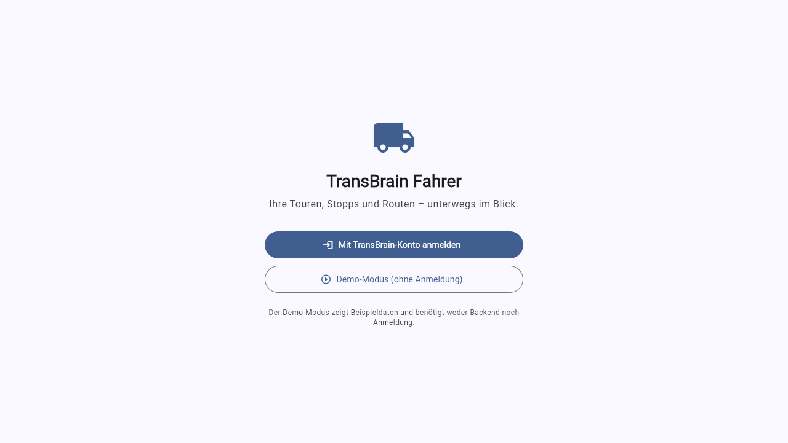
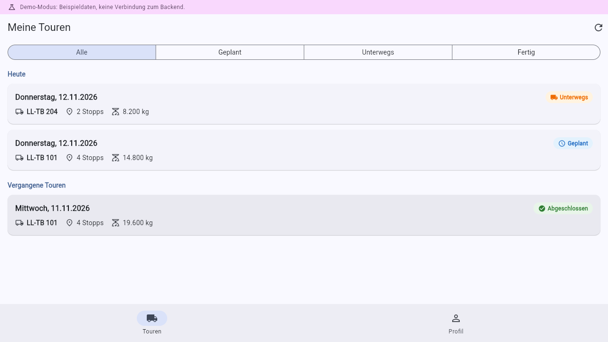
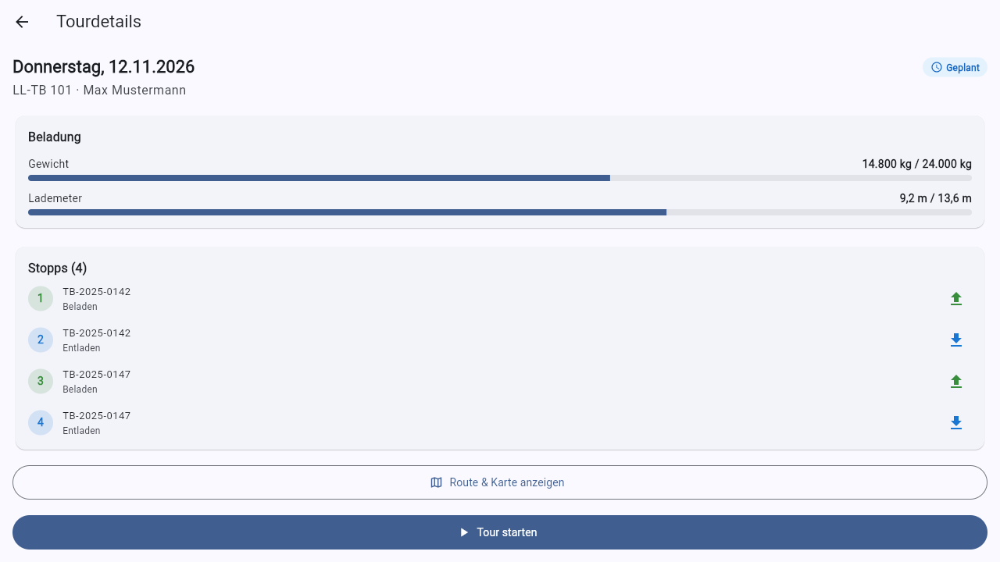
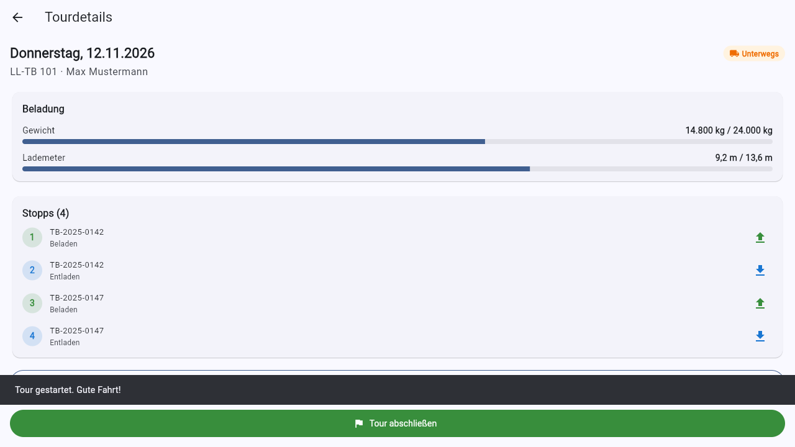
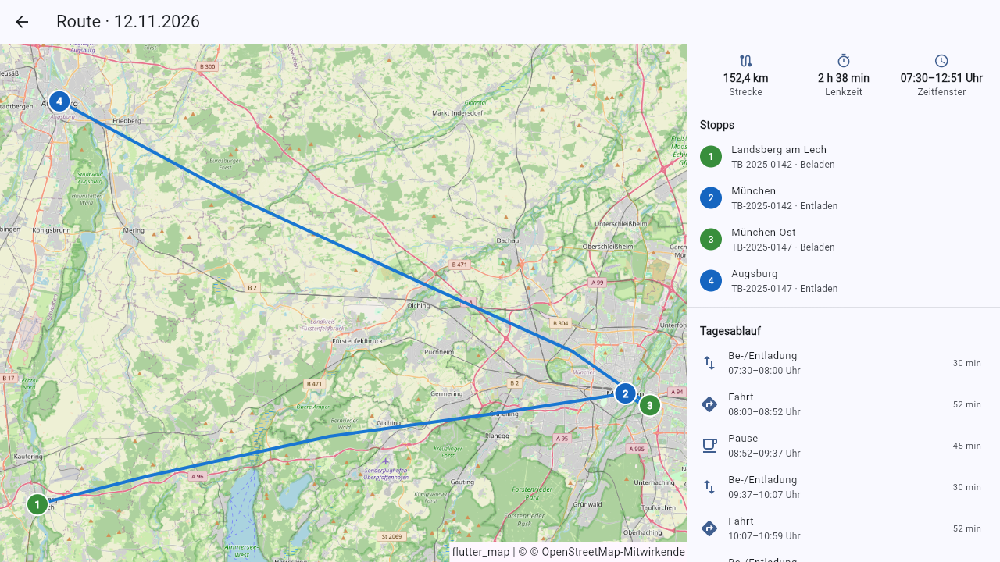
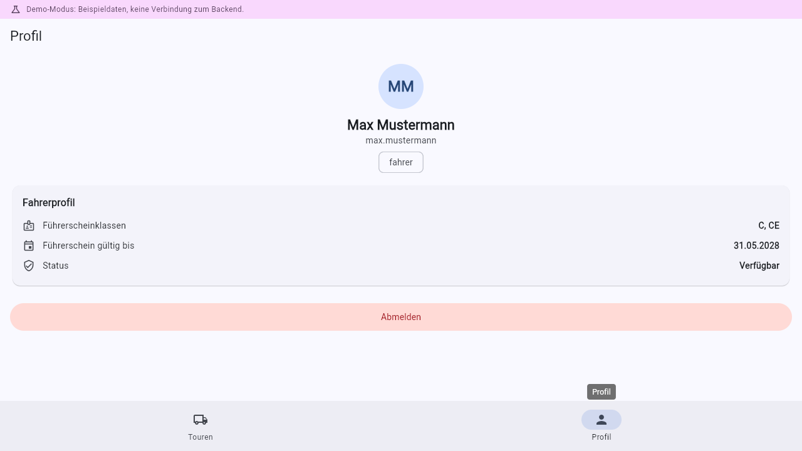

# Bedienung TransBrain Fahrer-App (Flutter)

Diese Anleitung beschreibt die Fahrer-Mobile-App von TransBrain
(`src/TransBrain.DriverApp`, Flutter). Die App richtet sich an Fahrerinnen und Fahrer:
Sie zeigt die eigenen Touren mit Stopps, Beladung, Route und Tagesablauf und erlaubt es,
Touren zu starten und abzuschließen. Sie läuft auf **Android**, **iOS** und — als
Testvariante — im **Browser** (Web-Demo).

Die Oberfläche ist durchgehend deutsch.

> **Achtung — Entwicklungsumgebung:** Keycloak importiert die Realm-Konfiguration bei
> jedem Start neu aus der Datei (`src/TransBrain.AppHost/realms/transbrain-realm.json`).
> Änderungen über die Keycloak-Verwaltungskonsole gehen beim nächsten Neustart verloren.

## Zwei Betriebsarten

Die App kennt zwei Betriebsarten, wählbar auf dem Anmeldebildschirm:



1. **Mit TransBrain-Konto anmelden** — die normale Betriebsart. Die Anmeldung läuft
   über Keycloak (OpenID Connect mit PKCE); die App zeigt danach die echten Touren
   des angemeldeten Fahrers aus der TransBrain-API. Voraussetzung: Der Stack läuft
   (`dotnet run --project src/TransBrain.AppHost`) und der Fahrer-Stammsatz ist über
   die **External user ID** mit dem Keycloak-Konto verknüpft (siehe
   `docs/KEYCLOAK.md`). Testbenutzer: `fahrer.user` / `fahrer`.
2. **Demo-Modus (ohne Anmeldung)** — zum Ausprobieren. Die App zeigt mitgelieferte
   Beispieldaten (drei Touren rund um Oberbayern) und benötigt **weder Backend noch
   Keycloak**. Alle Funktionen sind bedienbar; Statuswechsel wirken bis zum Beenden
   der App. Ein violettes Banner am oberen Rand erinnert an den Demo-Modus.

## Meine Touren

Nach der Anmeldung öffnet sich die Tourenliste. Sie zeigt ausschließlich die eigenen
Touren — das erzwingt die API serverseitig anhand der Fahrer-Rolle.



- **Filter** oberhalb der Liste: Alle / Geplant / Unterwegs / Fertig.
- Die Liste gruppiert nach **Heute**, **Kommende Touren** und **Vergangene Touren**;
  heutige Touren stehen zuoberst, laufende vor geplanten.
- Jede Karte zeigt Datum, Kennzeichen, Stoppanzahl, Gesamtgewicht und den Status
  (Geplant / Unterwegs / Abgeschlossen).
- **Ziehen nach unten** (Pull-to-refresh) oder das Aktualisieren-Symbol lädt neu.

Tippen auf eine Tour öffnet die Tourdetails.

## Tourdetails



- **Beladung**: Gewicht und Lademeter als Balken gegen die Fahrzeugwerte; ab 90 %
  färbt sich der Balken orange, über 100 % rot.
- **Stopps**: alle Stopps in Reihenfolge mit Auftragsnummer und Beladen/Entladen.
- **Route & Karte anzeigen** öffnet die Routenansicht (siehe unten).
- Je nach Status bietet die Seite die passende Aktion an:
  - **Tour starten** (bei geplanten Touren) — meldet die Tour als „Unterwegs";
    alle Aufträge gehen in den Transport.
  - **Tour abschließen** (bei laufenden Touren) — meldet die Tour als
    „Abgeschlossen"; alle Aufträge gelten als zugestellt.
- Beide Aktionen fragen zur Sicherheit nach, bevor sie melden:



Eine abgeschlossene Tour bietet keine Aktion mehr an. Meldet die API einen Konflikt
(z. B. Tour wurde inzwischen von der Disposition geändert), zeigt die App die
Fehlermeldung an und lässt den Zustand unverändert.

## Route & Tagesablauf



- **Karte** (OpenStreetMap) mit der geplanten Lkw-Route und nummerierten Markern
  je Stopp — grün für Beladen, blau für Entladen.
- **Kennzahlen**: Strecke, Lenkzeit und das Zeitfenster der Tour.
- **Stopps** mit Ort und Auftragsnummer.
- **Tagesablauf**: die geplante Abfolge aus Be-/Entladung, Fahrt und Pause mit
  Uhrzeiten und Dauer — geplant nach den Lenk- und Ruhezeitregeln der
  Verordnung (EG) Nr. 561/2006.
- **Hinweise**: Verstöße oder Warnungen der Lenkzeitplanung (z. B. Sonntagsfahrverbot)
  erscheinen oberhalb des Tagesablaufs.

Die Route stammt aus `GET /api/tours/{id}/route`; im Demo-Modus aus den Beispieldaten.
Ist der Kartendienst nicht konfiguriert oder nicht erreichbar, zeigt die App eine
Meldung statt der Karte — die übrigen Funktionen bleiben nutzbar.

## Profil



- Name, Benutzername und Rollen aus der Anmeldung.
- **Fahrerprofil** aus den TransBrain-Stammdaten: Führerscheinklassen, Gültigkeit
  und Status. Es erscheint, wenn ein Fahrer-Stammsatz über die External user ID
  mit dem Konto verknüpft ist; andernfalls erklärt die Seite, dass kein Stammsatz
  verknüpft ist.
- **Abmelden** beendet die Sitzung (mit Rückfrage). Im Demo-Modus verwirft das die
  Demo-Sitzung samt aller Statuswechsel.

## Starten der App (Entwicklung)

Voraussetzung: Flutter SDK (stabiler Kanal, ≥ 3.50). Alle Befehle im Verzeichnis
`src/TransBrain.DriverApp`.

### Web-Demo

```bash
flutter run -d chrome --web-port 4400
```

Der Port 4400 ist in der API-CORS-Konfiguration und in Keycloak
(`transbrain-mobile`-Client) freigegeben; der Demo-Modus funktioniert auch ohne
laufendes Backend. Produktionsbuild: `flutter build web` (Ergebnis in `build/web`,
beliebig statisch servierbar, z. B. `python -m http.server 4400 -d build/web`).

### Android

```bash
flutter run -d <gerät>
```

Im Android-Emulator ist der Entwicklungsrechner unter `10.0.2.2` erreichbar.
API und Keycloak-Authority dann per `--dart-define` umbiegen:

```bash
flutter run -d emulator-5554 ^
  --dart-define=TB_API_BASE_URL=http://10.0.2.2:5265 ^
  --dart-define=TB_AUTHORITY=http://10.0.2.2:8080/realms/transbrain
```

Debug-Builds dürfen Klartext-HTTP sprechen (nur Debug; Release erzwingt HTTPS).

### iOS

```bash
flutter run -d <iphone>    # macOS mit Xcode erforderlich
```

Für ein physisches Gerät müssen API und Keycloak über die IP des
Entwicklungsrechners erreichbar sein (`--dart-define` wie oben, mit der LAN-IP).

### Konfiguration

| `--dart-define` | Bedeutung | Standard |
|---|---|---|
| `TB_API_BASE_URL` | Basis-URL der TransBrain-API | `https://localhost:7049` |
| `TB_AUTHORITY` | Keycloak-Realm-URL | `https://localhost:8080/realms/transbrain` |
| `TB_CLIENT_ID` | OIDC-Client-ID | `transbrain-mobile` |
| `TB_MOBILE_REDIRECT_URI` | Rückleitungs-URI (nur Android/iOS) | `de.transbrain.driver://callback` |

Auf Android/iOS öffnet die Anmeldung den System-Browser und kehrt über das
URL-Schema `de.transbrain.driver://callback` in die App zurück; im Web läuft die
Anmeldung als Weiterleitung in derselben Browser-Registerkarte.

## Tests

```bash
flutter analyze
flutter test
```

Die Tests decken PKCE (RFC-7636-Testvektor), Token-/Sitzungsverarbeitung,
API-Fehlerübersetzung, die Modell-Deserialisierung, die Demo-Datenquelle
(Statusübergänge inkl. Konflikte) und die Bedienabläufe (Anmelden im Demo-Modus,
Tour öffnen und starten, Profil und Abmelden) als Widget-Tests ab.
