# Bedienung TransBrain.VueWeb (Vue)

Diese Anleitung beschreibt die Vue-Oberfläche von TransBrain (`src/TransBrain.VueWeb`,
Vuetify). Sie bietet denselben Funktionsumfang wie die Angular-Oberfläche gegen dieselbe
API — siehe `docs/BEDIENUNG_TRANSBRAIN_WEB.md` für die Angular-Variante. Wo sich das
Verhalten nicht unterscheidet, ist der Text hier bewusst wortgleich zu jener Anleitung.

Die Oberfläche ist in Deutsch und Englisch verfügbar (siehe Kapitel „Sprache“). Die
Beschriftungen in dieser Anleitung sind die englischen Bezeichnungen; die deutschen
Entsprechungen stehen jeweils dabei, soweit sie hilfreich sind.

> **Achtung — Entwicklungsumgebung:** Die Datenbank (Postgres) liegt auf einem dauerhaften
> Docker-Datenlaufwerk; Fahrzeuge, Fahrer, Aufträge usw. bleiben über einen Neustart von
> `dotnet run --project src/TransBrain.AppHost` hinweg erhalten. Keycloak dagegen hat
> absichtlich kein Datenlaufwerk und importiert die Realm-Konfiguration bei jedem Start neu
> aus der Datei: **Jede Änderung, die Sie über die Keycloak-Verwaltungskonsole vornehmen,
> geht beim nächsten Neustart verloren.**

## Voraussetzungen

- Der gesamte Stack läuft (`dotnet run --project src/TransBrain.AppHost`), siehe
  README.md.
- Ein gültiges Benutzerkonto in Keycloak. Für die lokale Entwicklung siehe die
  Testbenutzer in README.md, Abschnitt „Test users“ — je einer pro Rolle
  (`admin`, `disponent`, `fahrer`, `viewer`).
- Die Anwendung ist unter `http://localhost:4300` erreichbar (Port siehe Aspire-Dashboard,
  falls abweichend).

## Sprache

Die Oberfläche startet auf **Deutsch**. Über die Schaltfläche ganz rechts in der Kopfleiste
wechseln Sie auf Englisch: Sie zeigt die jeweils andere Sprache an (**„EN“** bei deutscher,
**„DE“** bei englischer Oberfläche). Der Wechsel wirkt sofort, ohne Neuladen.

Die Wahl wird im Browser gespeichert (lokaler Speicher, Schlüssel `transbrain.locale`). Sie
gilt daher pro Browser und Gerät, nicht für Ihr Benutzerkonto, und bleibt beim nächsten Aufruf
erhalten. Wenn der Browser den Speicher blockiert, gilt die Wahl nur bis zum nächsten Neuladen.

## Anmeldung

1. `http://localhost:4300` im Browser öffnen.
2. Ohne aktive Sitzung zeigt die Seite nur eine Schaltfläche **„Sign in“**. Es gibt keine
   Fahrzeug- oder Fahrerliste zu sehen, bevor eine Anmeldung stattgefunden hat.
3. Klick auf „Sign in“ leitet zur Keycloak-Anmeldeseite weiter (Benutzername/Passwort).
4. Nach erfolgreicher Anmeldung erfolgt die Rückleitung zu TransBrain.VueWeb, und die
   **Startseite** wird angezeigt — siehe das gleichnamige Kapitel unten.

## Startseite

Nach der Anmeldung landen Sie auf der Startseite. Sie zeigt genau die Bereiche und
Schaltflächen, die Ihre Rolle benötigt — eine Fahrerin sieht dort etwas anderes als ein
Administrator. Über die Kopfleiste erreichen Sie dieselben Bereiche jederzeit wieder; ganz
rechts stehen Ihr Name und die Schaltfläche **„Sign out"** zum Abmelden.

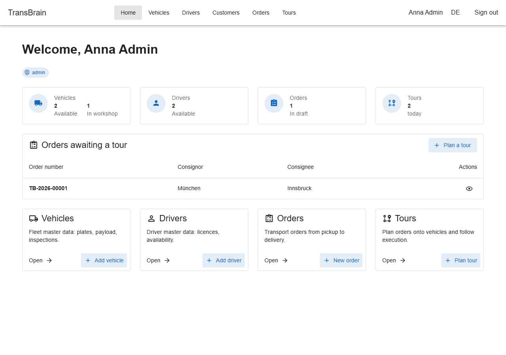

Der obere Bereich zeigt Kennzahlen, darunter folgen die Arbeitslisten und ganz unten die
Kacheln, über die Sie in die einzelnen Bereiche springen. Welche Rolle was sieht:

| Bestandteil | admin | disponent | fahrer | viewer |
|---|:-:|:-:|:-:|:-:|
| Kennzahlen zu Fahrzeugen und Fahrern | ✓ | ✓ | | ✓ |
| Kennzahl „Orders in draft" (ungeplante Aufträge) | ✓ | ✓ | | ✓ |
| Kennzahl „Tours today" | ✓ | ✓ | ✓ (eigene) | ✓ |
| Liste „Orders awaiting a tour" mit **„Plan a tour"** | ✓ | ✓ | | |
| Liste „My tours today" mit **„Start tour"** / **„Complete tour"** | | | ✓ | |
| Kacheln Vehicles, Drivers, Orders | ✓ | ✓ | | ✓ |
| Kachel Tours | ✓ | ✓ | ✓ | ✓ |
| Schaltflächen **„Add vehicle"** / **„Add driver"** | ✓ | | | |
| Schaltflächen **„New order"** / **„Plan tour"** | ✓ | ✓ | | |

Für eine Fahrerin ist die Seite bewusst schmal gehalten, damit sie auf einem Mobiltelefon
im Fahrerhaus bedienbar bleibt. Sie zeigt nur die eigenen Touren des Tages und erlaubt es,
sie direkt zu starten und abzuschließen, ohne den Umweg über die Tourenliste. Bei geringer
Bildschirmbreite blendet die Kopfleiste den Namen aus, damit die Navigation Platz behält.

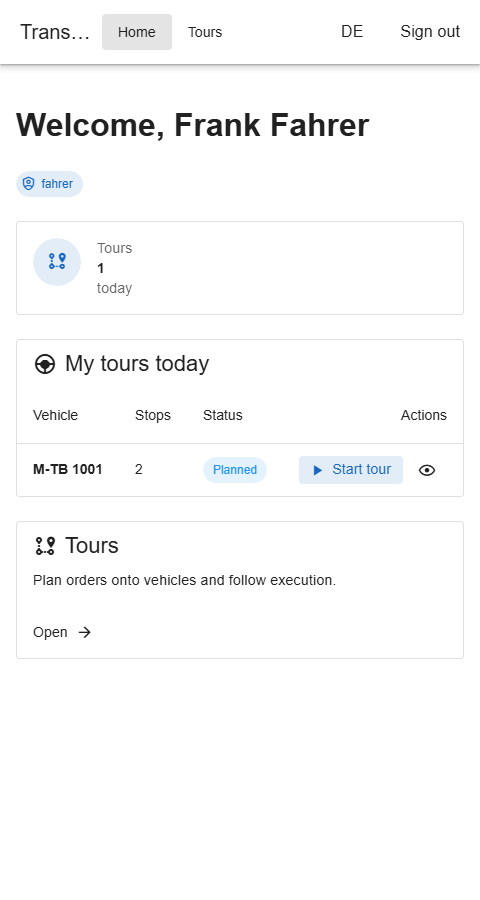

**Wichtig — der Unterschied zwischen „ausgeblendet" und „verboten":** Dass eine Kachel
fehlt, heißt nicht, dass Ihnen der Bereich verwehrt wäre. Alle vier Rollen dürfen alle
Listen lesen; ausgeblendet wird, was Ihre Rolle für ihre Arbeit nicht braucht. Geben Sie
etwa als Fahrerin `/vehicles` von Hand in die Adresszeile ein, sehen Sie die Fahrzeugliste.
Anders bei den Schaltflächen zum Anlegen, Ändern und Löschen: Die erscheinen nur, wenn Sie
die Änderung auch tatsächlich vornehmen dürfen. Rufen Sie ein Formular über die Adresszeile
auf, für das Ihnen die Berechtigung fehlt, bringt die Anwendung Sie zur Startseite zurück.

## Fahrzeugliste

Erreichbar über `/vehicles`, den Menüpunkt **Vehicles** oder die Kachel **Vehicles** auf der
Startseite. Hier pflegen Sie die Stammdaten des Fuhrparks.

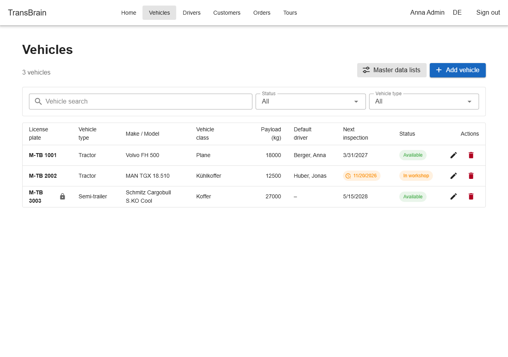

- Unter der Überschrift steht die Anzahl der geladenen Fahrzeuge (z. B. „3 vehicles“).
- **Filterleiste:**
  - **Vehicle search** sucht ohne Beachtung der Groß-/Kleinschreibung in Kennzeichen,
    Marke, Typbezeichnung, Fahrgestellnummer und Frächtergruppe (Code und Bezeichnung).
  - **Status** und **Vehicle type** schränken die Liste auf einen Status bzw. eine
    Fahrzeugart ein („All“ hebt den Filter auf).
  - Alle Filter wirken sofort und lassen sich kombinieren. Passt kein Fahrzeug, erscheint
    „No vehicles found.“
- **Spalten:** License plate, Vehicle type, Make / Model, Vehicle class, Payload (kg),
  Default driver, Next inspection, Status. Die Spalte Vehicle class zeigt die Bezeichnung aus
  den Fahrzeug-Stammdaten. Ein Klick auf eine Spaltenüberschrift sortiert
  auf- bzw. absteigend.
- **Markierungen:**
  - Ein **Schloss** neben dem Kennzeichen bedeutet „Kennzeichen geheim“.
  - Das Datum der nächsten Untersuchung erscheint als **roter** Chip, wenn sie überfällig
    ist, und als **oranger** Chip mit Uhr-Symbol, wenn sie in den nächsten 30 Tagen fällig
    wird.
  - Der Status erscheint als farbiger Chip: Available (grün), In workshop (orange),
    Decommissioned (grau).
- **„Master data lists“** oben rechts (für alle Benutzer) öffnet die
  [Fahrzeug-Stammdaten](#fahrzeug-stammdaten).
- **Aktionen** (nur für Administratoren sichtbar):
  - **„Add vehicle“** oben rechts legt ein neues Fahrzeug an.
  - Pro Zeile öffnet das **Stift-Symbol** das Fahrzeug zum Bearbeiten.
  - Das **Papierkorb-Symbol** löscht das Fahrzeug erst nach einer Sicherheitsabfrage
    („Do you really want to delete vehicle …?“, **„Delete“** / **„Cancel“**).
- Die Liste lädt bis zu 100 Fahrzeuge; Suche, Filter und Sortierung arbeiten auf diesen
  geladenen Einträgen.

## Fahrzeugformular (Anlegen / Bearbeiten)

Erreichbar über „Add vehicle“ (neu, `/vehicles/new`) oder das Stift-Symbol in der Liste
(`/vehicles/{id}`). Das Formular ist in zehn Bereiche gegliedert, auf breiten Bildschirmen
in zwei Spalten.

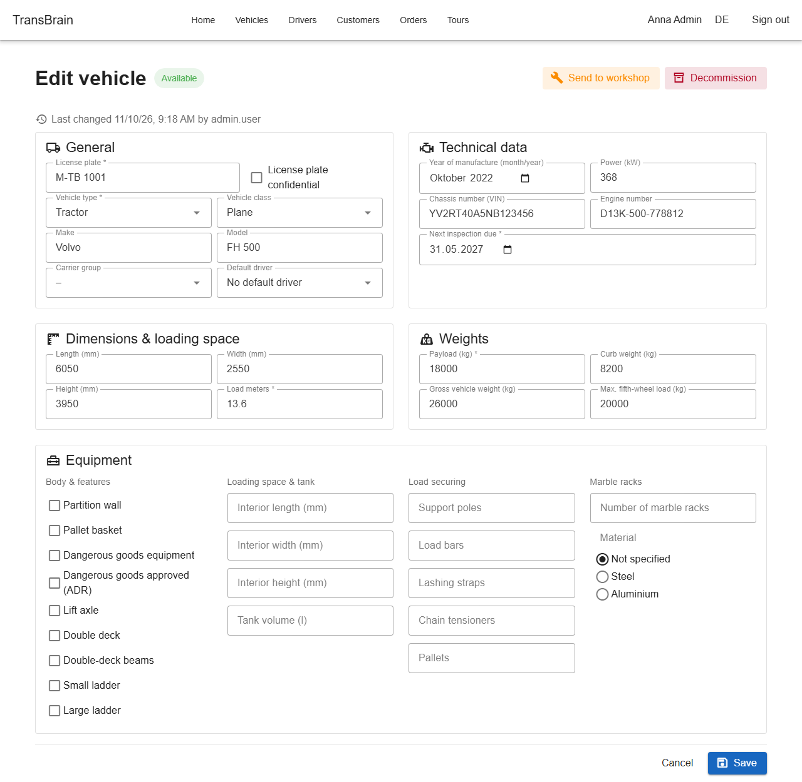

Alle Felder außer den mit * markierten Pflichtfeldern sind optional. Zahlenfelder müssen,
wenn sie ausgefüllt sind, größer als 0 sein; nur die Anzahlen im Bereich Equipment
dürfen auch 0 sein, ebenso Anschaffungspreis und Kilometerstand bei Anschaffung.

| Bereich | Feld (Beschriftung) | Bedeutung | Pflicht | Regeln |
|---|---|---|:---:|---|
| General | License plate | Kennzeichen | ja | eindeutig, max. 15 Zeichen |
| General | License plate confidential | Kennzeichen geheim | – | Häkchen; Schloss-Symbol in der Liste |
| General | Vehicle type | Fahrzeugart | ja | Tractor (Zugmaschine), Semi-trailer (Hänger (Sattel)) |
| General | Vehicle class | Aufbau / Fahrzeugklasse | – | Auswahl aus den aktiven Fahrzeugklassen der [Fahrzeug-Stammdaten](#fahrzeug-stammdaten) oder „–“ |
| General | Make / Model | Marke / Typbezeichnung | – | je max. 100 Zeichen |
| General | Carrier group | Frächtergruppe | – | Auswahl aus den aktiven Frächtergruppen der [Fahrzeug-Stammdaten](#fahrzeug-stammdaten) oder „–“ |
| General | Default driver | Stammfahrer | – | Auswahl aus der Fahrerliste oder „No default driver“ |
| Technical data | Year of manufacture (month/year) | Baujahr, monatsgenau | – | ab 1900 |
| Technical data | Power (kW) | Motorleistung | – | 1–2000 |
| Technical data | Chassis number (VIN) | Fahrgestellnummer | – | max. 30 Zeichen, wird in Großbuchstaben gespeichert |
| Technical data | Engine number | Motornummer | – | max. 30 Zeichen |
| Technical data | Next inspection due | nächste Untersuchung | ja | Datum |
| Dimensions & loading space | Length / Width / Height (mm) | Außenmaße | – | Länge 1–30000, Breite und Höhe 1–5000 |
| Dimensions & loading space | Load meters | Lademeter | ja | größer als 0 |
| Weights | Payload (kg) | Nutzlast | ja | größer als 0 |
| Weights | Curb weight (kg) | Eigengewicht | – | 1–100000 |
| Weights | Gross vehicle weight (kg) | zulässiges Gesamtgewicht | – | 1–100000, muss größer als das Eigengewicht sein |
| Weights | Max. fifth-wheel load (kg) | höchstzulässige Sattellast | – | 1–100000 |
| Equipment – Body & features | Partition wall, Pallet basket, Dangerous goods equipment, Dangerous goods approved (ADR), Lift axle, Double deck, Double-deck beams, Small ladder, Large ladder | Trennwand, Palettenkorb, Gefahrgutausrüstung, Gefahrguttauglich (ADR), Liftachse, Doppelstock, Doppelstockbalken, kleine / große Leiter | – | Häkchen |
| Equipment – Loading space & tank | Interior length / width / height (mm) | Innenmaße des Laderaums | – | Länge 1–30000, Breite und Höhe 1–5000 |
| Equipment – Loading space & tank | Tank volume (l) | Tankvolumen in Litern | – | 1–100000 |
| Equipment – Load securing | Support poles, Load bars, Lashing straps, Chain tensioners, Pallets | Anzahl Stützstangen, Spannlatten, Spanngurte, Kettenspanner, Paletten | – | ganze Zahl 0–999 |
| Equipment – Marble racks | Number of marble racks | Anzahl Marmorböcke | – | ganze Zahl 0–999 |
| Equipment – Marble racks | Material | Art der Marmorböcke | – | Auswahl „Not specified“ (keine Angabe), „Steel“ (Stahl) oder „Aluminium“ (Alu) |
| Commercial data | Purchase price (EUR) | Anschaffungspreis in Euro | – | 0–10000000, höchstens 2 Nachkommastellen |
| Commercial data | Purchase date | Anschaffungsdatum | – | ab 1900 |
| Commercial data | Odometer at purchase (km) | Kilometerstand bei Anschaffung | – | ganze Zahl 0–9999999 |
| Commercial data | First registration | Erstzulassung (Datum, unabhängig vom Baujahr) | – | ab 1900 |
| Commercial data | Useful life (years) / Useful life (km) | geplante Nutzungsdauer | – | Jahre 1–50, km 1–9999999 |
| Commercial data | Cost center | Kostenstelle | – | max. 30 Zeichen |
| Insurance – Vehicle insurance | Insurance company | Versicherungsgesellschaft der Fahrzeugversicherung | – | Auswahl aus den aktiven Versicherungen der [Fahrzeug-Stammdaten](#fahrzeug-stammdaten) oder „–“ |
| Insurance – Vehicle insurance | Policy numbers | Polizzennummern | – | max. 500 Zeichen, mehrere Zeilen erlaubt |
| Insurance – Transport insurance | Insurance company / Policy numbers | Versicherung und Polizzennummern der Transportversicherung | – | wie bei der Fahrzeugversicherung |
| Notes | Notes | Bemerkungen | – | max. 2000 Zeichen, mit Zeichenzähler |
| Data sheet | Data sheet | Datenblatt (freier Text, z. B. technische Daten des Herstellers) | – | max. 10000 Zeichen, mit Zeichenzähler |

Alle Gewichte werden in **Kilogramm** erfasst, alle Maße in **Millimetern**.

**Ausstattung (Equipment):** Der Bereich über die volle Breite erfasst die Ausstattung des
Fahrzeugs in vier Gruppen. Bei den Anzahlen bedeutet ein **leeres Feld „nicht erfasst“**,
**0 „keine vorhanden“**. Ein neues Fahrzeug startet ohne Häkchen, mit leeren Feldern und dem
Material „Not specified“. Beim Speichern wird die Ausstattung immer vollständig übernommen:
ein entferntes Häkchen oder ein geleertes Feld ist danach auch gespeichert leer. Die
Fahrzeugliste zeigt die Ausstattung nicht an.

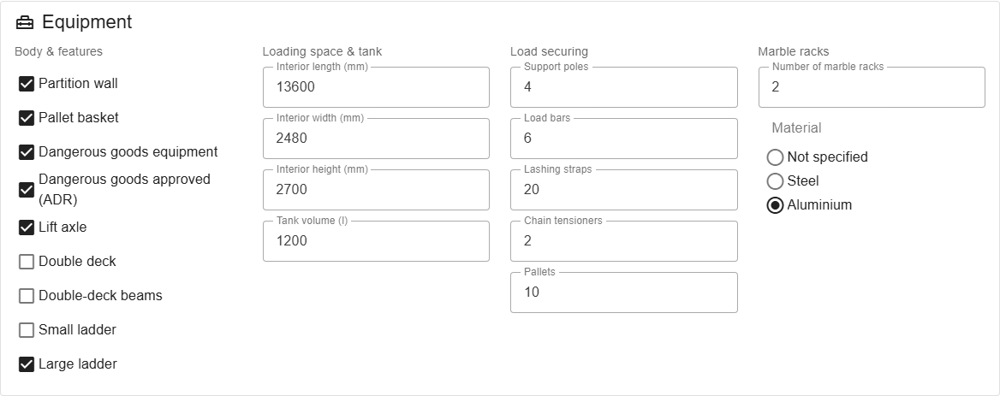

**Kaufmännische Daten und Versicherungen (Commercial data, Insurance):** Zwei Bereiche
nebeneinander erfassen Anschaffung, Nutzungsdauer und Kostenstelle sowie je eine
Versicherungsgesellschaft mit ihren Polizzennummern für Fahrzeug- und Transportversicherung.
Mehrere Polizzennummern schreiben Sie untereinander in das Feld. Die Versicherungen pflegen
Sie in den [Fahrzeug-Stammdaten](#fahrzeug-stammdaten); dort ist die Liste anfangs leer. Wie
bei der Ausstattung wird beim Speichern immer alles übernommen: ein geleertes Feld ist danach
auch gespeichert leer.

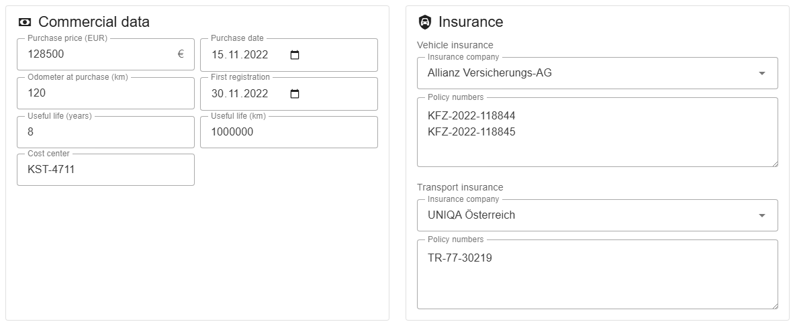

**Datenblatt (Data sheet):** Der letzte Bereich nimmt freien Text auf, z. B. das technische
Datenblatt des Herstellers. Der Text wird in Festbreitenschrift und **ohne automatischen
Zeilenumbruch** angezeigt (bei langen Zeilen erscheint eine horizontale Bildlaufleiste) und
genau so gespeichert, wie er eingegeben wurde – Leerzeichen am Zeilenanfang bleiben erhalten,
damit ausgerichtete Spalten ausgerichtet bleiben.

**Status ändern** (nur beim Bearbeiten, nur Administratoren): Neben der Überschrift zeigt ein
Chip den aktuellen Status. Die Schaltflächen daneben ändern ihn **sofort**, ohne „Save“:

| Aktueller Status | Schaltflächen |
|---|---|
| Available | **„Send to workshop“**, **„Decommission“** |
| In workshop | **„Return to service“**, **„Decommission“** |
| Decommissioned | keine — Hinweis „Decommissioned vehicles cannot be reactivated.“ |

„Decommission“ fragt vorher nach („Do you really want to decommission vehicle …? This cannot
be undone.“). Ein ausgemustertes Fahrzeug bleibt ausgemustert. Fahrzeuge in der Werkstatt
oder ausgemusterte Fahrzeuge lassen sich keiner Tour zuordnen.

**Änderungsvermerk:** Beim Bearbeiten steht unter der Überschrift „Last changed {Datum, Uhrzeit}
by {Benutzer}“. Jedes Speichern und jede Statusänderung aktualisiert ihn.

- **„Save“** am unteren Rand speichert; bei Erfolg erfolgt die Rückkehr zur Liste.
  **„Cancel“** verwirft die Eingabe und kehrt ohne Speichern zur Liste zurück.
- Ein leer gelassenes Pflichtfeld zeigt nach einem Speicherversuch direkt unter dem Feld
  „This field is required.“
- Lehnt die API die Eingabe ab, erscheint ihre Fehlermeldung direkt unter dem betroffenen
  Feld, z. B. bei einem bereits vergebenen Kennzeichen (HTTP 409) oder einem Gesamtgewicht,
  das nicht über dem Eigengewicht liegt. Fehler ohne Feldbezug (z. B. ein zwischenzeitlich
  gelöschter Stammfahrer) erscheinen als Meldung oberhalb des Formulars.
- Ein Ladefehler beim Öffnen zum Bearbeiten (z. B. wenn das Fahrzeug zwischenzeitlich
  gelöscht wurde) erscheint als Meldung oberhalb des Formulars.
- Wird ein Fahrer gelöscht, der als Stammfahrer eingetragen ist, verlieren die betroffenen
  Fahrzeuge lediglich ihren Stammfahrer.

### Sonderpapiere (Special documents)

Der Bereich **Special documents** listet die Sonderpapiere und Prüfungen des Fahrzeugs, z. B.
ADR-Zulassungsbescheinigung, Tachographenprüfung oder UVV-Prüfung. Anders als die übrigen
Bereiche wird er **unabhängig von „Save“** gespeichert: jede Änderung im Dialog ist sofort
gespeichert. Bei einem neuen Fahrzeug steht dort nur der Hinweis „Save the vehicle first to
record special documents.“ – speichern Sie das Fahrzeug zuerst und öffnen Sie es dann erneut.

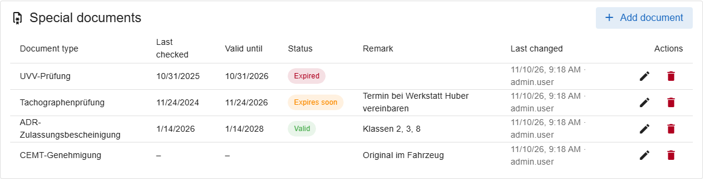

- **Spalten:** Art (Bezeichnung aus den Stammdaten), Last checked (letzte Prüfung), Valid until
  (gültig bis) mit Status, Remark (Bemerkung) und Last changed (Datum · Benutzer der letzten
  Änderung). Die Papiere sind nach Ablaufdatum sortiert, das nächste zuerst; Papiere ohne
  Ablaufdatum stehen am Ende.
- **Status** (nur wenn „Valid until“ gesetzt ist): **Expired** (rot, Datum liegt in der
  Vergangenheit), **Expires soon** (orange, läuft innerhalb der nächsten 30 Tage ab) oder
  **Valid** (grün).
- **„Add document“** (nur Administratoren) öffnet den Dialog „Add special document“:

  | Feld | Bedeutung | Pflicht | Regeln |
  |---|---|:---:|---|
  | Document type | Art des Sonderpapiers | ja | Auswahl aus den aktiven Sonderpapier-Arten der [Fahrzeug-Stammdaten](#fahrzeug-stammdaten); jede Art nur einmal je Fahrzeug |
  | Last checked | Datum der letzten Prüfung | – | ab 1900 |
  | Valid until | Ablaufdatum | – | ab 1900, nicht vor „Last checked“ |
  | Remark | Bemerkung | – | max. 500 Zeichen |

  Hat das Fahrzeug die gewählte Art schon, lehnt der Dialog das Speichern mit „This vehicle
  already has a '…' document.“ ab (HTTP 409) – bearbeiten Sie dann das vorhandene Papier.
- **Stift-Symbol:** öffnet dasselbe Formular zum Bearbeiten („Edit special document“), z. B. um
  nach einer neuen Prüfung die Daten zu verlängern.
- **Papierkorb-Symbol:** löscht das Sonderpapier nach einer Sicherheitsabfrage.
- Wird das Fahrzeug gelöscht, werden seine Sonderpapiere mitgelöscht.

## Fahrzeug-Stammdaten

Erreichbar über die Schaltfläche **„Master data lists“** oben in der Fahrzeugliste
(`/vehicle-catalog`). Hier pflegen Sie die Auswahllisten des Fahrzeugformulars.
Alle angemeldeten Benutzer sehen die Listen, ändern dürfen sie nur Administratoren.
**„Back to vehicles“** führt zurück zur Fahrzeugliste.

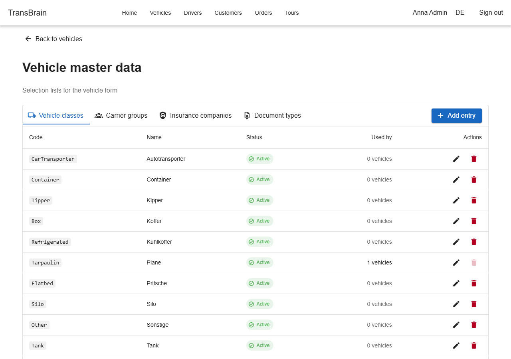

- **Reiter:** **Vehicle classes** (Fahrzeugklassen, z. B. Plane, Kühler, Tank),
  **Carrier groups** (Frächtergruppen), **Insurance companies** (Versicherungsgesellschaften
  für Fahrzeug- und Transportversicherung) und **Document types** (Sonderpapier-Arten). Beim
  ersten Start sind die Fahrzeugklassen des Altsystems (Sonstige, Tank, Kühler, Plane, Kipper,
  Leihfahrzeug), seine Frächtergruppen (Sonstige, Huter Vils, Huter Füssen, Fixe Frächter,
  Regelmäßig beschäftigte Frächter, Leihfahrzeuge) und sieben Sonderpapier-Arten (ADR, ATP,
  CEMT, Tachograph, UVV, Kran, Ladebordwand) bereits angelegt; Versicherungen legen Sie selbst an.
- **Spalten:** Code, Name (Bezeichnung), Status (**Active** grün / **Inactive** grau) und
  **Used by** – wie viele Fahrzeuge den Eintrag gerade verwenden (bei Versicherungen als Fahrzeug-
  oder Transportversicherung, bei Sonderpapier-Arten mit einem Sonderpapier dieser Art).
- **„Add entry“** (nur Administratoren) öffnet den Dialog für einen neuen Eintrag:

  | Feld | Bedeutung | Pflicht | Regeln |
  |---|---|:---:|---|
  | Code | Schlüssel, der am Fahrzeug gespeichert wird | ja | max. 20 Zeichen, nur Buchstaben, Ziffern, `-` und `_`; je Liste eindeutig (ohne Beachtung der Groß-/Kleinschreibung); **später nicht änderbar** |
  | Name | Bezeichnung, die in Formular und Liste erscheint | ja | max. 100 Zeichen; wird in allen Sprachen so angezeigt, wie sie erfasst wurde |
  | Active | Eintrag wird im Fahrzeugformular angeboten | – | Häkchen, standardmäßig gesetzt |

  Ein bereits vergebener Code wird mit einer Meldung im Dialog abgelehnt (HTTP 409).
- **Stift-Symbol:** ändert Bezeichnung und Aktiv-Status; der Code ist nur lesbar. Eine
  geänderte Bezeichnung erscheint sofort bei allen Fahrzeugen, die den Eintrag verwenden.
- **Papierkorb-Symbol:** löscht den Eintrag nach einer Sicherheitsabfrage („Delete entry …?“).
  Solange Fahrzeuge den Eintrag verwenden, ist es gesperrt („In use – deactivate instead“).
- **Deaktivieren statt löschen:** Ein inaktiver Eintrag wird für neue Auswahlen nicht mehr
  angeboten. Fahrzeuge, die ihn bereits haben, behalten ihn; im Formular erscheint er dort
  mit dem Zusatz „(inactive)“ und kann beim Speichern beibehalten werden.

## Fahrerliste

Erreichbar über `/drivers` oder den Menüpunkt **Drivers**. Die Seite ist wie die
Fahrzeugliste aufgebaut.

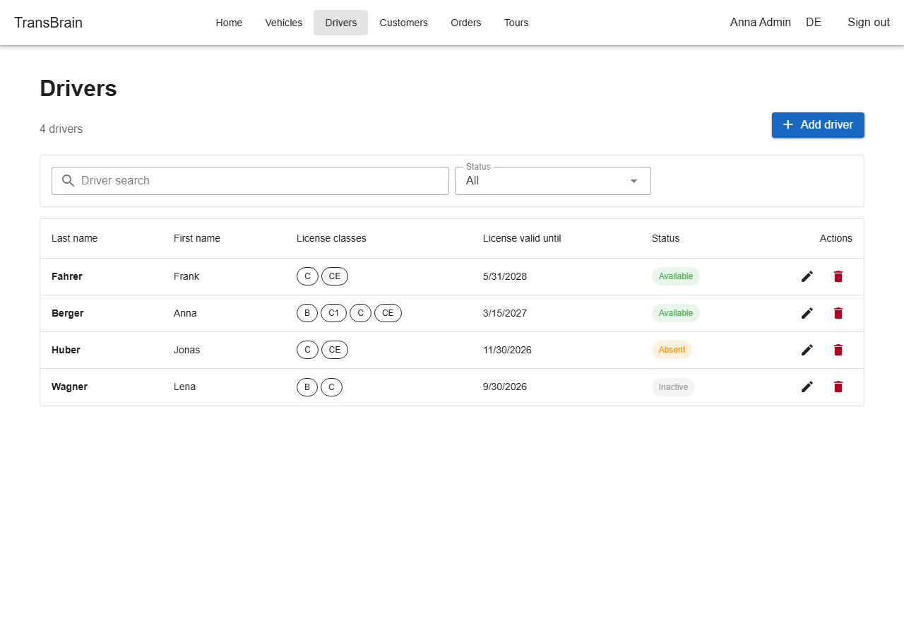

- Unter der Überschrift steht die Anzahl der angezeigten Fahrer (z. B. „4 drivers“).
- **Filterleiste:** **Driver search** sucht ohne Beachtung der Groß-/Kleinschreibung in
  Vor- und Nachname sowie den Führerscheinklassen; **Status** schränkt auf `Available`,
  `Absent` oder `Inactive` ein („All“ hebt den Filter auf). Passt kein Fahrer, erscheint
  „No drivers found.“
- Angezeigte Spalten: Last name (Nachname), First name (Vorname), License classes
  (Führerscheinklassen), License valid until (Führerschein gültig bis), Status (als farbiger
  Chip). Ein Klick auf einen Spaltenkopf sortiert die Liste.
- Schaltfläche **„Master data lists“** öffnet die [Fahrer-Stammdaten](#fahrer-stammdaten).
- Schaltfläche **„Add driver“** legt einen neuen Fahrer an.
- Pro Zeile: **Stift-Symbol** öffnet den Fahrer, **Papierkorb-Symbol** löscht ihn nach einer
  Sicherheitsabfrage („Really delete driver …?“, **„Delete“** / **„Cancel“**).

## Fahrerformular (Anlegen / Bearbeiten)

Erreichbar über „Add driver“ (neu, `/drivers/new`) oder das Stift-Symbol in der Liste
(`/drivers/{id}`).

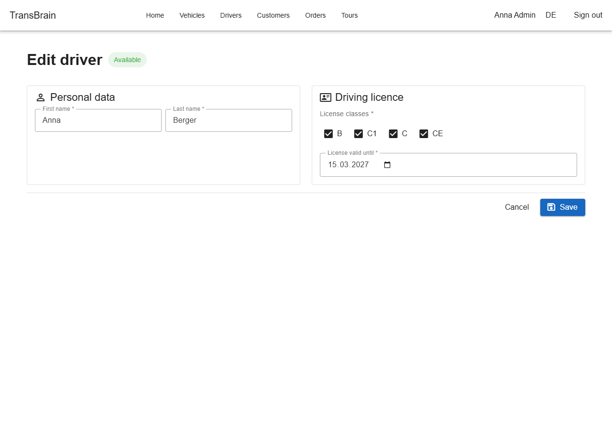

Die Felder stehen wie im Fahrzeugformular in Karten („Personal data“, „Driving licence“,
„Social insurance data“); beim Bearbeiten zeigt die Überschrift den Status des Fahrers.
**„Cancel“** und **„Save“** stehen in einer Leiste, die beim Scrollen am unteren Rand
sichtbar bleibt.

| Feld (Beschriftung)  | Bedeutung                          | Pflichtfeld | Regeln                                   |
|----------------------|--------------------------------------|:-----------:|--------------------------------------------|
| First name           | Vorname                              | ja          | darf nicht leer sein                       |
| Last name            | Nachname                             | ja          | darf nicht leer sein                       |
| License classes      | Führerscheinklassen (Kontrollkästchen: B, C1, C, CE) | ja | mindestens eine Klasse muss ausgewählt sein |
| License valid until  | Gültig bis (Datum)                   | ja          | Datum                                      |

- Führerscheinklassen werden über Kontrollkästchen aus- bzw. abgewählt, nicht über ein
  Dropdown.
- **„Save“** und **„Cancel“** verhalten sich wie im Fahrzeugformular.
- Validierungsfehler (fehlende Pflichtfelder, keine Führerscheinklasse ausgewählt) und
  serverseitige Fehler werden auf dieselbe Weise wie im Fahrzeugformular direkt am
  betroffenen Feld angezeigt.

### Sozialversicherung (Sozv-Daten)

Die Karte **Social insurance data** entspricht dem Reiter „Zusatz → Sozv-Daten“ des
Altsystems. Alle Angaben sind freiwillig. Wie bei den Zusatzdaten eines Kunden wird beim
Speichern immer die ganze Karte übernommen: ein geleertes Feld ist danach auch gespeichert
leer.

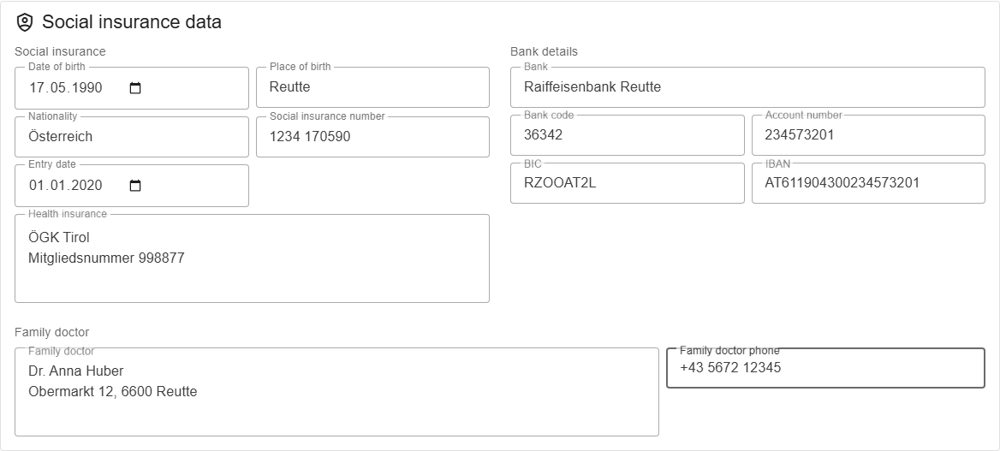

| Feld (Beschriftung) | Bedeutung | Regeln |
|---|---|---|
| Date of birth | Geburtsdatum (Geb_Dat.) | nicht vor 1900 |
| Place of birth | Geburtsort (Geb_Ort) | höchstens 200 Zeichen |
| Nationality | Staatsangehörigkeit (Staatsangeh.) | höchstens 100 Zeichen |
| Social insurance number | Sozialversicherungsnummer (Sozialvers-Nr.) | höchstens 50 Zeichen |
| Entry date | Eintrittsdatum (Eintritts-Dat.) | nicht vor 1900 |
| Health insurance | Krankenkasse | mehrzeilig, höchstens 500 Zeichen |
| Bank | Bank | höchstens 200 Zeichen |
| Bank code | Bankleitzahl (BLZ) | höchstens 20 Zeichen |
| Account number | Kontonummer (Konto) | höchstens 34 Zeichen |
| BIC | BIC | höchstens 11 Zeichen; Kleinbuchstaben werden zu Großbuchstaben |
| IBAN | IBAN | höchstens 34 Zeichen; Kleinbuchstaben werden zu Großbuchstaben |
| Family doctor | Hausarzt (Name und Anschrift) | mehrzeilig, höchstens 500 Zeichen |
| Family doctor phone | Telefon des Hausarzts (Tel_Hausarzt) | höchstens 50 Zeichen |

- Die Karte ist in drei Gruppen gegliedert: **„Social insurance“** (Geburts- und
  Versicherungsdaten samt Krankenkasse), **„Bank details“** (Bankverbindung) und
  **„Family doctor“** (Hausarzt mit Telefonnummer).
- Ein zu frühes Datum (vor 1900) oder ein zu langer Text wird direkt am betroffenen Feld
  angezeigt; das Formular wird dann nicht gespeichert.

### Führerschein-Dokumente

Die Karte **Driving licence** enthält neben Klassen und Ablaufdatum auch die Angaben des
Reiters „Zusatz → Dokumente“ des Altsystems. Alle drei Felder sind freiwillig.

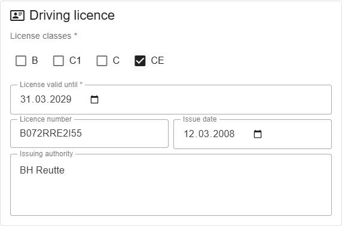

| Feld (Beschriftung) | Bedeutung | Regeln |
|---|---|---|
| Licence number | Führerscheinnummer | höchstens 50 Zeichen |
| Issue date | Ausstellungsdatum | nicht vor 1900 |
| Issuing authority | Ausstellende Behörde | mehrzeilig, höchstens 500 Zeichen |

### Kleidergrößen, Verwandte, Sonderpapiere und Telefone

Diese vier Karten entsprechen den Reitern „Zusatz → Kleidergrößen / Verwandte /
Sonderpapiere / Telefone“ des Altsystems. Alle Angaben sind freiwillig; beim Speichern
wird immer der ganze Formularinhalt übernommen (eine gelöschte Zeile ist danach auch
gespeichert gelöscht).

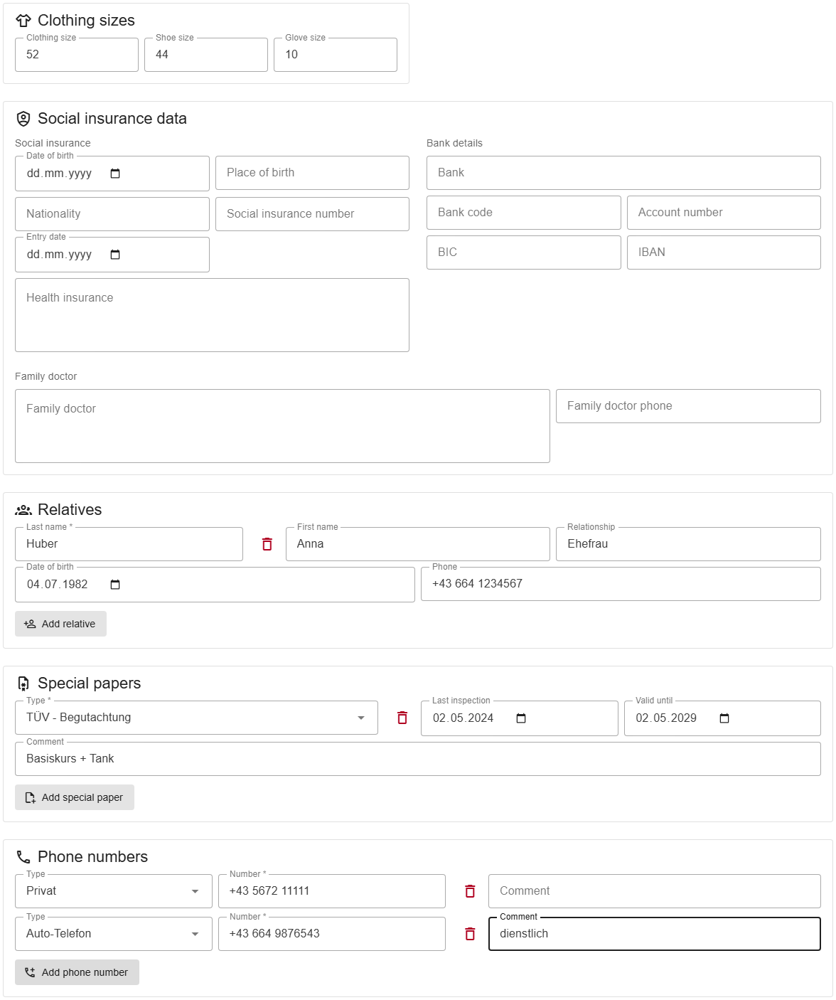

**Clothing sizes (Kleidergrößen)** — drei Textfelder mit je höchstens 50 Zeichen:

| Feld (Beschriftung) | Bedeutung |
|---|---|
| Clothing size | Kleidergröße |
| Shoe size | Schuhgröße |
| Glove size | Handschuhgröße |

**Relatives (Verwandte)** — Liste mit bis zu 20 Zeilen; **„Add relative“** fügt eine Zeile
hinzu, das Papierkorb-Symbol neben dem Nachnamen entfernt sie wieder:

| Feld (Beschriftung) | Bedeutung | Pflichtfeld | Regeln |
|---|---|:---:|---|
| Last name | Nachname | ja | höchstens 100 Zeichen |
| First name | Vorname | nein | höchstens 100 Zeichen |
| Relationship | Verwandtschaftsverhältnis (z. B. Ehefrau) | nein | höchstens 100 Zeichen |
| Date of birth | Geburtsdatum | nein | nicht vor 1900 |
| Phone | Telefonnummer | nein | höchstens 50 Zeichen |

**Special papers (Sonderpapiere)** — Liste mit bis zu 20 Zeilen (z. B. Gefahrengutschein,
TÜV - Begutachtung); **„Add special paper“** fügt eine Zeile hinzu:

| Feld (Beschriftung) | Bedeutung | Pflichtfeld | Regeln |
|---|---|:---:|---|
| Type | Art des Papiers | ja | Auswahl aus den aktiven Sonderpapier-Arten der [Fahrer-Stammdaten](#fahrer-stammdaten) (anfangs: Gefahrengutschein, Amtsarzt, TÜV - Begutachtung, B-3 - Bescheinigung, besondere Zulassung, besondere Genehmigung, Kesseldruckbescheinigung, Service - Intervall) |
| Last inspection | Letzte Überprüfung | nein | nicht vor 1900 |
| Valid until | Gültig bis | nein | nicht vor 1900 |
| Comment | Kommentar | nein | höchstens 500 Zeichen |

**Phone numbers (Telefone)** — Liste mit bis zu 20 Zeilen; **„Add phone number“** fügt
eine Zeile hinzu:

| Feld (Beschriftung) | Bedeutung | Pflichtfeld | Regeln |
|---|---|:---:|---|
| Type | Art des Anschlusses | nein | Auswahl aus den aktiven Telefontypen der [Fahrer-Stammdaten](#fahrer-stammdaten) (anfangs: Fax, Telefon, Email, Auto-Telefon, Home-Page, Privat, Notruf, Firma (DW)); „–" löscht die Auswahl |
| Number | Telefonnummer | ja | höchstens 50 Zeichen |
| Comment | Kommentar | nein | höchstens 200 Zeichen |

- In jeder Liste gilt: eine Zeile mit leerem Pflichtfeld verhindert das Speichern; der
  Fehler wird direkt in der betroffenen Zeile angezeigt.
- Die Reihenfolge der Zeilen bleibt beim Speichern und erneuten Öffnen erhalten.

## Fahrer-Stammdaten

Erreichbar über die Schaltfläche **„Master data lists“** oben in der Fahrerliste
(`/driver-catalog`). Hier pflegen Sie die Auswahllisten des Fahrerformulars in zwei
Reitern: **Phone types** (Telefontypen) und **Special paper types** (Sonderpapier-Arten).
Beim ersten Start sind die Einträge des Altsystems bereits angelegt — acht Anschlussarten
(Fax, Telefon, Email, Auto-Telefon, Home-Page, Privat, Notruf, Firma (DW)) und acht
Sonderpapier-Arten (Gefahrengutschein, Amtsarzt, TÜV - Begutachtung, B-3 - Bescheinigung,
besondere Zulassung, besondere Genehmigung, Kesseldruckbescheinigung, Service - Intervall).
**„Back to drivers“** führt zurück zur Fahrerliste.

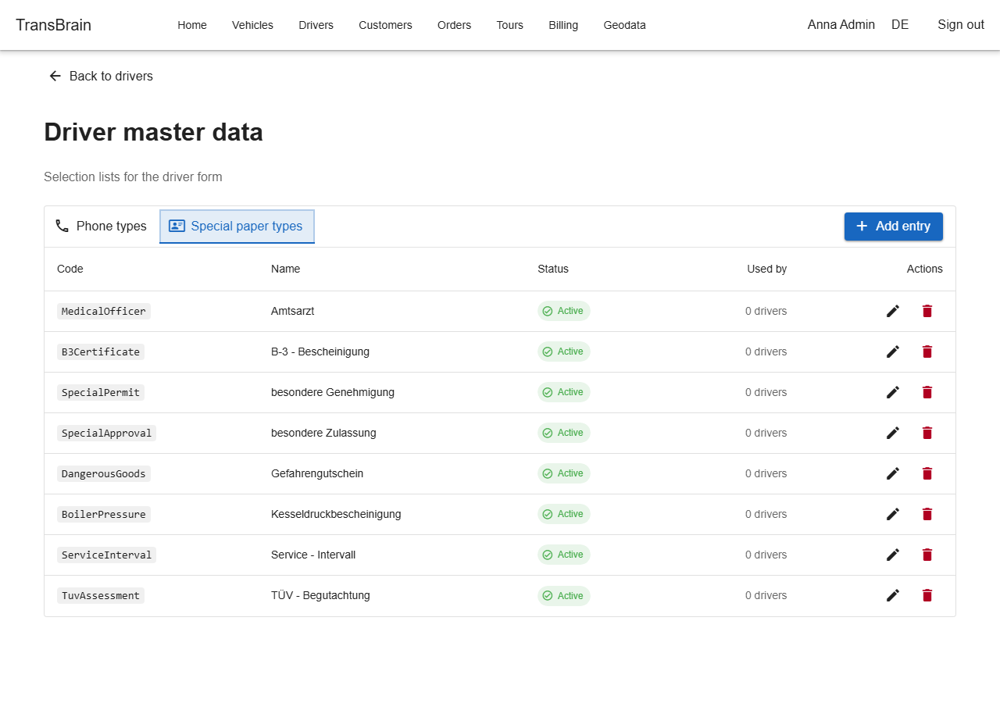

Die Seite funktioniert genau wie die [Fahrzeug-Stammdaten](#fahrzeug-stammdaten): alle
angemeldeten Benutzer sehen die Liste, ändern dürfen sie nur Administratoren; Code und Name
werden im selben Dialog erfasst, der Code ist später nicht änderbar. Die Spalte **Used by**
zählt hier die Fahrer („2 drivers“ — jeder Fahrer nur einmal, auch mit mehreren Einträgen
desselben Typs), und ein Eintrag, den noch ein Fahrer verwendet, lässt sich nicht
löschen, nur deaktivieren.

## Kundenliste

Erreichbar über den Menüpunkt **Kunden** (für `admin`, `disponent` und `viewer`; für den
Fahrer ausgeblendet).

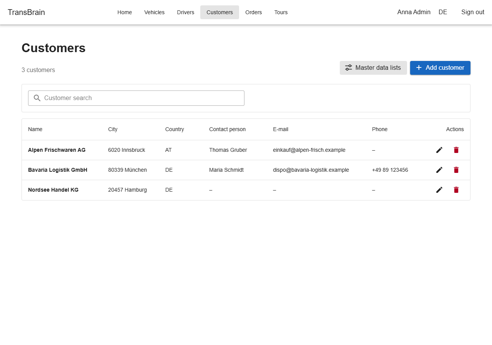

- Unter der Überschrift steht die Anzahl der angezeigten Kunden (z. B. „3 customers“).
- **Customer search** sucht in Name, PLZ, Ort, Land, Ansprechpartner, E-Mail, Telefon und
  UID-Nummer. Passt kein Kunde, erscheint „No customers found.“
- Angezeigte Spalten: Name, PLZ und Ort, Land, Ansprechpartner, E-Mail, Telefon. Ein Klick
  auf einen Spaltenkopf sortiert die Liste.
- Schaltfläche **„Add customer“** legt einen neuen Kunden an (nur `admin`).
- Schaltfläche **„Master data lists“** öffnet die [Kunden-Stammdaten](#kunden-stammdaten)
  (für alle angemeldeten Benutzer).
- Pro Zeile: **Stift-Symbol** (Bearbeiten) und **Papierkorb-Symbol** (Löschen nach
  Sicherheitsabfrage), nur `admin`.
- Geladen werden die ersten 100 Kunden, alphabetisch nach Name sortiert.

## Kundenformular (Anlegen / Bearbeiten)

Erreichbar über „Add customer“ (neu, `/customers/new`) oder das Stift-Symbol in der Liste
(`/customers/{id}`). Nur für `admin`.

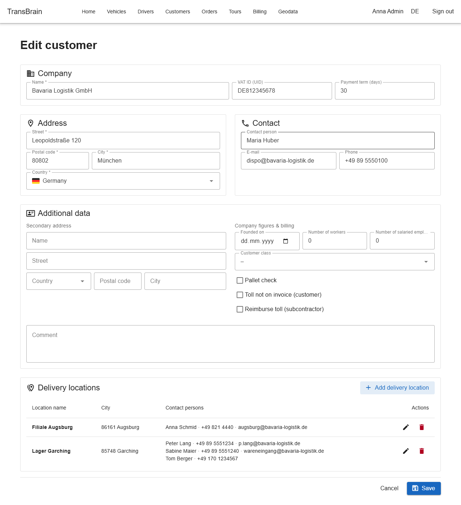

Die Felder sind in Karten gegliedert („Company“, „Address“, „Contact“, „Additional data“);
**„Cancel“** und **„Save“** stehen in einer Leiste am unteren Rand.

| Feld (Beschriftung)  | Bedeutung                          | Pflichtfeld | Regeln                                                |
|----------------------|------------------------------------|:-----------:|-------------------------------------------------------|
| Name                 | Firmenname                         | ja          | darf nicht leer sein, höchstens 200 Zeichen           |
| Street               | Straße                             | ja          | darf nicht leer sein, höchstens 200 Zeichen           |
| Postal code          | PLZ                                | ja          | darf nicht leer sein, höchstens 20 Zeichen            |
| City                 | Ort                                | ja          | darf nicht leer sein, höchstens 200 Zeichen           |
| Country              | Land                               | ja          | Auswahlliste europäischer Staaten mit Flagge und Landesnamen |
| Contact person       | Ansprechpartner                    | nein        | höchstens 200 Zeichen                                 |
| E-mail               | E-Mail-Adresse                     | nein        | gültige E-Mail-Adresse, wenn angegeben                |
| Phone                | Telefon                            | nein        | höchstens 50 Zeichen                                  |
| VAT ID (UID)         | UID-Nummer, z. B. `ATU12345678`    | nein        | höchstens 20 Zeichen                                  |
| Payment term (days)  | Zahlungsziel in Tagen              | ja          | 0 bis 365; 0 bedeutet sofort fällig                   |

- **„Save“** und **„Cancel“** verhalten sich wie im Fahrzeugformular.
- Fehlende Pflichtfelder und ungültige Werte werden direkt am Feld angezeigt. Ein Fehler, den
  der Server meldet (etwa ein ungültiges Land), erscheint oberhalb des Formulars.

### Zusatzdaten (Additional data)

Die Karte **Additional data** entspricht dem Reiter „Zusatz“ des Altsystems. Alle Angaben sind
freiwillig. Wie bei den kaufmännischen Daten eines Fahrzeugs wird beim Speichern immer die
ganze Karte übernommen: ein geleertes Feld ist danach auch gespeichert leer.

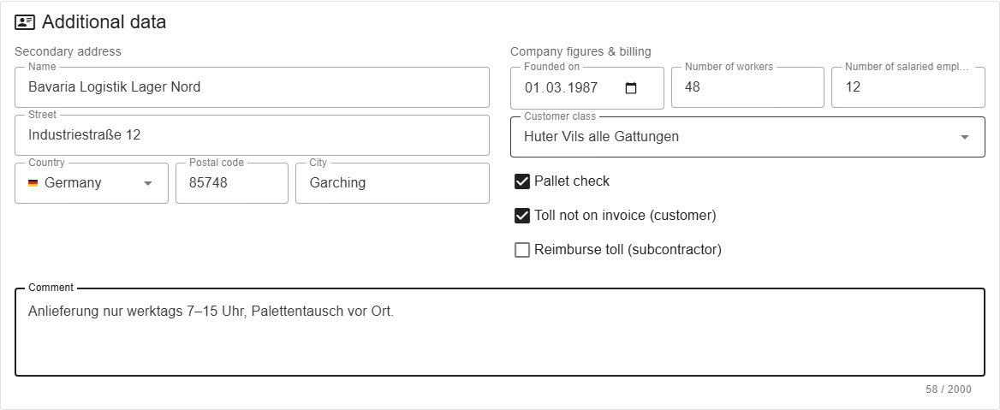

| Feld (Beschriftung) | Bedeutung | Regeln |
|---|---|---|
| Secondary address: Name, Street, Postal code, City, Country | Zusatzadresse (z. B. Lager oder Rechnungsanschrift), unabhängig von der Firmenadresse | Name, Straße, Ort je höchstens 200 Zeichen, PLZ höchstens 20; Country (Staat) als Auswahlliste mit Flagge und Landesnamen, das Kreuz am Feld leert es |
| Founded on | Gründungsdatum | nicht vor 1800 |
| Number of workers | Anzahl Arbeiter | ganze Zahl von 0 bis 1.000.000; leer zählt als 0 |
| Number of salaried employees | Anzahl Angestellte | ganze Zahl von 0 bis 1.000.000; leer zählt als 0 |
| Customer class | Kundenklasse, z. B. „Huter Vils alle Gattungen“ | Auswahl aus den aktiven Kundenklassen der [Kunden-Stammdaten](#kunden-stammdaten); „–“ entfernt sie |
| Pallet check | Palettenprüfung | Häkchen |
| Toll not on invoice (customer) | Maut wird dem Kunden nicht in Rechnung gestellt | Häkchen |
| Reimburse toll (subcontractor) | Maut wird dem Subunternehmer erstattet | Häkchen |
| Comment | Kommentar | höchstens 2000 Zeichen |

- Eine inzwischen deaktivierte Kundenklasse bleibt beim Kunden erhalten; sie erscheint mit dem
  Zusatz „(inactive)“ und kann beim Speichern beibehalten, aber keinem anderen Kunden neu
  zugewiesen werden.

### Anlieferorte

Ein Kunde kann mehrere Anlieferorte (Abladeadressen) haben, jeweils mit eigener Adresse und
beliebig vielen eigenen Ansprechpersonen. Die Anlieferorte stehen unter dem Abschnitt „Anlieferorte“ im Kundenformular.
Dieser Abschnitt erscheint erst im Bearbeitungsmodus, also nachdem der Kunde gespeichert wurde.

- Schaltfläche **„Add delivery location“** öffnet ein Formular für einen neuen Anlieferort
  (`/customers/{id}/locations/new`).
- Pro Zeile: **Stift-Symbol** und **Papierkorb-Symbol** (nur `admin`); das Löschen fragt
  vorher nach („Really delete delivery location …?“).
- Die Spalte **„Contact persons“** der Tabelle zeigt je Anlieferort alle Ansprechpersonen,
  eine pro Zeile mit Name · Telefon · E-Mail.
- Felder: Bezeichnung des Anlieferorts (Pflicht), Straße, PLZ, Ort und Land (Pflicht, wie beim
  Kunden), Ansprechperson, deren Telefon und E-Mail (optional).
- Karte **„Own company (invoice recipient)“**: optional ein eigener **Firmenname** („Own
  company name“) und eine eigene **USt-IdNr.** („VAT ID“) des Anlieferorts. Ein Anlieferort
  mit eigenem Firmennamen ist rechnungstechnisch eine eigene Firma: Er kann im
  [Rechnungsformular](#rechnungsformular-erstellen) als Rechnungsempfänger gewählt werden und
  erhält dann eine Rechnung auf seinen Namen, seine Adresse und seine USt-IdNr. Ohne eigenen
  Firmennamen bietet die Abrechnung den Anlieferort nicht an.
- Die Adresse eines Anlieferorts ist unabhängig von der Firmenadresse des Kunden. Im Bearbeitungsmodus zeigt eine Karte die Lage des Anlieferorts. Die Position wird aus der Adresse über einen Dienst auf dem eigenen Server bestimmt (Nominatim mit OpenStreetMap-Daten), der nur Adressen im geladenen Kartenausschnitt kennt. Ist die Adresse unbekannt, sagt ein Hinweis das ausdrücklich. Wird ein Kunde
  Kunden).
- Karte **„Contact persons“**: **„Add contact person“** fügt eine leere Zeile mit Name
  (Pflicht), Telefon und E-Mail (beide optional, die E-Mail muss gültig sein) hinzu; das
  **Papierkorb-Symbol** einer Zeile entfernt diese Ansprechperson. Bis zu 20 Ansprechpersonen
  je Anlieferort, die Reihenfolge bleibt wie eingegeben. Gespeichert wird die Liste erst mit
  **„Save“**; ein fehlender Name oder eine ungültige E-Mail wird direkt an der betroffenen Zeile
  angezeigt.

  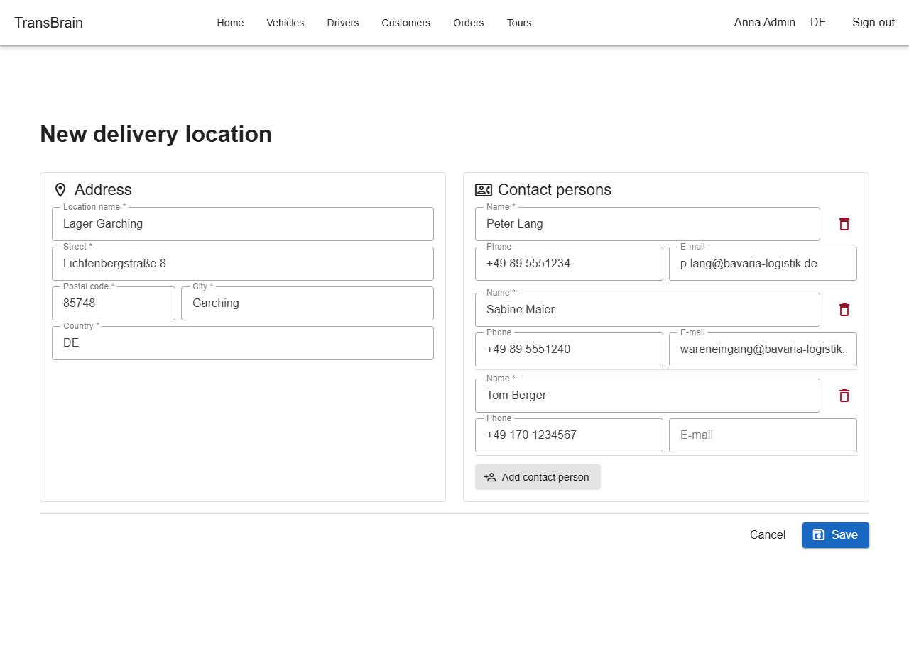
- Die Adresse eines Anlieferorts ist unabhängig von der Firmenadresse des Kunden. Im Bearbeitungsmodus zeigt eine Karte die Lage des Anlieferorts. Die Position wird aus der Adresse über Nominatim (OpenStreetMap) bestimmt. Der Dienst ist frei und braucht keinen Schlüssel. Ist die Adresse unbekannt, sagt ein Hinweis das ausdrücklich. Wird ein Kunde
  gelöscht, werden seine Anlieferorte mit gelöscht.

## Kunden-Stammdaten

Erreichbar über die Schaltfläche **„Master data lists“** oben in der Kundenliste
(`/customer-catalog`). Hier pflegen Sie die Auswahllisten des Kundenformulars, derzeit den
Reiter **Customer classes** (Kundenklassen). Beim ersten Start ist die Kundenklasse des
Altsystems „Huter Vils alle Gattungen“ (Code `HuterVilsAll`) bereits angelegt.
**„Back to customers“** führt zurück zur Kundenliste.

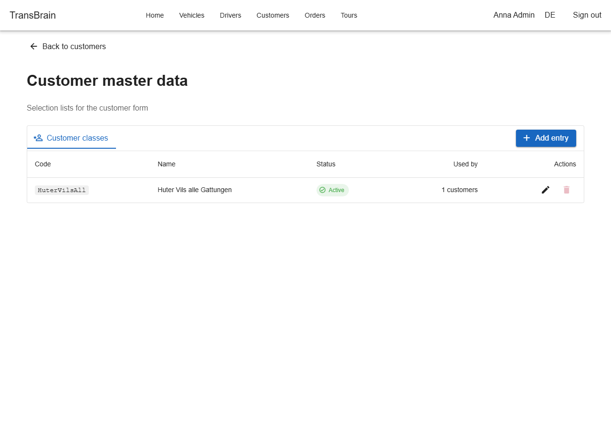

Die Seite funktioniert genau wie die [Fahrzeug-Stammdaten](#fahrzeug-stammdaten): alle
angemeldeten Benutzer sehen die Liste, ändern dürfen sie nur Administratoren; Code und Name
werden im selben Dialog erfasst, der Code ist später nicht änderbar. Die Spalte **Used by**
zählt hier die Kunden („3 customers“), und eine Kundenklasse, die noch ein Kunde verwendet,
lässt sich nicht löschen, nur deaktivieren.

## Auftragsliste

Erreichbar über `/orders`.

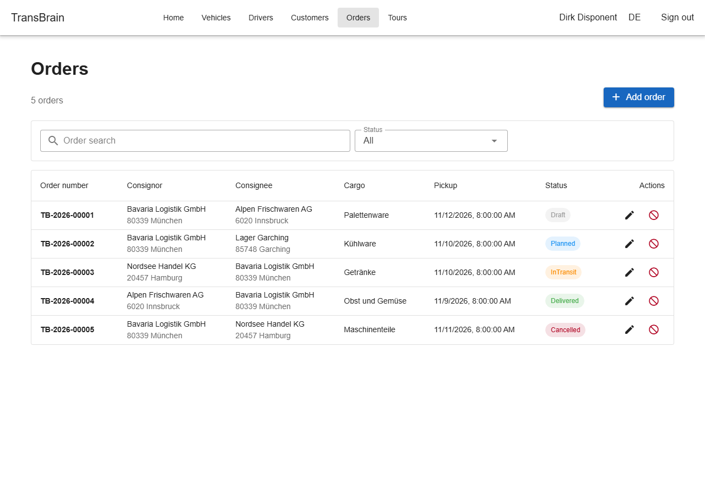

- Unter der Überschrift steht die Anzahl der angezeigten Aufträge (z. B. „5 orders“).
- **Order search** sucht in Auftragsnummer, Name und Ort von Absender und Empfänger sowie in
  der Ladung. Passt kein Auftrag, erscheint „No orders found.“
- Angezeigte Spalten: Order number (Auftragsnummer), Consignor (Absender), Consignee
  (Empfänger), Cargo (Ladung), Pickup (Beginn des Abholfensters), Status. Absender und
  Empfänger zeigen unter dem Namen PLZ und Ort. Ein Klick auf einen Spaltenkopf sortiert die
  Liste.
- Die **Auftragsnummer wird vom Server vergeben**, im Format `TB-2027-00042` — Jahr und
  eine fortlaufende Nummer innerhalb dieses Jahres. Sie kann nicht eingegeben oder
  geändert werden, auch nicht beim Bearbeiten.
- Schaltfläche **„Add order“** oberhalb der Tabelle legt einen neuen Auftrag an.
- Schaltfläche **„Master data lists“** öffnet die [Auftrags-Stammdaten](#auftrags-stammdaten)
  (für alle angemeldeten Benutzer).
- Das Auswahlfeld **„Status“** filtert die Liste. „All“ zeigt alle Aufträge; die übrigen
  Einträge entsprechen den fünf Status `Draft`, `Planned`, `InTransit`, `Delivered` und
  `Cancelled`.
- Pro Zeile: **Stift-Symbol** öffnet den Auftrag zum Bearbeiten, **Verbots-Symbol**
  („Cancel order“) storniert ihn.

**Stornieren ist kein Löschen.** Ein Auftrag wird nie entfernt. Nach dem Stornieren
bleibt die Zeile in der Liste stehen, ihr Status wechselt lediglich auf `Cancelled`. Das
ist beabsichtigt: Das Unternehmen behält den Nachweis über einen erteilten und wieder
zurückgezogenen Auftrag — für Rückfragen zur Abrechnung und weil die Auftragsnummer dem
Kunden gegenüber bereits genannt wurde.

**Sicherheitsabfrage beim Stornieren:** Wie beim Löschen von Fahrzeugen und Fahrern wird
hier nachgefragt. Ein Klick auf das Verbots-Symbol ersetzt es in derselben Zeile durch
**„Confirm cancel“** und **„Keep order“**. Erst „Confirm cancel“ storniert tatsächlich;
„Keep order“ bricht ab und ändert nichts.

## Auftragsformular (Anlegen / Bearbeiten)

Anlieferort (optional): Ganz oben im Empfänger-Bereich wählen Sie einen gespeicherten Anlieferort
aus den Kundenstammdaten. Die Empfängerfelder werden daraufhin mit Bezeichnung und Adresse des
Anlieferorts gefüllt und können danach noch geändert werden. Der Auftrag speichert die Adresse, wie
sie beim Speichern eingetragen ist; spätere Änderungen am Anlieferort wirken nicht auf bestehende
Aufträge. Ohne Auswahl tragen Sie die Empfängeradresse wie bisher von Hand ein.

Erreichbar über „Add order“ (`/orders/new`) oder das Stift-Symbol (`/orders/{id}`).

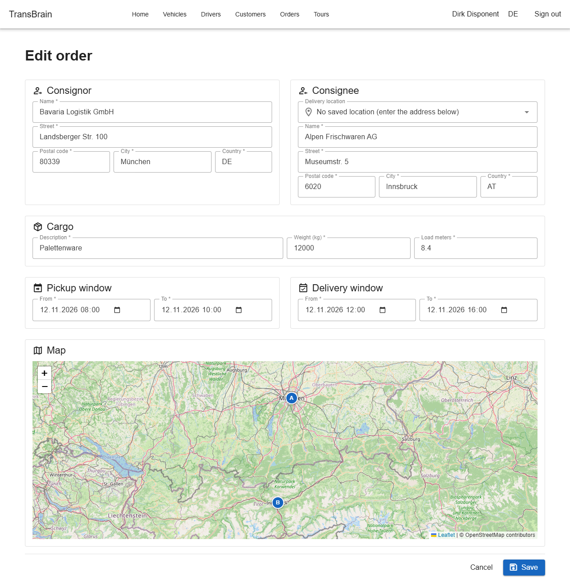

Das Formular ist in sechs Abschnitte gegliedert:

| Abschnitt       | Felder                                   | Pflicht | Hinweise                                                     |
|-----------------|------------------------------------------|:-------:|---------------------------------------------------------------|
| Consignor       | Name, Street, Postal code, City, Country | ja      | Country ist eine Auswahlliste europäischer Staaten mit Flagge und Landesnamen. Vorbelegt mit Deutschland. |
| Consignee       | Name, Street, Postal code, City, Country | ja      | dieselben Regeln wie beim Absender                            |
| Cargo           | Description, Weight (kg), Load meters    | ja      | Gewicht und Lademeter müssen größer als null sein. Lademeter dürfen Dezimalstellen haben (z. B. `8.4`). |
| Pickup window   | From, To                                 | ja      | Datum **und** Uhrzeit; „From“ muss vor „To“ liegen            |
| Delivery window | From, To                                 | ja      | Datum **und** Uhrzeit; „From“ muss vor „To“ liegen            |
| Special remarks | zwei Textfelder, zwei Häkchen            | nein    | siehe unten                                                   |

- **Special remarks (Besonderes):** Wie im Altsystem gibt es zwei getrennte Bemerkungsfelder
  (je bis 2000 Zeichen): **„Special remarks (internal)“** ist nur intern sichtbar,
  **„Special remarks on the order confirmation“** ist der Text, der für die
  Auftragsbestätigung gedacht ist. Darunter die beiden Ausstattungs-Häkchen
  **„Partition wall“** (Trennwand) und **„Double deck“** (Doppelstock).

- Die Zeitfenster werden in Ihrer lokalen Zeit eingegeben und angezeigt, intern aber in
  UTC gespeichert. Beim erneuten Öffnen zum Bearbeiten erscheinen wieder dieselben
  Uhrzeiten, die Sie eingegeben haben.
- **Das Lieferfenster darf nicht beginnen, bevor das Abholfenster endet.** Ist das doch
  der Fall, lehnt der Server das Speichern ab und zeigt oberhalb des Formulars die
  Meldung „The delivery window must not start before the pickup window ends.“
- **„Save“** und **„Cancel“** verhalten sich wie im Fahrzeug- und Fahrerformular.
- Validierungsfehler werden direkt am betroffenen Feld angezeigt, auch bei den
  verschachtelten Adressfeldern (z. B. eine Meldung unter „Consignor → Name“).

**Karte (nur beim Bearbeiten)** — Unterhalb des Formulars zeigt der Abschnitt „Karte“ Absender
(Markierung `A`) und Empfänger (Markierung `B`) auf einer OpenStreetMap-Karte. Der Mauszeiger auf
einer Markierung zeigt Name und Adresse. Die Karte erscheint erst für gespeicherte Aufträge, also
nicht beim Anlegen eines neuen Auftrags.

- Lässt sich eine Adresse nicht finden, steht darunter der Hinweis „… konnte nicht auf der Karte
  platziert werden: Die Adresse wurde nicht gefunden.“ Der Auftrag selbst ist davon nicht betroffen.
- Die Adressen verortet ein Dienst, der auf dem eigenen Server läuft; ein externer Dienst oder
  Schlüssel ist nicht nötig. Er kennt nur Adressen im geladenen Kartenausschnitt.
  Ist der Dienst nicht erreichbar oder noch im Aufbau, erscheint anstelle der Karte die
  Meldung „Der Karten- und Routingdienst ist nicht verfügbar …“. Das Formular bleibt voll nutzbar.

### Mautdaten (Toll data)

Beim Bearbeiten eines bestehenden Auftrags erscheint unterhalb der Karte die Tabelle
**„Toll data“** — das Gegenstück zum Mautdaten-Reiter des Altsystems. Hier halten Sie fest,
welche Mautstrecken für den Auftrag angefallen sind.

- **„Add toll“** öffnet den Dialog „New toll record“: **Toll category** (Maut-Art, Pflicht,
  Auswahlliste aus den [Auftrags-Stammdaten](#auftrags-stammdaten)), **Empty km** (Leer-km)
  und **Loaded km** (Last-km, je 0 bis 100 000) sowie **Rate (€/km)** (Faktor, 0 bis 1 000,
  bis zu vier Nachkommastellen).
- Die Beträge rechnet der Server: **Empty amount** = Leer-km × Faktor, **Loaded amount** =
  Last-km × Faktor. Sie erscheinen als Spalten in der Tabelle; die Summenzeile addiert
  Kilometer und Beträge — wie die Summenfelder unter dem alten Mautdaten-Reiter.
- Jede Zeile zeigt unter **Last modified**, wer sie zuletzt geändert hat und wann.
  Stift- und Papierkorb-Symbol (mit Sicherheitsabfrage) erscheinen nur mit Schreibrecht
  für die Disposition (`admin`, `disponent`).
- **Mautdaten sind in jedem Auftragsstatus änderbar** — anders als die übrigen
  Auftragsfelder, die nur im Status `Draft` bearbeitet werden können. Das ist Absicht:
  Mautkosten werden oft erst bekannt, während die Tour unterwegs ist oder danach.

### Zusatzpositionen (Additional charges)

Darunter steht die Tabelle **„Additional charges“** — das Gegenstück zum
Zusatzpositionen-Reiter des Altsystems. Hier erfassen Sie zusätzliche Leistungen, die mit
dem Auftrag abgerechnet werden sollen (z. B. Standgeld, Palettentausch).

- **„Add charge“** öffnet den Dialog „New additional charge“: **Description** (Bezeichnung,
  Pflicht, bis 200 Zeichen), **Quantity** (Menge, größer null bis 1 000 000), **Unit**
  (Einheit, optional, Auswahlliste aus den [Auftrags-Stammdaten](#auftrags-stammdaten) —
  „No unit“ lässt sie weg) und **Unit price** (Einzelpreis in €, 0 bis 1 000 000).
- **Total** (Gesamt = Menge × Einzelpreis) rechnet der Server; die Summenzeile addiert
  alle Gesamtbeträge.
- Bearbeiten, Löschen, die Spalte **Last modified** und die Statusregel verhalten sich wie
  bei den Mautdaten: Änderungen sind in jedem Auftragsstatus möglich, Schreibrecht für die
  Disposition vorausgesetzt.

## Auftrags-Stammdaten

Erreichbar über die Schaltfläche **„Master data lists“** oben in der Auftragsliste
(`/order-catalog`). Hier pflegen Sie die Auswahllisten des Auftragsformulars in zwei
Reitern: **Toll categories** (Maut-Arten) und **Units** (Einheiten). Beim ersten Start
sind die Einträge des Altsystems bereits angelegt — 15 Maut-Arten (A 0,300; A 0,310; A1;
A2; A-Tank; CH 0,55; D 0,124; D 0,15; D Tank; D3A EU 1/2; D3A EU 3/4; D3A EU 5;
D4/5A EU 5; D4/5A EU 1/2; D4/5A EU 3/4) und 11 Einheiten (Meter, Zentimeter, Millimeter,
Stück, Packung, Stunde, Minute, Tag, Liter, Tonnen, Kubikmeter). **„Back to the orders“** führt zurück zur Auftragsliste.

Die Seite funktioniert genau wie die [Fahrzeug-Stammdaten](#fahrzeug-stammdaten): alle
angemeldeten Benutzer sehen die Listen, ändern dürfen sie nur Administratoren; Code und
Name werden im selben Dialog erfasst, der Code ist später nicht änderbar. Die Spalte
**Used by** zählt die Aufträge, die einen Eintrag verwenden („2 orders“ — jeder Auftrag
nur einmal), und ein Eintrag, den noch ein Auftrag verwendet, lässt sich nicht löschen,
nur deaktivieren.

## Auftragsstatus: welche Schritte abgelehnt werden

Dies ist der Teil, der im Alltag am ehesten für Verwirrung sorgt: Nicht jede Aktion ist in
jedem Status erlaubt. Ein Auftrag durchläuft die Status
`Draft` → `Planned` → `InTransit` → `Delivered`.

| Status      | Bearbeiten („Edit“ → „Save“) | Stornieren („Cancel order“) |
|-------------|:----------------------------:|:---------------------------:|
| `Draft`     | ja                           | ja                          |
| `Planned`   | **nein**                     | ja                          |
| `InTransit` | **nein**                     | **nein**                    |
| `Delivered` | **nein**                     | **nein**                    |
| `Cancelled` | **nein**                     | **nein**                    |

**Was Sie bei einer Ablehnung sehen:**

- **Bearbeiten eines Auftrags, der kein Entwurf mehr ist:** Das Formular lässt sich
  weiterhin öffnen und ausfüllen, aber beim Klick auf „Save“ erscheint oberhalb des
  Formulars die Meldung „An order in status 'Planned' can no longer be edited. (HTTP
  409)“ — mit dem jeweils tatsächlichen Status. Die Änderung wird **nicht** gespeichert,
  und die Anwendung kehrt nicht zur Liste zurück.
- **Stornieren eines Auftrags, der bereits unterwegs ist:** Nach „Confirm cancel“
  erscheint oberhalb der Tabelle die Meldung „An order in status 'InTransit' cannot move
  to 'Cancelled'. (HTTP 409)“. Die Tabelle bleibt sichtbar, der Auftrag unverändert.
- **Erneutes Stornieren eines bereits stornierten Auftrags:** dieselbe Meldung, mit
  `'Cancelled'` als aktuellem Status.

Das ist jeweils kein Fehler der Anwendung, sondern die beabsichtigte Regel: Sobald die
Ware physisch unterwegs ist, beschreibt der Auftrag einen realen Vorgang, der sich nicht
mehr per Mausklick zurücknehmen lässt. Die Schaltflächen werden dabei bewusst **nicht**
ausgeblendet — Sie erhalten stattdessen eine Meldung, die den Grund nennt.

**Hinweis:** Die Übergänge nach `Planned`, `InTransit` und `Delivered` sind in dieser
Phase noch nicht über die Oberfläche auslösbar; sie entstehen in einer späteren Phase
durch die Tourenplanung. In der Praxis sehen Sie hier daher zunächst nur `Draft` und
`Cancelled`.

## Tourenliste

Erreichbar über `/tours`.

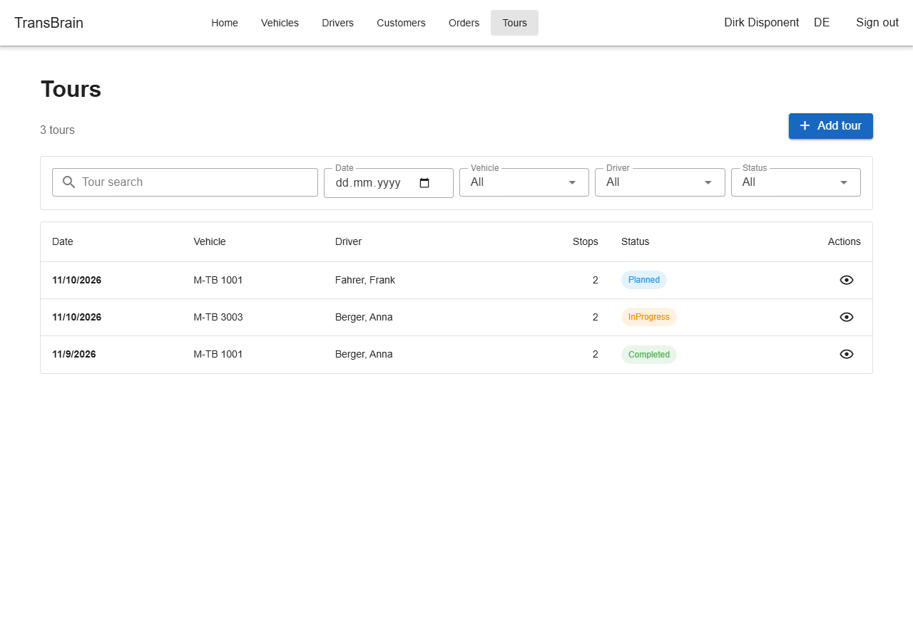

Eine **Tour** ist die Tagesarbeit eines Fahrzeugs mit einem Fahrer: eine geordnete Liste von
Stopps, die eine Menge von Aufträgen bedient.

- Unter der Überschrift steht die Anzahl der angezeigten Touren (z. B. „3 tours“).
- Angezeigte Spalten: Date (Tourdatum), Vehicle (Kennzeichen), Driver (Fahrer), Stops (Anzahl
  der Stopps), Status. Ein Klick auf einen Spaltenkopf sortiert die Liste.
- Schaltfläche **„Add tour“** oberhalb der Tabelle plant eine neue Tour.
- Filterleiste: **Tour search** (Kennzeichen, Fahrer, Auftragsnummern der Stopps) sowie die
  Filter **Date**, **Vehicle**, **Driver** und **Status**. Sie wirken gemeinsam. Passt keine
  Tour, erscheint „No tours found.“
- Pro Zeile öffnet das **Augen-Symbol** („Open“) die Detailseite — dort findet die eigentliche
  Arbeit statt.

## Tourenformular (Anlegen)

Erreichbar über „Add tour“ (`/tours/new`).

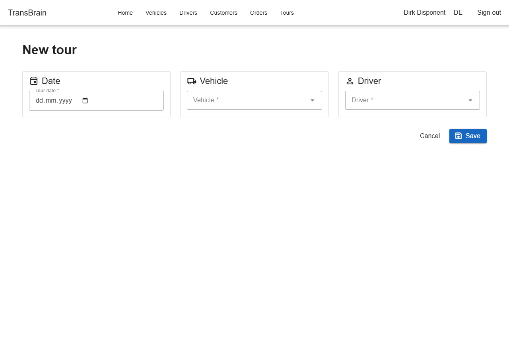

| Feld       | Bedeutung                          | Pflicht |
|------------|------------------------------------|:-------:|
| Tour date  | Datum, an dem die Tour gefahren wird | ja     |
| Vehicle    | Zugmaschine aus dem Fahrzeugstamm (Hänger werden nicht angeboten) | ja      |
| Driver     | Fahrer aus dem Fahrerstamm          | ja      |

Nach dem Speichern landen Sie **direkt auf der Detailseite** der neuen Tour, nicht in der Liste —
der nächste Schritt ist immer, Aufträge zuzuordnen.

**Eine Tour lässt sich nachträglich nicht umplanen.** Es gibt bewusst kein Bearbeiten-Formular:
Fahrzeug, Fahrer und Datum stehen mit dem Anlegen fest. Wurde falsch geplant, entfernen Sie die
Aufträge wieder (sie werden dadurch erneut disponierbar) und legen eine neue Tour an.

### Welche Kombinationen abgelehnt werden

Beim Speichern prüft der Server vier Regeln. Jede Ablehnung erscheint als Meldung oberhalb des
Formulars, und das Formular bleibt stehen — Ihre Eingaben gehen nicht verloren.

| Situation                                                | Meldung (sinngemäß)                                                            |
|----------------------------------------------------------|--------------------------------------------------------------------------------|
| Fahrzeug steht in der Werkstatt oder ist ausgemustert     | „Vehicle 'M-AB 1234' is 'InWorkshop' and cannot be assigned to a tour. (HTTP 409)“ |
| Fahrer ist abwesend oder inaktiv                          | „Driver 'Fahrer' is 'Absent' and cannot be assigned to a tour. (HTTP 409)“      |
| Führerschein läuft **vor** dem Tourdatum ab               | „The driver's licence expires on 2027-02-28, before the tour date 2027-03-01. (HTTP 409)“ |
| Fahrzeug hat an diesem Datum bereits eine Tour            | „That vehicle already has a tour on 2027-03-01. (HTTP 409)“                     |
| Fahrer hat an diesem Datum bereits eine Tour              | „That driver already has a tour on 2027-03-01. (HTTP 409)“                      |

**Zum Führerschein:** Ein Schein, der **genau am** Tourdatum abläuft, ist an diesem Tag noch
gültig — die Tour wird angenommen. Erst ab dem Folgetag lehnt der Server ab.

**Zur Doppelbuchung:** Sie gilt pro Kalendertag und ohne Ausnahme — auch eine bereits
abgeschlossene Tour belegt Fahrzeug und Fahrer für diesen Tag.

## Tourendetail

Erreichbar über „Open“ in der Liste (`/tours/{id}`).

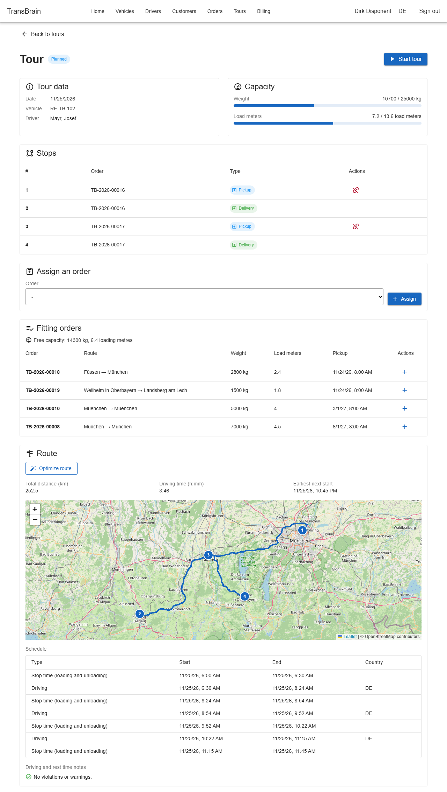

Ganz oben führt **„Back to tours“** zurück zur Liste. Die Überschrift zeigt den Status der
Tour; rechts daneben stehen je nach Status **„Start tour“** (nur bei `Planned`) bzw.
**„Complete tour“** (nur bei `InProgress`). Schaltflächen, die im aktuellen Status ohnehin
abgelehnt würden, werden ausgeblendet — anders als beim Stornieren eines Auftrags, wo die
Ablehnung die Regel erklärt.

Darunter gliedert sich die Seite in sechs Bereiche:

**1. Tour data** — Datum, Fahrzeug und Fahrer der Tour.

**2. Capacity (Auslastung)** — zwei Anzeigen mit Balken:

- `12000 / 18000 kg` — zugeladenes Gewicht gegen die Nutzlast des Fahrzeugs
- `8.4 / 13.6 load meters` — belegte Lademeter gegen die verfügbaren

Ab 90 % Auslastung wird ein Balken orange, über 100 % rot.

Diese Zahlen sind der Grund, warum die Seite existiert: Sie sehen **vor** dem Zuordnen, wie viel
Luft noch bleibt.

**3. Stops** — die Stoppliste in Reihenfolge. Je zugeordnetem Auftrag entstehen **automatisch
zwei** Stopps: ein `Pickup` (Abholung) und ein `Delivery` (Zustellung), wobei die Abholung immer
die kleinere Nummer trägt. Das **Entfernen-Symbol** („Remove“) an der Abholzeile nimmt den ganzen
Auftrag ohne Rückfrage wieder von der Tour; die verbleibenden Stopps werden lückenlos neu
nummeriert.

**4. Assign an order (Auftrag zuordnen)** — ein Auswahlfeld mit den zuordenbaren Aufträgen und
die Schaltfläche **„Assign“**.

**Angeboten werden nur Aufträge im Status `Draft`.** Jeder andere Status würde vom Server
abgelehnt, und eine Auswahl anzubieten, die anschließend abgelehnt wird, ist schlechter, als sie
gar nicht anzubieten. Ein Auftrag, der bereits auf einer anderen Tour liegt, ist deshalb nicht in
der Liste.

**5. Fitting orders (Passende Aufträge)** — nur sichtbar für Disponenten, solange die Tour im
Status `Planned` ist. Die Karte zeigt zuerst die **freie Kapazität** („Free capacity: 5200 kg,
4.2 loading metres“) und darunter alle offenen Aufträge (`Draft`), die **einzeln** noch in diese
Lücke passen — mit Auftragsnummer, Strecke (Abhol- → Zustellort), Gewicht, Lademetern und
Abholdatum. Die Schaltfläche **„Assign“** an jeder Zeile ordnet den Auftrag direkt zu, ohne den
Umweg über das Auswahlfeld. Nach dem Zuordnen werden Liste und freie Kapazität neu berechnet;
Aufträge, die durch die kleinere Lücke herausfallen, verschwinden dabei von selbst. Passt gar
nichts mehr, steht dort „No open orders fit into the free capacity.“

**Beachten Sie:** Die Liste beantwortet die Frage „Welcher **eine** Auftrag passt noch?“ Zwei
Aufträge aus der Liste passen zusammen nur dann, wenn auch ihre **Summe** in die freie Kapazität
passt — sonst lehnt der Server den zweiten ab, wie unter „Was beim Zuordnen abgelehnt wird“
beschrieben.

**6. Route (Strecke)** — eine Karte mit der Fahrstrecke (blaue Linie) und den nummerierten
Stopps. Darunter stehen:

- **Gesamtstrecke** in km und **Fahrzeit** im Format `h:mm`
- **Frühester nächster Start** — der früheste Zeitpunkt, zu dem die Tour nach den Lenk- und
  Ruhezeiten wieder beginnen kann
- **Fahrplan** — Fahrten, Pausen und Standzeiten (Be- und Entladung) mit Beginn und Ende
- **Hinweise zu Lenk- und Ruhezeiten** — ein Verstoß erscheint rot, eine Warnung gelb. Ohne
  Befund steht dort „Keine Verstöße oder Warnungen.“

Die Route berechnet der Server neu, sobald sich die Stopps ändern. Das übernimmt ein Routing-Dienst auf dem
eigenen Server, ohne externen Dienst oder Schlüssel; er kann nur Strecken im geladenen
Kartenausschnitt planen. Ist der Dienst noch im Aufbau oder nicht
erreichbar, erscheint anstelle der Route die Meldung „Der Karten- und Routingdienst ist nicht
verfügbar …“. Liegt die Adresse eines Stopps außerhalb des geladenen Kartenausschnitts oder ist sie unbekannt, nennt die Meldung diese Adresse: „Die Adresse „…“ wurde im geladenen Kartenausschnitt nicht gefunden. Ohne sie lässt sich die Route nicht berechnen.“ Schlägt die Berechnung aus einem
anderen Grund fehl, wird der Grund angezeigt. Die übrige Tourseite bleibt in allen Fällen nutzbar.

### Route optimieren

Oben im Bereich „Route“ steht für Disponenten die Schaltfläche **„Optimize route“** — sichtbar
nur bei Status `Planned` und erst ab **zwei zugeordneten Aufträgen**, denn bei einem einzigen
Auftrag ist die Reihenfolge (Abholung vor Zustellung) ohnehin festgelegt.

Ein Klick ordnet die Stopps der Tour so um, dass die **Gesamtstrecke kürzer** wird. Dabei gilt
unverrückbar: Die **Abholung eines Auftrags bleibt immer vor seiner Zustellung**. Die Stopps
werden anschließend lückenlos neu nummeriert (1, 2, …), und Stoppliste wie Route laden neu. Ist
die aktuelle Reihenfolge bereits die kürzeste, ändert sich nichts — die Schaltfläche zu drücken
ist also nie falsch.

Die Optimierung rechnet mit **Luftlinien-Entfernungen** zwischen den Stopp-Adressen, nicht mit
der tatsächlichen Fahrstrecke. Das genügt, um offensichtliches Hin- und Herfahren zu beseitigen;
die angezeigte Route (Strecke, Fahrzeit) berechnet danach wie gewohnt der Routing-Dienst.

| Situation                                              | Meldung (sinngemäß)                                        |
|--------------------------------------------------------|------------------------------------------------------------|
| Tour ist bereits gestartet oder abgeschlossen           | Hinweis, dass die Tour nicht mehr bearbeitet werden kann (HTTP 409) |
| Eine Stopp-Adresse kann nicht geokodiert werden         | Hinweis mit der betroffenen Adresse (HTTP 503)             |

### Was beim Zuordnen abgelehnt wird

| Situation                                                     | Meldung (sinngemäß)                                                              |
|---------------------------------------------------------------|----------------------------------------------------------------------------------|
| Gewicht der Tour überschreitet die Nutzlast                    | „Adding this order would load 21000 kg onto a vehicle rated for 18000 kg. (HTTP 409)“ |
| Lademeter überschreiten die verfügbaren                        | „Adding this order would need 15.0 load meters on a vehicle offering 13.6. (HTTP 409)“ |
| Tour ist bereits gestartet oder abgeschlossen                  | „A tour in status 'InProgress' no longer accepts changes to its stops. (HTTP 409)“ |

**Wichtig:** Die Kapazität wird gegen die **Summe der gesamten Tour** geprüft, nicht nur gegen
den einzelnen Auftrag. Ein Auftrag, der allein passen würde, kann als dritter oder vierter
trotzdem abgelehnt werden. Die Anzeige unter „Capacity“ zeigt Ihnen vorher, wie viel bleibt.

## Tourstatus: welche Schritte abgelehnt werden

Eine Tour durchläuft `Planned` → `InProgress` → `Completed`.

| Status       | Aufträge zuordnen/entfernen | „Start tour“ | „Complete tour“ |
|--------------|:---------------------------:|:------------:|:---------------:|
| `Planned`    | ja                          | ja           | **nein**        |
| `InProgress` | **nein**                    | **nein**     | ja              |
| `Completed`  | **nein**                    | **nein**     | **nein**        |

- **Eine Tour ohne Stopps lässt sich nicht starten.** Sie erhalten „A tour without stops cannot
  be started. (HTTP 409)“. Das ist Absicht: Eine leere Tour würde Fahrzeug und Fahrer für den Tag
  binden, ohne etwas zu transportieren.

### Der wichtigste Zusammenhang: Tour und Auftrag hängen zusammen

Das Starten und Abschließen einer Tour **verändert die Aufträge mit**, ohne dass jemand die
Auftragsmaske öffnet:

| Aktion an der Tour        | Was mit jedem zugeordneten Auftrag geschieht |
|---------------------------|-----------------------------------------------|
| Auftrag zuordnen          | `Draft` → `Planned`                           |
| Auftrag entfernen         | `Planned` → `Draft` (wieder disponierbar)     |
| **„Start tour“**          | `Planned` → `InTransit`                       |
| **„Complete tour“**       | `InTransit` → `Delivered`                     |

Wenn Sie sich also wundern, warum ein Auftrag in der Auftragsliste plötzlich `InTransit` zeigt,
obwohl niemand ihn angefasst hat: Seine Tour wurde gestartet. Das ist der normale Weg — die
Auftragsmaske selbst kennt diese Übergänge gar nicht.

**Nebenwirkung, die überrascht:** Sobald eine Tour gestartet ist, sind ihre Aufträge `InTransit`
und lassen sich **nicht mehr stornieren und nicht mehr bearbeiten**. Wollen Sie einen Auftrag
noch ändern, tun Sie es vor dem Start der Tour — oder nehmen Sie ihn vorher von der Tour.

## Touren als Fahrer (`fahrer`)

Dies ist die erste Stelle im System, an der **zwei angemeldete Benutzer Unterschiedliches sehen**.

Ein Benutzer mit der Rolle `fahrer` sieht in der Tourenliste **ausschließlich seine eigenen
Touren** und kann auch nur diese starten und abschließen. Für Administratoren, Disponenten und
Betrachter gilt das nicht — sie sehen alle Touren.

**Der kurze Weg führt über die Startseite:** Ein Fahrer findet seine Touren des Tages dort unter
„My tours today“ und kann sie direkt starten und abschließen, ohne die Tourenliste zu öffnen. Die
Regeln unten gelten unverändert — die Startseite ist nur eine bequemere Tür zu denselben Aktionen.

- **Die Liste wird eingeschränkt, nicht verweigert.** Ein Fahrer, der `/tours` öffnet, sieht seine
  Touren. Filtert er ausdrücklich auf einen Kollegen, bleibt die Liste **leer** — das ist die
  wahrheitsgemäße Antwort auf „die Touren dieses Kollegen, unter meinen“.
- **Eine fremde Tour direkt aufzurufen wird abgelehnt.** `/tours/{id}` einer fremden Tour meldet
  „A driver may only see their own tours. (HTTP 403)“.
- **Start und Abschluss einer fremden Tour werden abgelehnt** mit „A driver may only start or
  complete their own tours. (HTTP 403)“.

**Voraussetzung:** Die Zuordnung läuft über das Feld **External user id** im Fahrerstamm, in dem
die Keycloak-Kennung (`sub`) des Fahrers hinterlegt wird. Ist dieses Feld leer, gehört der
Fahrerdatensatz zu **niemandem, der sich anmelden kann** — dessen Touren kann dann auch kein
Fahrer starten. Das ist Absicht: Ein leeres Feld als „passt zu jedem“ zu behandeln, würde die
Tour dem erstbesten Fahrer überlassen.

## Rechnungsliste (Frachtabrechnung)

Erreichbar über den Menüpunkt **Abrechnung** (`/invoices`). Der Menüpunkt erscheint für
Administratoren, Disponenten und Betrachter; Fahrer sehen ihn nicht.

Hier werden zugestellte Aufträge zu Rechnungen zusammengefasst und deren Weg bis zur Bezahlung
verfolgt. Eine Rechnung durchläuft die Status **Draft** (Entwurf) → **Issued** (ausgestellt) →
**Paid** (bezahlt); **Cancelled** (storniert) ist jederzeit vor der Bezahlung möglich.

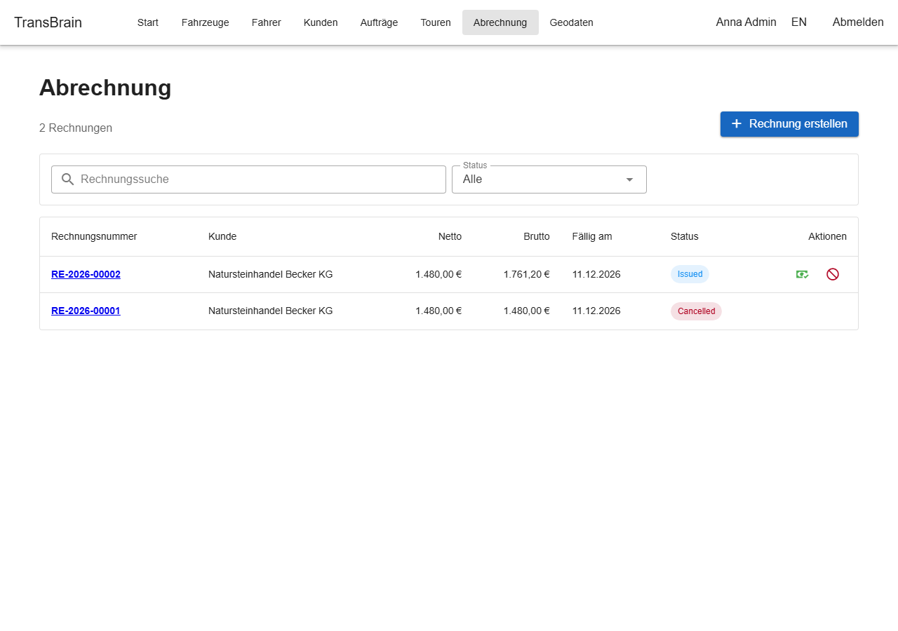

- **Spalten:** Rechnungsnummer (öffnet das Rechnungsdetail), Kunde, Netto, Brutto, Fällig am
  („—“ solange die Rechnung nicht ausgestellt ist) und Status. Alle Spalten sind sortierbar.
- Die **Rechnungsnummer** hat die Form `RE-2027-00042` — fortlaufend pro Jahr, vergeben beim
  Anlegen. Auch eine stornierte Rechnung behält ihre Nummer; Lücken in der Zählung entstehen
  dadurch nicht, die Nummer ist schlicht „verbraucht“.
- **Statusfarben:** **Paid** grün, **Issued** blau, **Cancelled** rot, **Draft** neutral.
- Das Feld **„Rechnungssuche“** filtert die geladenen Einträge nach Rechnungsnummer, Kunde und
  Status; das Dropdown **Status** filtert serverseitig.
- Aktionen pro Zeile (nur `admin` und `disponent`):
  - **Ausstellen** (Papierflieger, nur bei **Draft**): stempelt das Ausstellungsdatum und
    errechnet die Fälligkeit aus dem Zahlungsziel des Kunden.
  - **Als bezahlt markieren** (nur bei **Issued**).
  - **Stornieren** (nur bei **Draft** oder **Issued**): die Zeile fragt direkt an Ort und
    Stelle nach — bestätigt wird mit **„Stornierung bestätigen“**, abgebrochen mit
    **„Rechnung behalten“**. Ein Dialog öffnet sich nicht.
- **„Rechnung erstellen“** rechts oben (nur `admin` und `disponent`) öffnet das Formular.

## Rechnungsformular (Erstellen)

Nur für `admin` und `disponent`, erreichbar über **„Rechnung erstellen“** in der Rechnungsliste
(`/invoices/new`). Eine Rechnung wird **einmalig zusammengestellt und dann nur noch durch ihre
Statusschritte verändert** — ein Bearbeiten nach dem Anlegen gibt es bewusst nicht. Wer sich
vertan hat, storniert die Rechnung und erstellt sie neu.

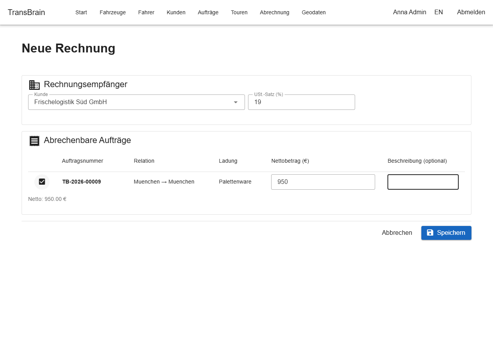

Der Abschnitt **Rechnungsempfänger** erwartet:

| Feld | Pflicht | Regeln |
|---|:---:|---|
| Kunde | ja | Auswahl aus den angelegten Kunden |
| Rechnung an | nein | erscheint nur, wenn der gewählte Kunde Anlieferorte mit eigenem Firmennamen hat; Vorgabe „Kunde (Standardadresse)“ = Rechnung an den Kunden selbst, alternativ ein Anlieferort als „‹Firmenname› (‹Bezeichnung des Anlieferorts›)“ |
| USt.-Satz (%) | ja | 0 bis 100, vorbelegt mit 19 |

Der Abschnitt **Abrechenbare Aufträge** listet ausschließlich **zugestellte Aufträge, die noch
auf keiner Rechnung stehen** — unabhängig vom gewählten Kunden. Je Auftrag:

- **Haken** zum Aufnehmen in die Rechnung — mindestens ein Auftrag muss gewählt sein, sonst
  meldet das Formular „Bitte mindestens einen Auftrag auswählen.“
- **Relation** zeigt Abhol- und Lieferort des Auftrags zur Orientierung.
- **Nettobetrag (€)** ist je gewähltem Auftrag Pflicht und muss größer null sein — den Preis
  kennt die Disposition, nicht das System. Fehlt er, meldet das Formular „Bitte einen
  Nettobetrag größer null für Auftrag … angeben.“
- **Beschreibung (optional)**: der Positionstext auf der Rechnung. Leer gelassen wird daraus
  automatisch „Transport ‹Auftragsnummer›“.

Unter der Tabelle rechnet eine Vorschau das **Netto** der gewählten Aufträge live zusammen.
Gespeichert wird mit **„Speichern“**; die neue Rechnung beginnt als **Draft** und wird
direkt im Rechnungsdetail geöffnet.

**Was beim Speichern abgelehnt wird:**

- Ein Auftrag, der nicht zugestellt ist: „Order … is ‹Status› and only delivered orders can be
  billed. (HTTP 409)“.
- Ein Auftrag, der inzwischen schon auf einer anderen (nicht stornierten) Rechnung steht —
  etwa weil ein Kollege schneller war: „These orders are already billed on another invoice: ….
  (HTTP 409)“. Die Liste der abrechenbaren Aufträge neu zu laden räumt die Auswahl auf.

**Wichtig zu wissen:** Beim Anlegen übernimmt die Rechnung **Name, Rechnungsadresse,
USt-IdNr. und Zahlungsziel des Kunden als Kopie**. Ist ein Anlieferort als
**Rechnungsempfänger** gewählt, übernimmt sie stattdessen **dessen Firmennamen, dessen
Adresse und dessen USt-IdNr.** — nur das Zahlungsziel bleibt das des Kunden, und in der
Rechnungsliste steht die Rechnung weiter beim Kunden. Spätere Änderungen am Kundenstamm wirken
nur auf künftige Rechnungen — eine bereits geschriebene Rechnung ist ein Dokument und ändert
sich nicht mehr rückwirkend.

## Rechnungsdetail

Erreichbar über die Rechnungsnummer in der Liste (`/invoices/{id}`). Zeigt den Status als
farbigen Chip neben der Rechnungsnummer sowie — je nach Status und nur für `admin` und
`disponent` — die Aktionen **Ausstellen**, **Als bezahlt markieren** und **Stornieren**
(mit derselben Rückfrage „Stornierung bestätigen“ / „Rechnung behalten“). Bei ausgestellten
und bezahlten Rechnungen stehen zusätzlich für alle Rollen die Schaltflächen
**PDF herunterladen** und **XRechnung herunterladen** bereit (siehe unten).

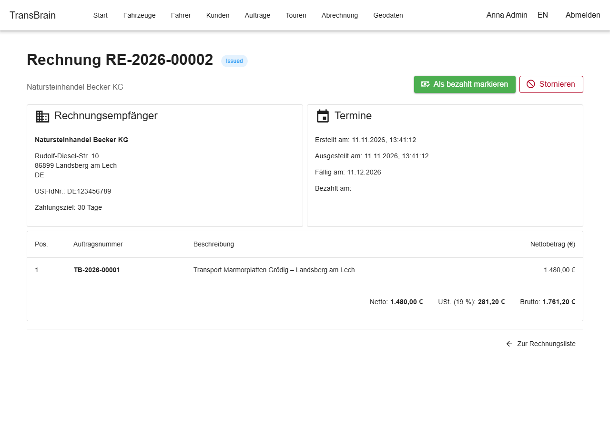

- Die Karte **Rechnungsempfänger** zeigt die beim Anlegen kopierten Kundendaten: Name,
  Rechnungsadresse, USt-IdNr. (falls hinterlegt) und Zahlungsziel.
- Die Karte **Termine** zeigt „Erstellt am“, „Ausgestellt am“, „Fällig am“ und „Bezahlt am“ —
  jeweils „—“, solange der Schritt noch nicht erfolgt ist. Die Fälligkeit ergibt sich beim
  Ausstellen als Ausstellungsdatum plus Zahlungsziel.
- Die Positionstabelle zeigt je Auftrag Position, Auftragsnummer, Beschreibung und Nettobetrag;
  darunter stehen **Netto**, **USt.** und **Brutto**. Die Umsatzsteuer wird kaufmännisch auf
  zwei Nachkommastellen gerundet.

### Rechnungsstatus: welche Schritte abgelehnt werden

Erlaubt ist nur der Weg **Draft → Issued → Paid**; **Stornieren** geht aus **Draft** und
**Issued**. Alles andere lehnt die API mit `HTTP 409` ab, die Oberfläche bietet die Schaltflächen
erst gar nicht an:

| Aktion | erlaubt aus | abgelehnt aus |
|---|---|---|
| Ausstellen | Draft | Issued, Paid, Cancelled |
| Als bezahlt markieren | Issued | Draft, Paid, Cancelled |
| Stornieren | Draft, Issued | **Paid**, Cancelled |

Eine Ablehnung meldet den Zustand wörtlich, z. B. „An invoice in status 'Paid' cannot move to
'Cancelled'. (HTTP 409)“. Dass eine **bezahlte** Rechnung nicht mehr storniert werden kann, ist
Absicht: Das Geld ist geflossen; die Korrektur wäre eine Gutschrift — ein neues Dokument, das es
in dieser Ausbaustufe noch nicht gibt.

**Der wichtigste Zusammenhang: Stornieren gibt die Aufträge frei.** Solange ein Auftrag auf
einer nicht stornierten Rechnung steht, taucht er im Rechnungsformular nicht mehr unter den
abrechenbaren Aufträgen auf. Wird die Rechnung storniert, sind ihre Aufträge sofort wieder
abrechenbar — so lässt sich eine fehlerhafte Rechnung durch Stornieren und Neuanlegen
korrigieren, ohne dass ein Auftrag doppelt oder gar nicht abgerechnet wird.

### Drucken und E-Rechnung (XRechnung)

Sobald eine Rechnung **ausgestellt** oder **bezahlt** ist, erscheinen im Kopf des
Rechnungsdetails zwei zusätzliche Schaltflächen — für **alle** Rollen, denn das Herunterladen
ist ein Lesevorgang und verändert nichts:

- **PDF herunterladen** lädt die Rechnung als druckfertiges PDF (`RE-2026-00002.pdf`):
  Briefkopf mit Absenderzeile, Empfängeranschrift, Rechnungsnummer, Ausstellungs- und
  Fälligkeitsdatum, Positionstabelle sowie Netto, USt. und Brutto. Bei offenen Rechnungen
  folgt die Zahlungsaufforderung mit IBAN und Verwendungszweck, bei bezahlten ein Hinweis
  auf den Zahlungseingang. Das PDF wird zum Drucken oder Archivieren im Browser gespeichert.
- **XRechnung herunterladen** erzeugt die elektronische Rechnung als XML
  (`RE-2026-00002-xrechnung.xml`) im UBL-Format nach **XRechnung 3.0** — das Format, das
  deutsche Behörden und zunehmend Geschäftskunden verlangen. Die Datei wird per E-Mail oder
  über ein Rechnungsportal an den Kunden übermittelt; einen automatischen Versand aus
  TransBrain heraus gibt es nicht.

Beide Exporte gibt es nur für Dokumente, also ausgestellte oder bezahlte Rechnungen. Für
einen **Entwurf** oder eine **stornierte** Rechnung zeigt die Oberfläche die Schaltflächen
nicht an; ein direkter API-Aufruf wird abgelehnt mit „An invoice in status 'Draft' cannot be
exported; only issued or paid invoices can. (HTTP 409)“.

Die Absenderangaben des PDFs und der XRechnung (Firmenname, Anschrift, USt-IdNr., IBAN)
stammen aus dem Abschnitt `InvoiceSeller` der API-Konfiguration (`appsettings.json`) und
sind im Auslieferungszustand mit Beispieldaten der TransBrain Logistik GmbH belegt — vor dem
Echtbetrieb anpassen.

## Geodaten-Wartung

Erreichbar über den Menüpunkt **Geodata** (`/geodata`). Der Menüpunkt erscheint nur für
Administratoren; über die Adresszeile können alle Rollen die Seite lesend öffnen.

Hintergrund: Für Kartenpositionen und Tourrouten übersetzt das System Adressen in Koordinaten.
Das erledigt der eingebaute Geocoder, der nur die Adressen seines Kartenausschnitts kennt.
Adressen außerhalb davon bleiben ohne Koordinaten — das Tourendetail kann ihre Route dann nicht
zeichnen. Diese Seite zeigt den Stand aller verwendeten Adressen und lässt Administratoren
fehlende Koordinaten von Hand nachtragen oder falsche korrigieren.

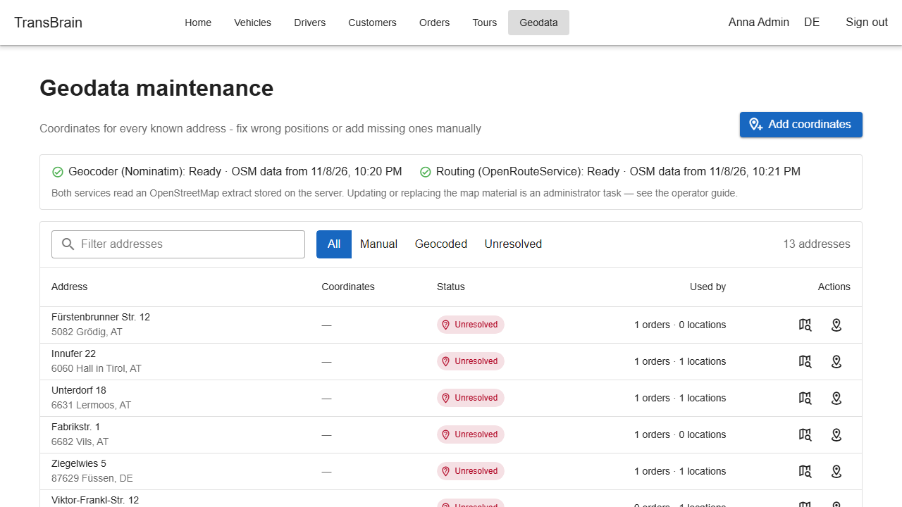

- Die Liste enthält jede Adresse aus Aufträgen (Abhol- und Lieferadressen) und
  Kunden-Standorten, sortiert nach Land, Ort und Straße; die Anzahl steht rechts oben
  (z. B. „14 addresses“).
- **Spalten:** Address (Straße, darunter PLZ, Ort und Land), Coordinates (Breite und Länge
  mit fünf Nachkommastellen, „—“ wenn unbekannt), Status und **Used by** — wie viele
  Aufträge und Standorte die Adresse gerade verwenden (z. B. „1 orders · 0 locations“).
- **Status:**
  - **Manual** (blau): Koordinaten wurden von Hand gesetzt. Sie haben überall Vorrang
    vor dem Geocoder — in Tourrouten, Auftragspositionen und Standortanzeigen.
  - **Geocoded** (grün): der Geocoder hat die Adresse bereits aufgelöst.
  - **Unresolved** (rot): noch keine Koordinaten bekannt.
- **Filterleiste:** **„Filter addresses“** sucht in Straße, PLZ, Ort und Land; die Schalter
  **All / Manual / Geocoded / Unresolved** schränken auf einen Status ein. Passt nichts,
  erscheint „No addresses found.“
- Aktionen pro Zeile (nur `admin`):
  - **„Try geocoding“** (nur bei nicht-manuellen Zeilen) fragt den Geocoder an. Kennt er
    die Adresse, wird die Zeile zu **Geocoded**; sonst meldet die Seite „The geocoder does
    not know this address. Set the coordinates manually.“
  - **„Set coordinates“** öffnet den Koordinaten-Dialog (siehe unten); die Adresse ist dort
    schreibgeschützt.
  - **„Remove manual coordinates“** (nur bei **Manual**) entfernt die manuellen Koordinaten
    nach einer Sicherheitsabfrage („Remove the manual coordinates for …? The address falls
    back to the geocoder.“).
- **„Add coordinates“** legt Koordinaten für eine ganz neue Adresse an, bevor sie in einem
  Auftrag oder Standort verwendet wird.
- Manuelle Einträge zu Adressen, die nirgends mehr vorkommen, bleiben mit dem Hinweis
  **„Not in use“** sichtbar, damit sie aufgeräumt werden können.

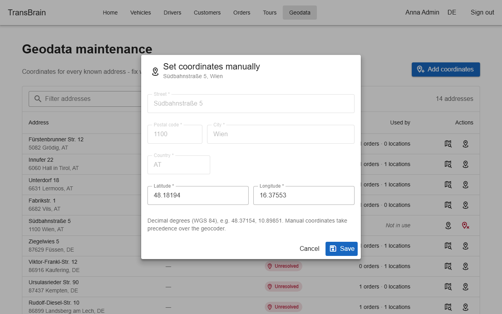

Der Dialog **„Set coordinates manually“** (bzw. **„Add address with coordinates“** bei einer
neuen Adresse) erwartet:

| Feld | Pflicht | Regeln |
|---|:---:|---|
| Street, Postal code, City | ja | bei einer bestehenden Adresse schreibgeschützt |
| Country | ja | Auswahlliste mit Flagge und Landesnamen; bei einer bestehenden Adresse schreibgeschützt |
| Latitude | ja | Dezimalgrad (WGS 84), −90 bis 90 |
| Longitude | ja | Dezimalgrad (WGS 84), −180 bis 180 |

Erneutes Speichern derselben Adresse überschreibt den bestehenden Eintrag — es entsteht kein
Duplikat. Die Koordinaten entnehmen Sie z. B. einem Kartendienst (Rechtsklick auf den Punkt).

### Kartenmaterial (OSM)

Oberhalb der Liste zeigt eine Statuskarte die beiden Kartendienste des Systems:

- **Geocoder (Nominatim)** — übersetzt Adressen in Koordinaten.
- **Routing (OpenRouteService)** — berechnet die Tourrouten.

Je Dienst steht dort **Ready** (grünes Häkchen) oder **Unavailable** (durchgestrichene Wolke)
und, sobald der Dienst es meldet, das Alter des Kartenmaterials („OSM data from …“). So ist auf
einen Blick erkennbar, ob fehlende Koordinaten am Kartenausschnitt, an veraltetem Material oder
an einem nicht laufenden Dienst liegen. Lässt sich der Status selbst nicht abrufen, wird die
Karte ausgeblendet. Die Zeile **Kartenauszug** darunter zeigt, welche Region als OSM-Auszug auf
dem Server installiert ist (z. B. `europe/germany/bayern/oberbayern`), die Dateigröße und den
Datenstand der Datei. Ist das Dateidatum neuer als das der Dienste, wurde der Auszug bereits
ausgetauscht, aber noch nicht neu importiert.

Beide Dienste lesen einen OpenStreetMap-Auszug, der auf dem Server liegt. **Das Aktualisieren
oder Ersetzen des Kartenmaterials ist bewusst keine Funktion dieser Seite**, sondern eine
Verwaltungsaufgabe am Server: Dort wird der Auszug ausgetauscht und beim nächsten Start der
Dienste neu importiert — das dauert je nach Region Minuten bis Stunden (Skript
`scripts/update-osm-extract.py`, Details im Developer Guide, Abschnitt 4.1). Zeigt die
Statuskarte **Unavailable**, läuft gerade ein solcher Import oder der Dienst ist gestoppt; die
Seite bleibt benutzbar, nur „Try geocoding“ und neue Routenberechnungen schlagen solange fehl.

## Datenimport

Der Datenimport ist Teil des globalen Wartungsbereichs: Menüpunkt **Wartung**, Reiter **Import**
(`/maintenance/import`, nur für die Rolle `system-admin` sichtbar; zuvor den Mandanten wählen,
siehe Abschnitt „Wartung“). Er übernimmt Stammdaten aus
anderen Programmen nach TransBrain: Kunden, Fahrer oder Fahrzeuge. Ein Assistent führt in fünf
Schritten von der Quelle bis zum Ergebnis; der Reiter **Import-Verlauf** daneben listet alle
bisherigen Import-Sitzungen.

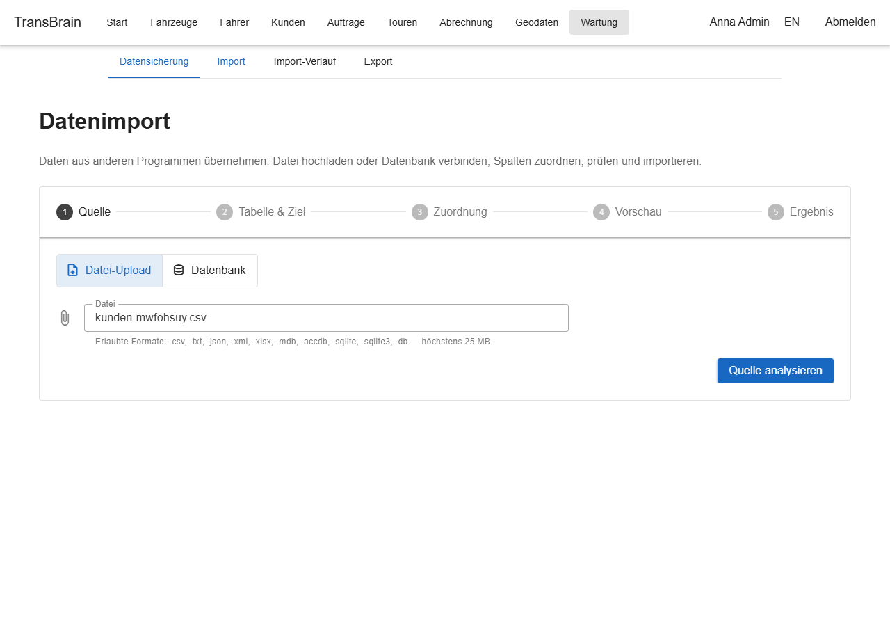

### Schritt 1: Quelle

Zwei Arten von Quellen stehen zur Wahl:

- **Datei hochladen** — unterstützt werden die gängigen Austauschformate:
  - **CSV** (`.csv`, `.txt`): Trennzeichen Semikolon, Komma oder Tabulator werden automatisch erkannt;
    UTF-8 und Latin-1 (Windows-Umlaute) werden gelesen; Anführungszeichen nach RFC 4180.
  - **JSON** (`.json`): ein Array von Objekten oder ein Objekt, dessen Eigenschaften Arrays
    sind (dann wird je Eigenschaft eine Tabelle angeboten); verschachtelte Objekte werden als
    `adresse.ort` zu Spalten flachgelegt.
  - **XML** (`.xml`): sich wiederholende Satz-Elemente werden als Zeilen gelesen,
    Kindelemente und Attribute als Spalten.
  - **Excel** (`.xlsx`): jedes Tabellenblatt mit Kopfzeile und mindestens einer Datenzeile
    wird als Tabelle angeboten; Datumszellen werden als Datum gelesen.
  - **Microsoft Access** (`.mdb`, `.accdb`): die Datei wird auf dem Server über den
    ODBC-Access-Treiber gelesen. Fehlt der Treiber auf dem Server, erscheint eine
    entsprechende Meldung (unter Windows ist er meist vorhanden, unter Linux hilft
    `mdbtools`).
  - **SQLite** (`.sqlite`, `.sqlite3`, `.db`): alle Tabellen der Datei werden angeboten.

  Die Datei darf höchstens **25 MB** groß sein.

- **Datenbank** — eine laufende Datenbank eines Altsystems wird direkt ausgelesen:
  **PostgreSQL**, **SQL Server**, **MySQL/MariaDB** oder eine beliebige **ODBC**-Quelle.
  Dazu werden Anbieter und Verbindungszeichenfolge eingegeben. Die Verbindung wird **einmalig
  beim Anlegen der Sitzung gelesen** und die Verbindungszeichenfolge **nicht gespeichert** —
  im Verlauf erscheint nur eine unkenntlich gemachte Anzeige wie `PostgreSql: altserver/altdb`.
  Ist die Datenbank nicht erreichbar, lehnt der Schritt mit einer klaren Meldung ab, ohne
  die Zugangsdaten preiszugeben.

In beiden Fällen liest TransBrain die Quelle sofort vollständig ein und legt eine
**Import-Sitzung** an: alle Tabellen mit ihren Spalten und Zeilen, mandantenbezogen und
komprimiert in der TransBrain-Datenbank abgelegt. Ab jetzt wird die Quelle nicht mehr
benötigt — Vorschau und Ausführung arbeiten ausschließlich mit der Sitzung. Je Quelle werden
höchstens 100 Tabellen, 256 Spalten und 50.000 Zeilen pro Tabelle übernommen.

### Schritt 2: Tabelle und Ziel

Links wird die Quelltabelle gewählt (bei CSV gibt es genau eine; Access, SQLite, Excel und
Datenbanken bieten meist mehrere an). Zu jeder Tabelle zeigt der Assistent die Zeilenzahl und
die ersten fünf Zeilen als Kostprobe. Rechts wird das Ziel gewählt: **Kunden**, **Fahrer**
oder **Fahrzeuge**.

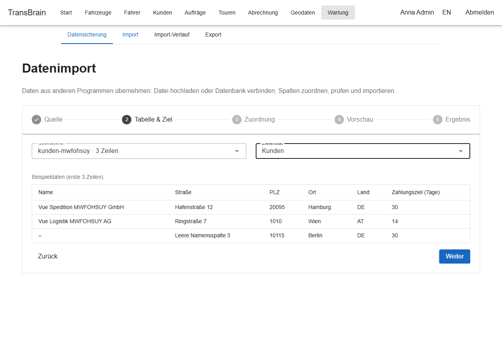

### Schritt 3: Zuordnung (Mapping)

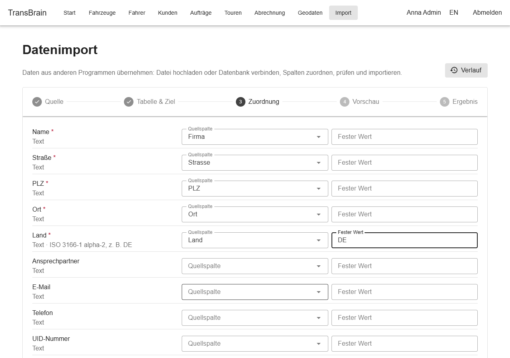

Das Herzstück: eine Zeile je Zielfeld. Pflichtfelder sind mit `*` markiert. Für jedes
Zielfeld wird entweder

- eine **Quellspalte** gewählt (der Assistent belegt beim Betreten des Schritts automatisch
  vor, was per Namensgleichheit passt — Groß-/Kleinschreibung spielt keine Rolle), oder
- ein **fester Wert** eingetragen, der dann für alle Zeilen gilt (z. B. Land `DE`, wenn die
  Quelle keine Länderspalte hat), oder
- beides: dann gilt der feste Wert als Ersatz für leere Zellen.

Zu jedem Feld zeigt der Assistent den erwarteten Typ (Text, Zahl, Datum, Ja/Nein, Liste)
und — wo es sie gibt — die erlaubten Werte (etwa die Fahrzeugtypen). Die Werte dürfen so
formatiert sein, wie Altsysteme sie üblicherweise liefern: Zahlen deutsch (`13,6`) oder
englisch (`13.6`, auch `1.234` als Tausendergruppierung), Datumsangaben als ISO
(`2026-02-16`), deutsch (`16.02.2026`) oder Excel-Zahlenwert, Ja/Nein-Felder als
`ja`/`nein`, `true`/`false`, `x` oder `-`, Listen (z. B. Führerscheinklassen) mit Semikolon
getrennt (`C1;CE`).

### Schritt 4: Vorschau

Die Vorschau prüft die ersten Zeilen (voreingestellt 20) **mit denselben Regeln wie das
jeweilige Formular** — was hier durchgeht, geht auch beim Ausführen durch. Oben stehen die
Gesamtzahlen (gesamt / gültig / fehlerhaft über alle Zeilen der Tabelle, nicht nur die
angezeigten), darunter die geprüften Zeilen mit den übernommenen Werten; fehlerhafte Zeilen
sind rot markiert und nennen die Fehler im Klartext (z. B. „Name ist erforderlich“ oder ein
unbekanntes Land). Zum Nachbessern einfach zu Schritt 3 zurückgehen — die Sitzung bleibt
erhalten.

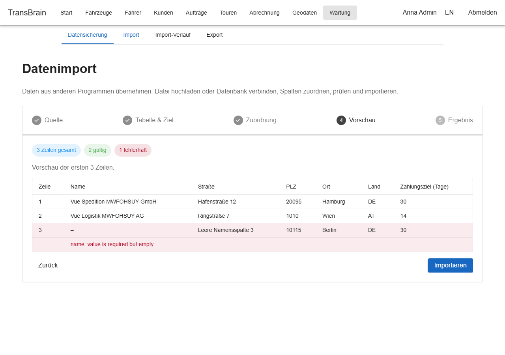

### Schritt 5: Ausführen und Ergebnis

**Importieren** legt die Datensätze zeilenweise an — über dieselbe Logik wie das manuelle
Anlegen, einschließlich Duplikatprüfung (ein bereits vorhandenes Kennzeichen lehnt die
Zeile ab, nicht den ganzen Import). Fehlerhafte Zeilen werden übersprungen und am Ende mit
Zeilennummer und Begründung aufgelistet (höchstens die ersten 100); alle übrigen Zeilen sind
dann bereits importiert. Das Ergebnis zeigt den Status der Sitzung: **Completed** (alles
importiert), **CompletedWithErrors** (teilweise) oder **Failed** (keine Zeile). Ein erneutes
Ausführen derselben Sitzung — etwa mit nachgebesserter Zuordnung oder anderem Ziel — ist
möglich. Dabei schützt nur die Duplikatprüfung des Ziels vor Doppelanlagen — bei Fahrzeugen
das Kennzeichen; Kunden und Fahrer haben kein solches Merkmal und würden erneut angelegt.

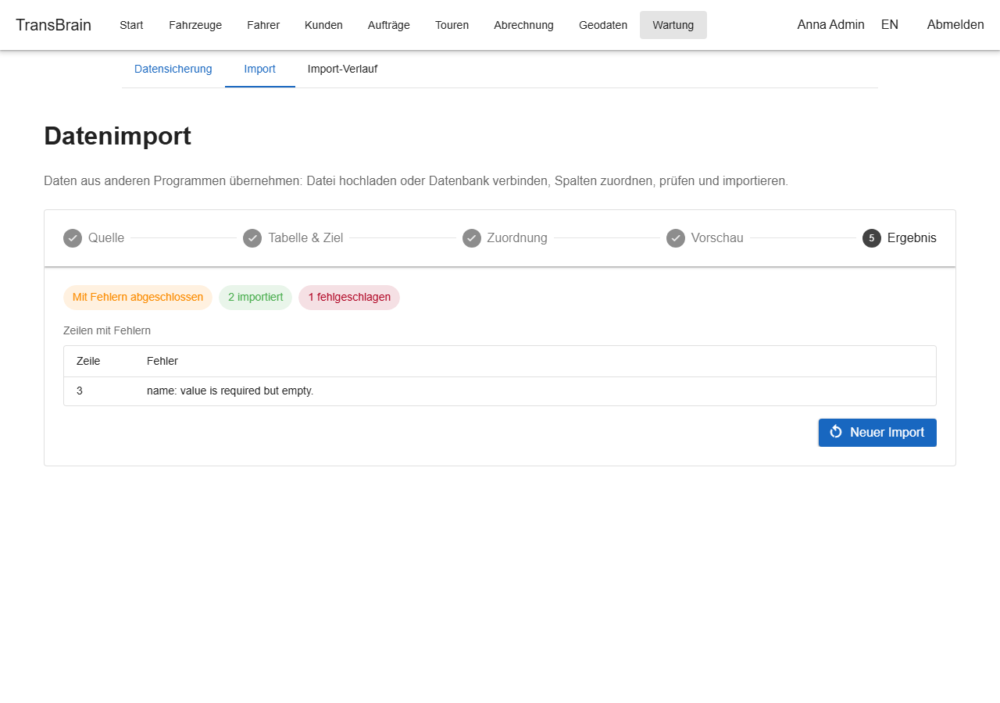

### Verlauf

Der Reiter **Import-Verlauf** (in der Reiterleiste des Wartungsbereichs neben **Import**)
listet alle Import-Sitzungen des gewählten Mandanten, neueste zuerst: Quelle,
Status, Ziel, Anzahl importiert/fehlerhaft, wer sie wann angelegt hat. **Löschen** entfernt
eine Sitzung samt der eingelesenen Daten endgültig (mit Sicherheitsabfrage); die bereits
importierten Datensätze bleiben selbstverständlich bestehen.

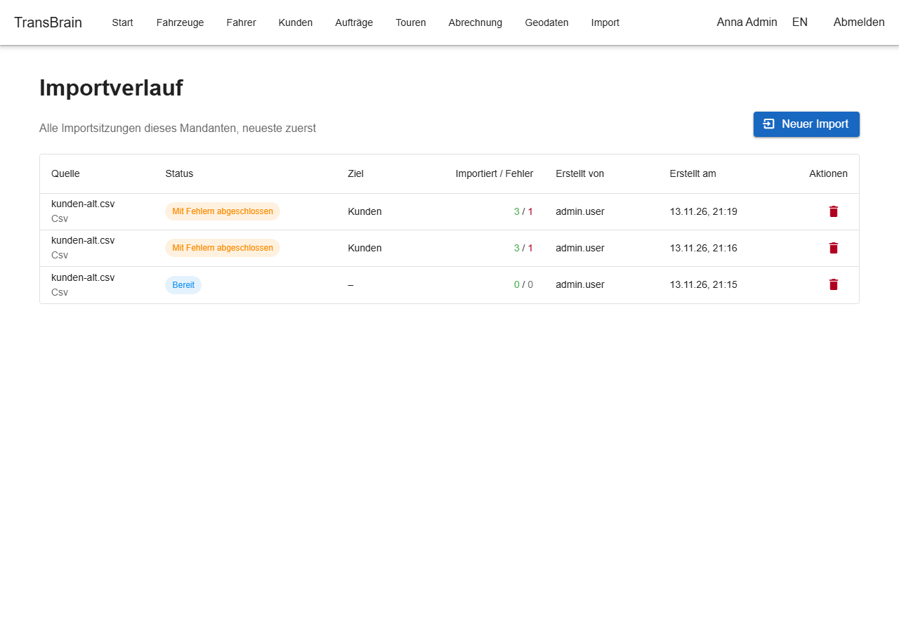

### Grenzen

- Datei höchstens 25 MB; je Quelle höchstens 100 Tabellen, 256 Spalten, 50.000 Zeilen je
  Tabelle, 4.000 Zeichen je Zelle.
- Importiert werden Stammdaten: Kunden, Fahrer, Fahrzeuge. Aufträge, Touren und Rechnungen
  sind bewusst nicht importierbar.
- Access-Dateien benötigen auf dem **Server** einen ODBC-Treiber für Access.
- Die eingelesenen Daten gehören zum gewählten Mandanten; ein anderer Mandant sieht
  weder die Sitzungen noch die importierten Datensätze.

## Datenexport

Der Datenexport ist das Gegenstück zum Datenimport und ebenfalls Teil des globalen
Wartungsbereichs: Menüpunkt **Wartung**, Reiter **Export** (`/maintenance/export`, nur Rolle
`system-admin`; zuvor den Mandanten wählen). Er lädt
einen Stammdatenbereich vollständig als Datei herunter — etwa um Daten in Excel zu prüfen,
weiterzugeben oder in einen anderen Mandanten zu übernehmen (dazu nach dem Export einfach den
gewählten Mandanten wechseln und die Datei über den Reiter **Import** einspielen).

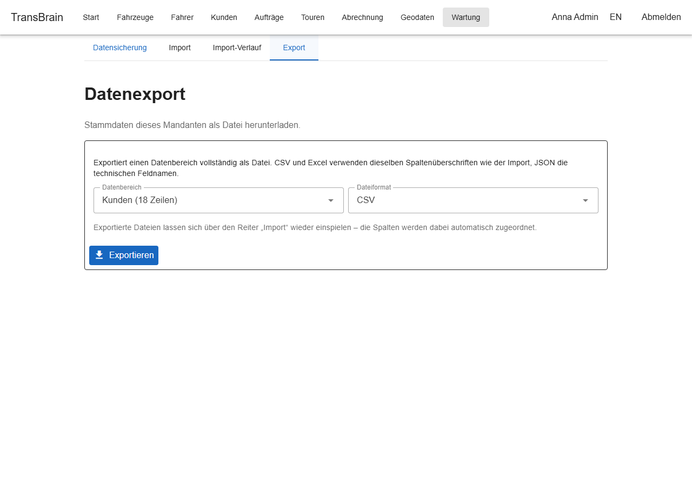

So gehen Sie vor:

1. **Datenbereich** wählen: **Kunden**, **Fahrer** oder **Fahrzeuge**. Jeder Eintrag zeigt
   die aktuelle Zeilenzahl an.
2. **Dateiformat** wählen: **CSV** (Semikolon-getrennt, UTF-8), **Excel (XLSX)** oder
   **JSON**.
3. **Exportieren** lädt die Datei herunter
   (`transbrain-export-<bereich>-<datum>-<uhrzeit>.<endung>`).

Die Spalten entsprechen genau den Feldern des Imports: CSV- und Excel-Dateien tragen die
deutschen Spaltenüberschriften des Import-Assistenten (z. B. **Name**, **Straße**, **PLZ**),
JSON-Dateien die technischen Feldnamen. Eine exportierte Datei lässt sich deshalb über den
Reiter **Import** unverändert wieder einspielen — die Spalten werden dort automatisch
zugeordnet. Beim Wieder-Einspielen gelten die üblichen Import-Regeln; insbesondere lehnt die
Duplikatprüfung Datensätze ab, die es im Mandanten bereits gibt (z. B. einen Kunden mit
demselben Namen).

Exportiert werden Stammdaten: Kunden, Fahrer, Fahrzeuge. Aufträge, Touren und Rechnungen sind
— wie beim Import — bewusst nicht enthalten. Die Datei enthält ausschließlich Daten des
gewählten Mandanten.

## Wartung (globaler Systembereich)

Erreichbar über den Menüpunkt **Wartung** (`/maintenance`). Der Wartungsbereich bündelt die
mandantenübergreifenden System-Werkzeuge unter einer Reiterleiste: **Datensicherung** (dieser
Abschnitt), **Import** und **Import-Verlauf** (Abschnitt „Datenimport“) sowie **Export**
(Abschnitt „Datenexport“). Menüpunkt und Seiten stehen ausschließlich der Rolle
**`system-admin`** zur Verfügung — einem technischen Systemverwalter, der selbst **keinem
Mandanten angehört**. Alle anderen Rollen (auch `admin`) werden zur Startseite umgeleitet,
und die API lehnt ihre Anfragen ab.

### Mandant auswählen

Da ein System-Administrator keinen eigenen Mandanten hat, verlangt die Seite als Erstes die
Wahl des Mandanten, dessen Daten gewartet werden sollen:

- **Auswahlliste**: alle Mandanten, die bereits Daten besitzen, mit ihrer Gesamtzeilenzahl.
- **Manuelle Eingabe**: eine Mandanten-ID (GUID) lässt sich auch direkt eintippen und mit
  **Übernehmen** aktivieren — etwa für einen neuen, noch leeren Mandanten, in den eine
  Sicherung oder ein Import eingespielt werden soll.

Erst nach der Wahl erscheinen die Werkzeug-Reiter; jede Aktion wirkt ausschließlich auf den
gewählten Mandanten, der oberhalb der Reiter angezeigt wird. Die Wahl gilt für die laufende
Browser-Sitzung; eine neue Anmeldung beginnt neutral.

### Datensicherung

Der Reiter **Datensicherung** sichert und wiederherstellt die Daten **des gewählten
Mandanten**: Fahrzeuge samt
Katalogen und Dokumenten, Fahrer, Kunden mit Standorten, Aufträge, Touren, Rechnungen,
manuelle Geo-Koordinaten sowie die Nummernkreise für Auftrags- und Rechnungsnummern. Daten
anderer Mandanten sind in der Sicherung nicht enthalten und werden bei einer Wiederherstellung
nicht berührt.

### Sicherung erstellen

Die Karte **„Create backup"** lädt mit **„Download backup"** den kompletten Datenbestand des
gewählten Mandanten als eine JSON-Datei herunter (`transbrain-backup-<Datum>-<Uhrzeit>.json`). Die Datei
ist an den Mandanten und an den Datenbankstand gebunden, unter dem sie erstellt wurde.
Bewahren Sie sie an einem sicheren Ort auf — sie enthält alle Geschäftsdaten.

### Sicherung wiederherstellen

Die Karte **„Restore backup"** spielt eine zuvor erstellte Sicherungsdatei zurück:

1. Im Dateifeld **„Choose backup file"** die JSON-Datei auswählen. Die Seite zeigt dann, wann
   die Sicherung erstellt wurde und wie viele Tabellen sie enthält. Eine Datei, die keine
   TransBrain-Sicherung ist, wird bereits hier abgelehnt („The file is not a TransBrain
   backup.").
2. Den Warnhinweis lesen und das Bestätigungsfeld **„I understand that the current data will
   be replaced."** ankreuzen — ohne Haken bleibt die Schaltfläche gesperrt.
3. **„Restore now"** startet die Wiederherstellung.

**Die Wiederherstellung ersetzt alle aktuellen Daten des gewählten Mandanten unwiderruflich**
durch den
Stand aus der Datei. Sie läuft vollständig oder gar nicht: Schlägt ein Schritt fehl, bleibt
der bisherige Datenbestand unverändert erhalten („The restore failed. No data has been
changed."). Nach Erfolg zeigt eine Tabelle je Datenbanktabelle die Zahl der geschriebenen
Zeilen. Auftrags- und Rechnungsnummern zählen anschließend dort weiter, wo die Sicherung
aufgehört hat — es entstehen keine doppelten Nummern.

Zwei Dateien werden mit einer Fehlermeldung abgewiesen:

- Eine Sicherung **eines anderen Mandanten** („The backup belongs to a different
  tenant …"). Eine Sicherung lässt sich nur in den Mandanten zurückspielen, aus dem sie
  stammt — wählen Sie dazu oben den passenden Mandanten aus.
- Eine Sicherung, die unter einem **anderen Datenbankstand** erstellt wurde („The backup was
  taken on database schema …"), etwa vor einem Software-Update. Spielen Sie
  solche Sicherungen in eine Installation mit passendem Stand zurück und erstellen Sie nach
  jedem Update eine frische Sicherung.

## Rollen und Rechte

Die Anmeldung erfolgt über Keycloak mit genau einer der Rollen `admin`,
`disponent`, `fahrer`, `viewer` oder `system-admin`.

| Rolle       | Ansehen          | Fahrzeuge/Fahrer/Kunden pflegen | Aufträge pflegen | Touren planen | Tour starten/abschließen | Rechnungen pflegen |
|-------------|------------------|:------------------------:|:----------------:|:-------------:|:------------------------:|:------------------:|
| `admin`     | alles            | ja                       | ja               | ja            | ja                       | ja                 |
| `disponent` | alles            | **nein**                 | **ja**           | **ja**        | **ja**                   | **ja**             |
| `fahrer`    | **nur eigene Touren** | **nein**            | **nein**         | **nein**      | **nur eigene**           | **nein**           |
| `viewer`    | alles            | **nein**                 | **nein**         | **nein**      | **nein**                 | **nein**           |

**Aufträge, Touren und Rechnungen sind die Ausnahme von der Regel „nur `admin` darf
schreiben“.** Ein Disponent darf Aufträge und Rechnungen anlegen, ändern beziehungsweise deren
Statusschritte auslösen und Touren planen — das ist genau seine Aufgabe. Bei Fahrzeugen, Fahrern
und Kunden (Stammdaten) darf er weiterhin nur lesen.

**Der Fahrer ist die zweite Ausnahme:** Er darf nichts anlegen, aber seine eigenen Touren starten
und abschließen — siehe Abschnitt „Touren als Fahrer“.

**`system-admin` ist keine Mandanten-Rolle:** Der Systemverwalter gehört keinem Mandanten an
und taucht deshalb in der Tabelle nicht auf. Er sieht ausschließlich den globalen
Wartungsbereich (Datensicherung, Import, Export — Abschnitt „Wartung“) und wählt dort je
Vorgang den Mandanten, auf den er wirkt; die fachlichen Bereiche (Fahrzeuge, Aufträge,
Touren …) stehen ihm nicht zur Verfügung.

**Die Oberfläche bietet nur an, was Ihre Rolle auch darf.** Die Schaltflächen
„Add vehicle“/„Add driver“/„Add customer“, „Edit“ und „Delete“ erscheinen ausschließlich für die Rolle
`admin`; „New order“, „Edit“, „Cancel order“ und „Plan tour“ sowie „Rechnung erstellen“,
„Ausstellen“, „Als bezahlt markieren“ und „Stornieren“ (Abrechnung) nur für `admin` und
`disponent`; „Start tour“ und „Complete tour“ für `admin`, `disponent` und `fahrer`. Der
Menüpunkt **Geodata** und die Änderungen der Geodaten-Wartung („Add coordinates“,
„Set coordinates“, „Remove manual coordinates“) sind ebenfalls `admin` vorbehalten. Der
Menüpunkt **Maintenance** — mit der Mandantenwahl und den Reitern **Backup & restore**
(Datensicherung), **Import** und **Import history** (Datenimport) sowie **Export**
(Datenexport) — ist zur Gänze — einschließlich des
Ansehens — `system-admin` vorbehalten. Wer eine Schaltfläche nicht sieht, dürfte sie ohnehin nicht benutzen.

Das **Lesen** ist davon unberührt: alle vier Mandanten-Rollen dürfen alle Listen ansehen, mit der
einen Ausnahme, dass ein Fahrer in der Tourenliste nur seine eigenen Touren sieht. Die
Navigation blendet für einen Fahrer die Bereiche Fahrzeuge, Fahrer, Kunden, Aufträge und
Abrechnung aus, weil er sie für seine Arbeit nicht braucht — über die Adresszeile bleiben sie
erreichbar.

Sollten Sie dennoch eine Ablehnung mit `HTTP 403` sehen, ist das kein Bedienfehler: Es
bedeutet, dass sich Ihre Rechte seit dem Laden der Seite geändert haben. Ein Neuladen zeigt
dann die passende Oberfläche.

## Bekannte Einschränkungen (Zusammenfassung)

- Die Kennzahlen und Arbeitslisten der Startseite werden beim Öffnen einmal geladen; sie
  aktualisieren sich nicht von selbst, solange die Seite offen bleibt.
- Das Entfernen eines Auftrags von einer Tour erfolgt sofort, ohne Sicherheitsabfrage; das
  Löschen von Stammdaten und das Stornieren eines Auftrags fragen dagegen nach.
- Suche und Sortierung wirken nur auf die geladenen Einträge (siehe unten).
- In der Auftragsliste lässt sich nur nach Status filtern und suchen; die Filter nach
  Abholzeitraum, die die API anbietet, haben noch keine Bedienelemente.
- Eine Tour lässt sich nach dem Anlegen weder umplanen noch löschen. Eine falsch geplante Tour
  bleibt als leere Tour stehen, nachdem ihre Aufträge entfernt wurden — und belegt Fahrzeug und
  Fahrer für diesen Tag weiter.
- Eine Rechnung lässt sich nach dem Anlegen nicht bearbeiten — der Korrekturweg ist Stornieren
  und Neuanlegen. Eine bezahlte Rechnung lässt sich auch nicht mehr stornieren; eine Gutschrift
  gibt es noch nicht. PDF und XRechnung werden nur heruntergeladen — einen automatischen
  Versand (z. B. per E-Mail) aus dem System heraus gibt es nicht.
- Die Listen zeigen bis zu 100 Einträge und haben keine Blätterfunktion; darüber hinaus sind
  ältere Einträge nicht erreichbar.
