# Bedienung TransBrain.Web (Angular)

Diese Anleitung beschreibt die Angular-Oberfläche von TransBrain (`src/TransBrain.Web`).
Die zweite Oberfläche, TransBrain.VueWeb, bietet denselben Funktionsumfang gegen dieselbe
API — siehe `docs/BEDIENUNG_TRANSBRAIN_VUEWEB.md`.

Die Beschriftungen der Oberfläche selbst (Schaltflächen, Feldnamen, Fehlermeldungen) sind
auf Englisch, da die Anwendung noch nicht lokalisiert ist. Diese Anleitung ist auf Deutsch
verfasst, nennt aber die tatsächlichen englischen Beschriftungen, damit sie zu dem passt,
was auf dem Bildschirm zu sehen ist.

> **Achtung — Entwicklungsumgebung, keine Daten bleiben erhalten:** Bei jedem Neustart
> von `dotnet run --project src/TransBrain.AppHost` beginnt die Anwendung mit einer
> **leeren Datenbank**. Postgres und Keycloak haben in dieser Umgebung absichtlich kein
> dauerhaftes Datenlaufwerk — Postgres führt bei jedem Start alle Migrationen neu von
> Grund auf aus, und Keycloak importiert die Realm-Konfiguration erneut aus der Datei.
> Das macht jeden Start reproduzierbar, bedeutet aber auch: **Jedes Fahrzeug, jeder
> Fahrer und jede Änderung, die Sie über die Keycloak-Verwaltungskonsole vornehmen, geht
> beim nächsten Neustart verloren.** Tragen Sie hier keine Daten ein, auf deren
> Fortbestand Sie sich verlassen — das gilt auch für eine ganze Vormittagsarbeit an
> Stammdaten.

## Voraussetzungen

- Der gesamte Stack läuft (`dotnet run --project src/TransBrain.AppHost`), siehe
  README.md.
- Ein gültiges Benutzerkonto in Keycloak. Für die lokale Entwicklung siehe die
  Testbenutzer in README.md, Abschnitt „Test users“ — je einer pro Rolle
  (`admin`, `disponent`, `fahrer`, `viewer`).
- Die Anwendung ist unter `http://localhost:4200` erreichbar (Port siehe Aspire-Dashboard,
  falls abweichend).

## Sprache

Die Oberfläche ist auf **Deutsch** (Standard) und **Englisch** verfügbar. Die Umschaltung
erfolgt über die Schaltfläche **„EN“** bzw. **„DE“** in der Kopfleiste; sie ist auch vor der
Anmeldung sichtbar. Die gewählte Sprache wird im Browser gespeichert und gilt bei jedem
weiteren Besuch auf diesem Gerät. Andere Browser oder Geräte beginnen wieder mit Deutsch.

> Hinweis: Die Screenshots in dieser Anleitung zeigen noch die englische Oberfläche.

## Anmeldung

1. `http://localhost:4200` im Browser öffnen.
2. Ohne aktive Sitzung zeigt die Seite nur eine Schaltfläche **„Sign in“**. Es gibt keine
   Fahrzeug- oder Fahrerliste zu sehen, bevor eine Anmeldung stattgefunden hat.
3. Klick auf „Sign in“ leitet zur Keycloak-Anmeldeseite weiter (Benutzername/Passwort).
4. Nach erfolgreicher Anmeldung erfolgt die Rückleitung zu TransBrain.Web, und die
   **Startseite** wird angezeigt — siehe das gleichnamige Kapitel unten.
5. Schlägt die Anmeldung fehl oder ist Keycloak nicht erreichbar, erscheint die Meldung
   „Der Anmeldestatus konnte nicht geprüft werden. Bitte erneut anmelden.“ (auf Englisch: „Could not verify your sign-in status. Please try signing in again.“)

**Hinweis für die Fehlersuche:** Wenn die Anmeldung überhaupt nicht bis zur
Keycloak-Login-Seite kommt, ist meist das lokale HTTPS-Entwicklungszertifikat nicht als
vertrauenswürdig hinterlegt — siehe README.md, Abschnitt „Trust the development HTTPS
certificate“.

## Startseite

Nach der Anmeldung landen Sie auf der Startseite. Sie zeigt genau die Bereiche und
Schaltflächen, die Ihre Rolle benötigt — eine Fahrerin sieht dort etwas anderes als ein
Administrator. Über die Kopfleiste erreichen Sie dieselben Bereiche jederzeit wieder; ganz
rechts stehen Ihr Name und die Schaltfläche **„Sign out"** zum Abmelden.

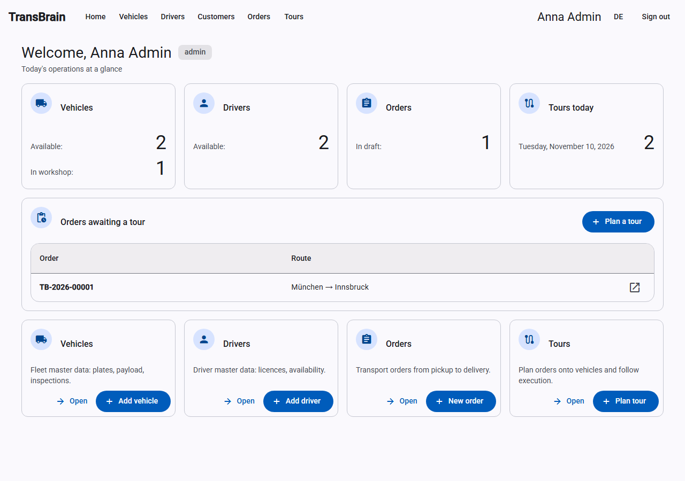

Der obere Bereich zeigt Kennzahlen, darunter folgen die Arbeitslisten und ganz unten die
Kacheln, über die Sie in die einzelnen Bereiche springen. Welche Rolle was sieht:

| Bestandteil | admin | disponent | fahrer | viewer |
|---|:-:|:-:|:-:|:-:|
| Kennzahlen zu Fahrzeugen und Fahrern | ✓ | ✓ | | ✓ |
| Kennzahl „Orders in draft" (ungeplante Aufträge) | ✓ | ✓ | | ✓ |
| Kennzahl „Tours today" | ✓ | ✓ | ✓ (eigene) | ✓ |
| Liste „Orders awaiting a tour" mit **„Plan a tour"** | ✓ | ✓ | | |
| Liste „My tours today" mit **„Start tour"** / **„Complete tour"** | | | ✓ | |
| Kacheln Vehicles, Drivers, Orders | ✓ | ✓ | | ✓ |
| Kachel Tours | ✓ | ✓ | ✓ | ✓ |
| Schaltflächen **„Add vehicle"** / **„Add driver"** | ✓ | | | |
| Schaltflächen **„New order"** / **„Plan tour"** | ✓ | ✓ | | |

Für eine Fahrerin ist die Seite bewusst schmal gehalten, damit sie auf einem Mobiltelefon
im Fahrerhaus bedienbar bleibt. Sie zeigt nur die eigenen Touren des Tages und erlaubt es,
sie direkt zu starten und abzuschließen, ohne den Umweg über die Tourenliste. Bei geringer
Bildschirmbreite blendet die Kopfleiste den Namen aus, damit die Navigation Platz behält.

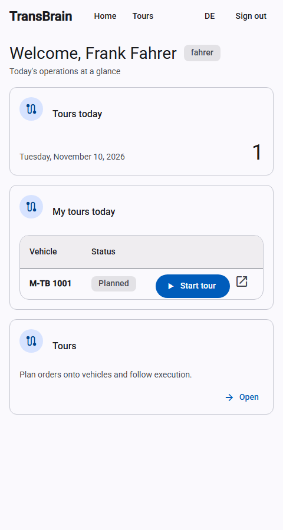

**Wichtig — der Unterschied zwischen „ausgeblendet" und „verboten":** Dass eine Kachel
fehlt, heißt nicht, dass Ihnen der Bereich verwehrt wäre. Alle vier Rollen dürfen alle
Listen lesen; ausgeblendet wird, was Ihre Rolle für ihre Arbeit nicht braucht. Geben Sie
etwa als Fahrerin `/vehicles` von Hand in die Adresszeile ein, sehen Sie die Fahrzeugliste.
Anders bei den Schaltflächen zum Anlegen, Ändern und Löschen: Die erscheinen nur, wenn Sie
die Änderung auch tatsächlich vornehmen dürfen. Rufen Sie ein Formular über die Adresszeile
auf, für das Ihnen die Berechtigung fehlt, bringt die Anwendung Sie zur Startseite zurück.

## Fahrzeugliste

Erreichbar über `/vehicles`, den Menüpunkt **Vehicles** oder die Kachel **Vehicles** auf der
Startseite. Hier pflegen Sie die Stammdaten des Fuhrparks.

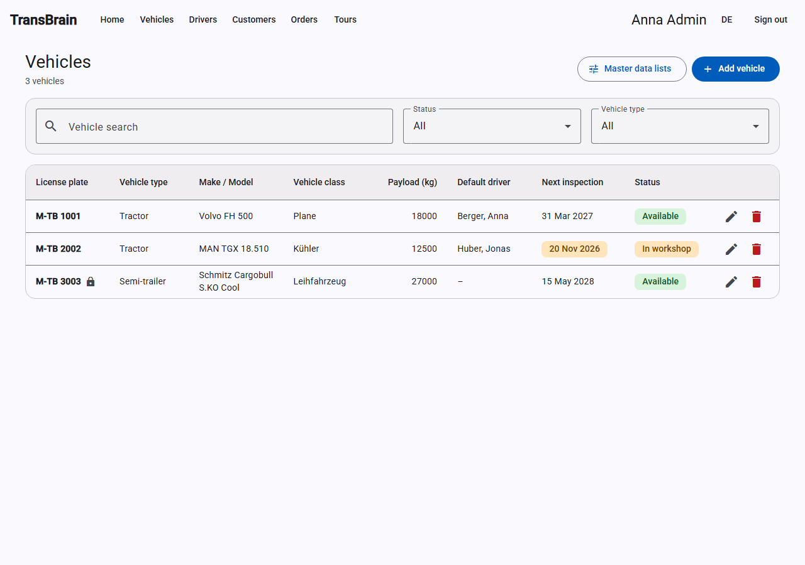

- Unter der Überschrift steht die Anzahl der geladenen Fahrzeuge (z. B. „3 vehicles“).
- **Filterleiste:**
  - **Vehicle search** sucht ohne Beachtung der Groß-/Kleinschreibung in Kennzeichen,
    Marke, Typbezeichnung, Fahrgestellnummer und Frächtergruppe (Code und Bezeichnung).
  - **Status** und **Vehicle type** schränken die Liste auf einen Status bzw. eine
    Fahrzeugart ein („All“ hebt den Filter auf).
  - Alle Filter wirken sofort und lassen sich kombinieren. Passt kein Fahrzeug, erscheint
    „No vehicles found.“
- **Spalten:** License plate, Vehicle type, Make / Model, Vehicle class, Payload (kg),
  Default driver, Next inspection, Status. Die Spalte Vehicle class zeigt die Bezeichnung aus\n  den Fahrzeug-Stammdaten. Ein Klick auf eine Spaltenüberschrift sortiert
  auf- bzw. absteigend.
- **Markierungen:**
  - Ein **Schloss** neben dem Kennzeichen bedeutet „Kennzeichen geheim“.
  - Das Datum der nächsten Untersuchung ist **rot** hinterlegt, wenn sie überfällig ist,
    und **gelb**, wenn sie in den nächsten 30 Tagen fällig wird.
  - Der Status erscheint als farbiger Chip: Available (grün), In workshop (orange),
    Decommissioned (grau).
- **„Master data lists“** oben rechts (für alle Benutzer) öffnet die
  [Fahrzeug-Stammdaten](#fahrzeug-stammdaten).
- **Aktionen** (nur für Administratoren sichtbar):
  - **„Add vehicle“** oben rechts legt ein neues Fahrzeug an.
  - Pro Zeile öffnet das **Stift-Symbol** das Fahrzeug zum Bearbeiten.
  - Das **Papierkorb-Symbol** löscht das Fahrzeug erst nach einer Sicherheitsabfrage
    („Do you really want to delete vehicle …?“, **„Delete“** / **„Cancel“**).
- Die Liste lädt bis zu 100 Fahrzeuge; Suche, Filter und Sortierung arbeiten auf diesen
  geladenen Einträgen.

## Fahrzeugformular (Anlegen / Bearbeiten)

Erreichbar über „Add vehicle“ (neu, `/vehicles/new`) oder das Stift-Symbol in der Liste
(`/vehicles/{id}`). Das Formular ist in zehn Bereiche gegliedert, auf breiten Bildschirmen
in zwei Spalten.

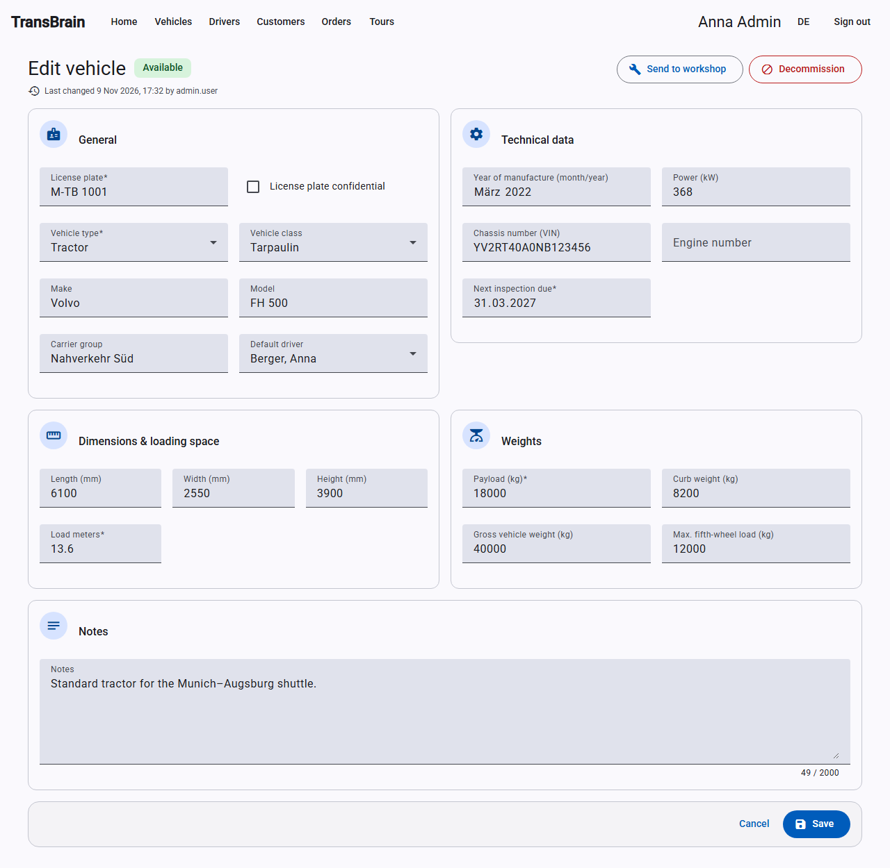

Alle Felder außer den mit * markierten Pflichtfeldern sind optional. Zahlenfelder müssen,
wenn sie ausgefüllt sind, größer als 0 sein; nur die Anzahlen im Bereich Equipment
dürfen auch 0 sein, ebenso Anschaffungspreis und Kilometerstand bei Anschaffung.

| Bereich | Feld (Beschriftung) | Bedeutung | Pflicht | Regeln |
|---|---|---|:---:|---|
| General | License plate | Kennzeichen | ja | eindeutig, max. 15 Zeichen |
| General | License plate confidential | Kennzeichen geheim | – | Häkchen; Schloss-Symbol in der Liste |
| General | Vehicle type | Fahrzeugart | ja | Tractor (Zugmaschine), Semi-trailer (Hänger (Sattel)) |
| General | Vehicle class | Aufbau / Fahrzeugklasse | – | Auswahl aus den aktiven Fahrzeugklassen der [Fahrzeug-Stammdaten](#fahrzeug-stammdaten) oder „–“ |
| General | Make / Model | Marke / Typbezeichnung | – | je max. 100 Zeichen |
| General | Carrier group | Frächtergruppe | – | Auswahl aus den aktiven Frächtergruppen der [Fahrzeug-Stammdaten](#fahrzeug-stammdaten) oder „–“ |
| General | Default driver | Stammfahrer | – | Auswahl aus der Fahrerliste oder „No default driver“ |
| Technical data | Year of manufacture (month/year) | Baujahr, monatsgenau | – | ab 1900 |
| Technical data | Power (kW) | Motorleistung | – | 1–2000 |
| Technical data | Chassis number (VIN) | Fahrgestellnummer | – | max. 30 Zeichen, wird in Großbuchstaben gespeichert |
| Technical data | Engine number | Motornummer | – | max. 30 Zeichen |
| Technical data | Next inspection due | nächste Untersuchung | ja | Datum |
| Dimensions & loading space | Length / Width / Height (mm) | Außenmaße | – | Länge 1–30000, Breite und Höhe 1–5000 |
| Dimensions & loading space | Load meters | Lademeter | ja | größer als 0 |
| Weights | Payload (kg) | Nutzlast | ja | größer als 0 |
| Weights | Curb weight (kg) | Eigengewicht | – | 1–100000 |
| Weights | Gross vehicle weight (kg) | zulässiges Gesamtgewicht | – | 1–100000, muss größer als das Eigengewicht sein |
| Weights | Max. fifth-wheel load (kg) | höchstzulässige Sattellast | – | 1–100000 |
| Equipment – Body & features | Partition wall, Pallet basket, Dangerous goods equipment, Dangerous goods approved (ADR), Lift axle, Double deck, Double-deck beams, Small ladder, Large ladder | Trennwand, Palettenkorb, Gefahrgutausrüstung, Gefahrguttauglich (ADR), Liftachse, Doppelstock, Doppelstockbalken, kleine / große Leiter | – | Häkchen |
| Equipment – Loading space & tank | Interior length / width / height (mm) | Innenmaße des Laderaums | – | Länge 1–30000, Breite und Höhe 1–5000 |
| Equipment – Loading space & tank | Tank volume (l) | Tankvolumen in Litern | – | 1–100000 |
| Equipment – Load securing | Support poles, Load bars, Lashing straps, Chain tensioners, Pallets | Anzahl Stützstangen, Spannlatten, Spanngurte, Kettenspanner, Paletten | – | ganze Zahl 0–999 |
| Equipment – Marble racks | Number of marble racks | Anzahl Marmorböcke | – | ganze Zahl 0–999 |
| Equipment – Marble racks | Material | Art der Marmorböcke | – | Auswahl „Not specified“ (keine Angabe), „Steel“ (Stahl) oder „Aluminium“ (Alu) |
| Commercial data | Purchase price (EUR) | Anschaffungspreis in Euro | – | 0–10000000, höchstens 2 Nachkommastellen |
| Commercial data | Purchase date | Anschaffungsdatum | – | ab 1900 |
| Commercial data | Odometer at purchase (km) | Kilometerstand bei Anschaffung | – | ganze Zahl 0–9999999 |
| Commercial data | First registration | Erstzulassung (Datum, unabhängig vom Baujahr) | – | ab 1900 |
| Commercial data | Useful life (years) / Useful life (km) | geplante Nutzungsdauer | – | Jahre 1–50, km 1–9999999 |
| Commercial data | Cost center | Kostenstelle | – | max. 30 Zeichen |
| Insurance – Vehicle insurance | Insurance company | Versicherungsgesellschaft der Fahrzeugversicherung | – | Auswahl aus den aktiven Versicherungen der [Fahrzeug-Stammdaten](#fahrzeug-stammdaten) oder „–“ |
| Insurance – Vehicle insurance | Policy numbers | Polizzennummern | – | max. 500 Zeichen, mehrere Zeilen erlaubt |
| Insurance – Transport insurance | Insurance company / Policy numbers | Versicherung und Polizzennummern der Transportversicherung | – | wie bei der Fahrzeugversicherung |
| Notes | Notes | Bemerkungen | – | max. 2000 Zeichen, mit Zeichenzähler |
| Data sheet | Data sheet | Datenblatt (freier Text, z. B. technische Daten des Herstellers) | – | max. 10000 Zeichen, mit Zeichenzähler |

Alle Gewichte werden in **Kilogramm** erfasst, alle Maße in **Millimetern**.

**Ausstattung (Equipment):** Der Bereich über die volle Breite erfasst die Ausstattung des
Fahrzeugs in vier Gruppen. Bei den Anzahlen bedeutet ein **leeres Feld „nicht erfasst“**,
**0 „keine vorhanden“**. Ein neues Fahrzeug startet ohne Häkchen, mit leeren Feldern und dem
Material „Not specified“. Beim Speichern wird die Ausstattung immer vollständig übernommen:
ein entferntes Häkchen oder ein geleertes Feld ist danach auch gespeichert leer. Die
Fahrzeugliste zeigt die Ausstattung nicht an.

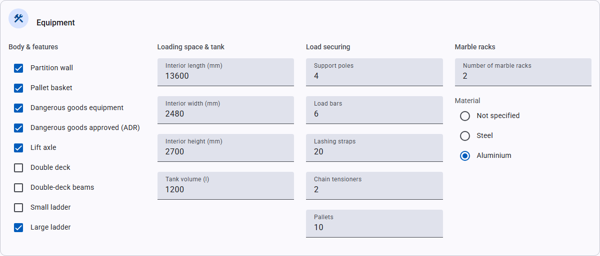

**Kaufmännische Daten und Versicherungen (Commercial data, Insurance):** Zwei Bereiche
nebeneinander erfassen Anschaffung, Nutzungsdauer und Kostenstelle sowie je eine
Versicherungsgesellschaft mit ihren Polizzennummern für Fahrzeug- und Transportversicherung.
Mehrere Polizzennummern schreiben Sie untereinander in das Feld. Die Versicherungen pflegen
Sie in den [Fahrzeug-Stammdaten](#fahrzeug-stammdaten); dort ist die Liste anfangs leer. Wie
bei der Ausstattung wird beim Speichern immer alles übernommen: ein geleertes Feld ist danach
auch gespeichert leer.

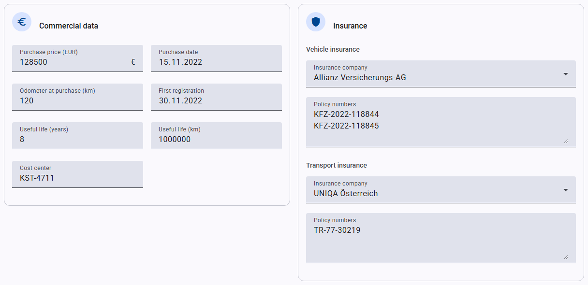

**Datenblatt (Data sheet):** Der letzte Bereich nimmt freien Text auf, z. B. das technische
Datenblatt des Herstellers. Der Text wird in Festbreitenschrift und **ohne automatischen
Zeilenumbruch** angezeigt (bei langen Zeilen erscheint eine horizontale Bildlaufleiste) und
genau so gespeichert, wie er eingegeben wurde – Leerzeichen am Zeilenanfang bleiben erhalten,
damit ausgerichtete Spalten ausgerichtet bleiben.

**Status ändern** (nur beim Bearbeiten, nur Administratoren): Neben der Überschrift zeigt ein
Chip den aktuellen Status. Die Schaltflächen daneben ändern ihn **sofort**, ohne „Save“:

| Aktueller Status | Schaltflächen |
|---|---|
| Available | **„Send to workshop“**, **„Decommission“** |
| In workshop | **„Return to service“**, **„Decommission“** |
| Decommissioned | keine — Hinweis „Decommissioned vehicles cannot be reactivated.“ |

„Decommission“ fragt vorher nach („Do you really want to decommission vehicle …? This cannot
be undone.“). Ein ausgemustertes Fahrzeug bleibt ausgemustert. Fahrzeuge in der Werkstatt
oder ausgemusterte Fahrzeuge lassen sich keiner Tour zuordnen.

**Änderungsvermerk:** Beim Bearbeiten steht unter der Überschrift „Last changed {Datum, Uhrzeit}
by {Benutzer}“. Jedes Speichern und jede Statusänderung aktualisiert ihn.

- **„Save“** in der Aktionsleiste am unteren Rand speichert; bei Erfolg erfolgt die Rückkehr
  zur Liste. **„Cancel“** verwirft die Eingabe und kehrt ohne Speichern zur Liste zurück.
- Ein leer gelassenes Pflichtfeld zeigt nach einem Speicherversuch direkt unter dem Feld
  „This field is required.“
- Lehnt die API die Eingabe ab, erscheint ihre Fehlermeldung direkt unter dem betroffenen
  Feld, z. B. bei einem bereits vergebenen Kennzeichen (HTTP 409) oder einem Gesamtgewicht,
  das nicht über dem Eigengewicht liegt. Fehler ohne Feldbezug (z. B. ein zwischenzeitlich
  gelöschter Stammfahrer) erscheinen als Meldung oberhalb des Formulars.
- Ein Ladefehler beim Öffnen zum Bearbeiten (z. B. wenn das Fahrzeug zwischenzeitlich
  gelöscht wurde) erscheint als Meldung oberhalb des Formulars.
- Wird ein Fahrer gelöscht, der als Stammfahrer eingetragen ist, verlieren die betroffenen
  Fahrzeuge lediglich ihren Stammfahrer.

### Sonderpapiere (Special documents)

Der Bereich **Special documents** listet die Sonderpapiere und Prüfungen des Fahrzeugs, z. B.
ADR-Zulassungsbescheinigung, Tachographenprüfung oder UVV-Prüfung. Anders als die übrigen
Bereiche wird er **unabhängig von „Save“** gespeichert: jede Änderung im Dialog ist sofort
gespeichert. Bei einem neuen Fahrzeug steht dort nur der Hinweis „Save the vehicle first to
record special documents.“ – speichern Sie das Fahrzeug zuerst und öffnen Sie es dann erneut.

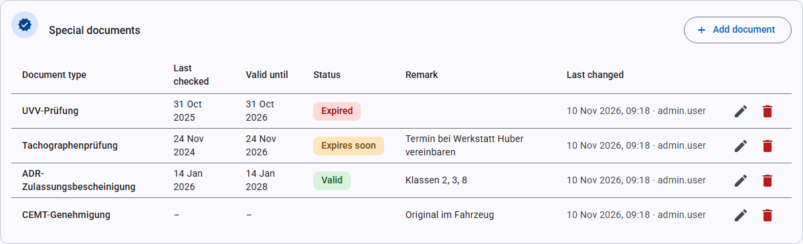

- **Spalten:** Art (Bezeichnung aus den Stammdaten), Last checked (letzte Prüfung), Valid until
  (gültig bis) mit Status, Remark (Bemerkung) und Last changed (Datum · Benutzer der letzten
  Änderung). Die Papiere sind nach Ablaufdatum sortiert, das nächste zuerst; Papiere ohne
  Ablaufdatum stehen am Ende.
- **Status** (nur wenn „Valid until“ gesetzt ist): **Expired** (rot, Datum liegt in der
  Vergangenheit), **Expires soon** (orange, läuft innerhalb der nächsten 30 Tage ab) oder
  **Valid** (grün).
- **„Add document“** (nur Administratoren) öffnet den Dialog „Add special document“:

  | Feld | Bedeutung | Pflicht | Regeln |
  |---|---|:---:|---|
  | Document type | Art des Sonderpapiers | ja | Auswahl aus den aktiven Sonderpapier-Arten der [Fahrzeug-Stammdaten](#fahrzeug-stammdaten); jede Art nur einmal je Fahrzeug |
  | Last checked | Datum der letzten Prüfung | – | ab 1900 |
  | Valid until | Ablaufdatum | – | ab 1900, nicht vor „Last checked“ |
  | Remark | Bemerkung | – | max. 500 Zeichen |

  Hat das Fahrzeug die gewählte Art schon, lehnt der Dialog das Speichern mit „This vehicle
  already has a '…' document.“ ab (HTTP 409) – bearbeiten Sie dann das vorhandene Papier.
- **Stift-Symbol:** öffnet dasselbe Formular zum Bearbeiten („Edit special document“), z. B. um
  nach einer neuen Prüfung die Daten zu verlängern.
- **Papierkorb-Symbol:** löscht das Sonderpapier nach einer Sicherheitsabfrage.
- Wird das Fahrzeug gelöscht, werden seine Sonderpapiere mitgelöscht.

## Fahrzeug-Stammdaten

Erreichbar über die Schaltfläche **„Master data lists“** oben in der Fahrzeugliste
(`/vehicle-catalog`). Hier pflegen Sie die Auswahllisten des Fahrzeugformulars.
Alle angemeldeten Benutzer sehen die Listen, ändern dürfen sie nur Administratoren.
**„Back to vehicles“** führt zurück zur Fahrzeugliste.

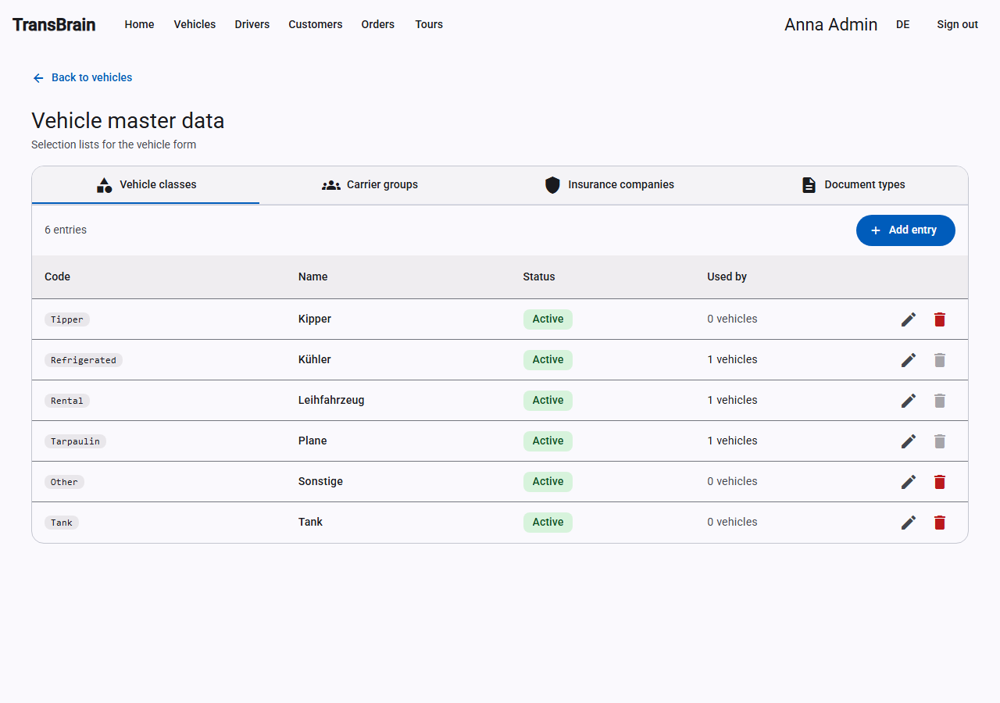

- **Reiter:** **Vehicle classes** (Fahrzeugklassen, z. B. Plane, Kühlkoffer, Tank),
  **Carrier groups** (Frächtergruppen), **Insurance companies** (Versicherungsgesellschaften
  für Fahrzeug- und Transportversicherung) und **Document types** (Sonderpapier-Arten). Beim
  ersten Start sind die bisherigen elf Fahrzeugklassen und sieben Sonderpapier-Arten (ADR,
  ATP, CEMT, Tachograph, UVV, Kran, Ladebordwand) bereits angelegt; Frächtergruppen und
  Versicherungen legen Sie selbst an.
- **Spalten:** Code, Name (Bezeichnung), Status (**Active** grün / **Inactive** grau) und
  **Used by** – wie viele Fahrzeuge den Eintrag gerade verwenden (bei Versicherungen als Fahrzeug-
  oder Transportversicherung, bei Sonderpapier-Arten mit einem Sonderpapier dieser Art).
- **„Add entry“** (nur Administratoren) öffnet den Dialog für einen neuen Eintrag:

  | Feld | Bedeutung | Pflicht | Regeln |
  |---|---|:---:|---|
  | Code | Schlüssel, der am Fahrzeug gespeichert wird | ja | max. 20 Zeichen, nur Buchstaben, Ziffern, `-` und `_`; je Liste eindeutig (ohne Beachtung der Groß-/Kleinschreibung); **später nicht änderbar** |
  | Name | Bezeichnung, die in Formular und Liste erscheint | ja | max. 100 Zeichen; wird in allen Sprachen so angezeigt, wie sie erfasst wurde |
  | Active | Eintrag wird im Fahrzeugformular angeboten | – | Häkchen, standardmäßig gesetzt |

  Ein bereits vergebener Code wird mit einer Meldung im Dialog abgelehnt (HTTP 409).
- **Stift-Symbol:** ändert Bezeichnung und Aktiv-Status; der Code ist nur lesbar. Eine
  geänderte Bezeichnung erscheint sofort bei allen Fahrzeugen, die den Eintrag verwenden.
- **Papierkorb-Symbol:** löscht den Eintrag nach einer Sicherheitsabfrage („Delete entry …?“).
  Solange Fahrzeuge den Eintrag verwenden, ist es gesperrt („In use – deactivate instead“).
- **Deaktivieren statt löschen:** Ein inaktiver Eintrag wird für neue Auswahlen nicht mehr
  angeboten. Fahrzeuge, die ihn bereits haben, behalten ihn; im Formular erscheint er dort
  mit dem Zusatz „(inactive)“ und kann beim Speichern beibehalten werden.

## Fahrerliste

Erreichbar über `/drivers` oder den Menüpunkt **Drivers**.

- Angezeigte Spalten: Last name (Nachname), First name (Vorname), License classes
  (Führerscheinklassen), Status.
- Schaltfläche **„Add driver“** legt einen neuen Fahrer an.
- Pro Zeile: **„Edit“** öffnet den Fahrer, **„Delete“** löscht ihn sofort, ohne
  Sicherheitsabfrage.
- Die Fahrerliste hat keine Such-, Filter- oder Sortiermöglichkeit.

## Fahrerformular (Anlegen / Bearbeiten)

Erreichbar über „Add driver“ (neu, `/drivers/new`) oder „Edit“ in der Liste
(`/drivers/{id}`).

| Feld (Beschriftung)  | Bedeutung                          | Pflichtfeld | Regeln                                   |
|----------------------|--------------------------------------|:-----------:|--------------------------------------------|
| First name           | Vorname                              | ja          | darf nicht leer sein                       |
| Last name            | Nachname                             | ja          | darf nicht leer sein                       |
| License classes      | Führerscheinklassen (Kontrollkästchen: B, C1, C, CE) | ja | mindestens eine Klasse muss ausgewählt sein |
| License valid until  | Gültig bis (Datum)                   | ja          | Datum                                      |

- Führerscheinklassen werden über Kontrollkästchen aus- bzw. abgewählt, nicht über ein
  Dropdown.
- **„Save“** und **„Cancel“** verhalten sich wie im Fahrzeugformular.
- Validierungsfehler (fehlende Pflichtfelder, keine Führerscheinklasse ausgewählt) und
  serverseitige Fehler werden auf dieselbe Weise wie im Fahrzeugformular direkt am
  betroffenen Feld angezeigt.

## Kundenliste

Erreichbar über den Menüpunkt **Kunden** (für `admin`, `disponent` und `viewer`; für den
Fahrer ausgeblendet).

- Angezeigte Spalten: Name, PLZ und Ort, Ansprechpartner, E-Mail.
- Schaltfläche **„Add customer“** legt einen neuen Kunden an (nur `admin`).
- Pro Zeile: **„Edit“** und **„Delete“** (nur `admin`).
- Es gibt keine Suche und keine Filter. Angezeigt werden die ersten 100 Kunden, alphabetisch
  nach Name sortiert.

## Kundenformular (Anlegen / Bearbeiten)

Erreichbar über „Add customer“ (neu, `/customers/new`) oder „Edit“ in der Liste
(`/customers/{id}`). Nur für `admin`.

| Feld (Beschriftung)  | Bedeutung                          | Pflichtfeld | Regeln                                                |
|----------------------|------------------------------------|:-----------:|-------------------------------------------------------|
| Name                 | Firmenname                         | ja          | darf nicht leer sein, höchstens 200 Zeichen           |
| Street               | Straße                             | ja          | darf nicht leer sein, höchstens 200 Zeichen           |
| Postal code          | PLZ                                | ja          | darf nicht leer sein, höchstens 20 Zeichen            |
| City                 | Ort                                | ja          | darf nicht leer sein, höchstens 200 Zeichen           |
| Country              | Land                               | ja          | zwei Buchstaben nach ISO 3166-1, z. B. `AT` oder `DE` |
| Contact person       | Ansprechpartner                    | nein        | höchstens 200 Zeichen                                 |
| E-mail               | E-Mail-Adresse                     | nein        | gültige E-Mail-Adresse, wenn angegeben                |
| Phone                | Telefon                            | nein        | höchstens 50 Zeichen                                  |
| VAT ID (UID)         | UID-Nummer, z. B. `ATU12345678`    | nein        | höchstens 20 Zeichen                                  |
| Payment term (days)  | Zahlungsziel in Tagen              | ja          | 0 bis 365; 0 bedeutet sofort fällig                   |

- **„Save“** und **„Cancel“** verhalten sich wie im Fahrzeugformular.
- Fehlende Pflichtfelder und ungültige Werte werden direkt am Feld angezeigt. Ein Fehler, den
  der Server meldet (etwa ein ungültiges Land), erscheint oberhalb des Formulars.

### Anlieferorte

Ein Kunde kann mehrere Anlieferorte haben, jeweils mit eigener Adresse und eigenem
Ansprechpartner. Die Anlieferorte stehen unter dem Abschnitt „Anlieferorte“ im Kundenformular.
Dieser Abschnitt erscheint erst im Bearbeitungsmodus, also nachdem der Kunde gespeichert wurde.

- Schaltfläche **„Add delivery location“** öffnet ein Formular für einen neuen Anlieferort
  (`/customers/{id}/locations/new`).
- Pro Zeile: **„Edit“** und **„Delete“** (nur `admin`).
- Felder: Bezeichnung des Anlieferorts (Pflicht), Straße, PLZ, Ort und Land (Pflicht, wie beim
  Kunden), Ansprechperson, deren Telefon und E-Mail (optional).
- Die Adresse eines Anlieferorts ist unabhängig von der Firmenadresse des Kunden. Im Bearbeitungsmodus zeigt eine Karte die Lage des Anlieferorts. Die Position wird aus der Adresse über Nominatim (OpenStreetMap) bestimmt. Der Dienst ist frei und braucht keinen Schlüssel. Ist die Adresse unbekannt, sagt ein Hinweis das ausdrücklich. Wird ein Kunde
  gelöscht, werden seine Anlieferorte mit gelöscht.

## Auftragsliste

Erreichbar über `/orders`.

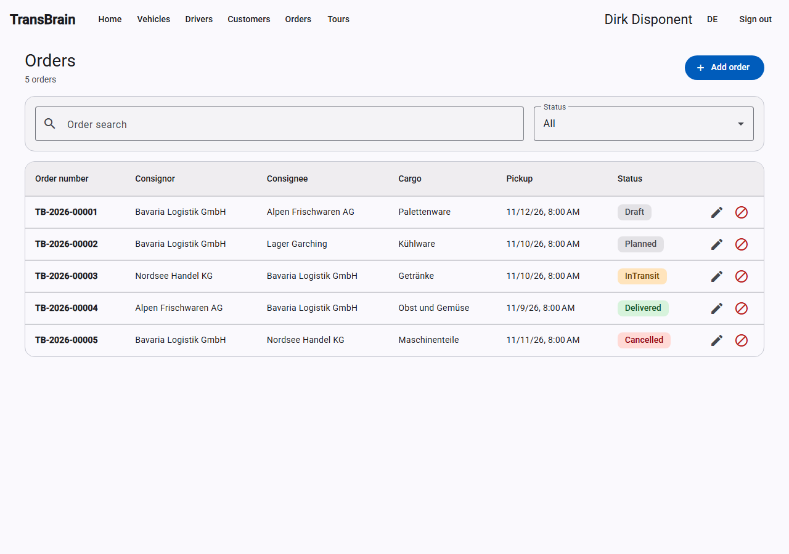

- Angezeigte Spalten: Order number (Auftragsnummer), Consignor (Absender), Consignee
  (Empfänger), Cargo (Ladung), Pickup (Beginn des Abholfensters), Status.
- Die **Auftragsnummer wird vom Server vergeben**, im Format `TB-2027-00042` — Jahr und
  eine fortlaufende Nummer innerhalb dieses Jahres. Sie kann nicht eingegeben oder
  geändert werden, auch nicht beim Bearbeiten.
- Schaltfläche **„Add order“** oberhalb der Tabelle legt einen neuen Auftrag an.
- Das Auswahlfeld **„Status“** filtert die Liste. „All“ zeigt alle Aufträge; die übrigen
  Einträge entsprechen den fünf Status `Draft`, `Planned`, `InTransit`, `Delivered` und
  `Cancelled`.
- Pro Zeile: **„Edit“** öffnet den Auftrag zum Bearbeiten, **„Cancel order“** storniert
  ihn.

**Stornieren ist kein Löschen.** Ein Auftrag wird nie entfernt. Nach dem Stornieren
bleibt die Zeile in der Liste stehen, ihr Status wechselt lediglich auf `Cancelled`. Das
ist beabsichtigt: Das Unternehmen behält den Nachweis über einen erteilten und wieder
zurückgezogenen Auftrag — für Rückfragen zur Abrechnung und weil die Auftragsnummer dem
Kunden gegenüber bereits genannt wurde.

**Sicherheitsabfrage beim Stornieren:** Wie beim Löschen von Fahrzeugen (und anders als
beim Löschen von Fahrern) wird hier nachgefragt. Ein Klick auf „Cancel order“ ersetzt die Schaltfläche in
derselben Zeile durch **„Confirm cancel“** und **„Keep order“**. Erst „Confirm cancel“
storniert tatsächlich; „Keep order“ bricht ab und ändert nichts.

## Auftragsformular (Anlegen / Bearbeiten)

Anlieferort (optional): Ganz oben im Empfänger-Bereich wählen Sie einen gespeicherten Anlieferort
aus den Kundenstammdaten. Die Empfängerfelder werden daraufhin mit Bezeichnung und Adresse des
Anlieferorts gefüllt und können danach noch geändert werden. Der Auftrag speichert die Adresse, wie
sie beim Speichern eingetragen ist; spätere Änderungen am Anlieferort wirken nicht auf bestehende
Aufträge. Ohne Auswahl tragen Sie die Empfängeradresse wie bisher von Hand ein.

Erreichbar über „Add order“ (`/orders/new`) oder „Edit“ (`/orders/{id}`).

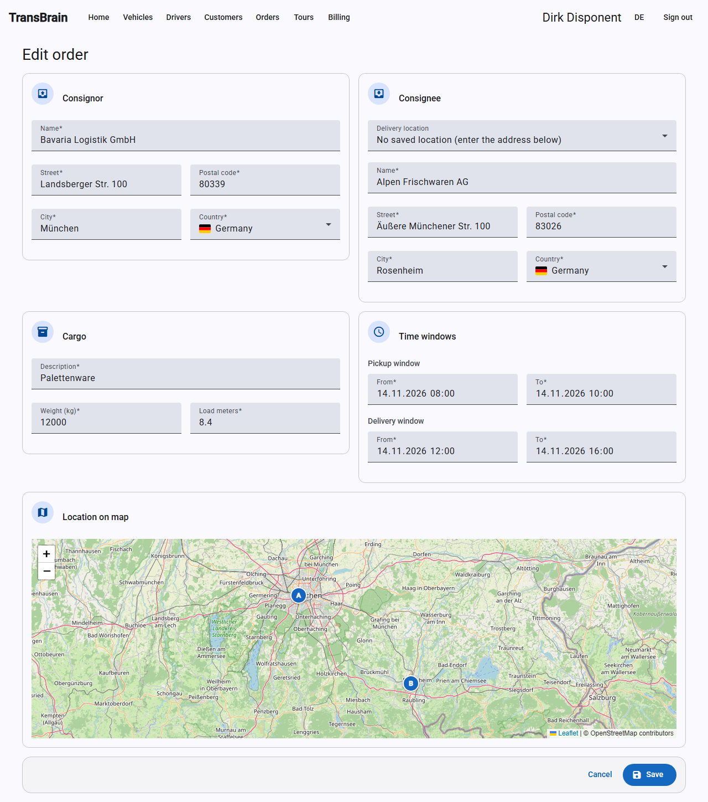

Das Formular ist in fünf Abschnitte gegliedert:

| Abschnitt       | Felder                                   | Pflicht | Hinweise                                                     |
|-----------------|------------------------------------------|:-------:|---------------------------------------------------------------|
| Consignor       | Name, Street, Postal code, City, Country | ja      | Country ist ein zweibuchstabiger Ländercode nach ISO 3166-1, z. B. `DE`. Vorbelegt mit `DE`. |
| Consignee       | Name, Street, Postal code, City, Country | ja      | dieselben Regeln wie beim Absender                            |
| Cargo           | Description, Weight (kg), Load meters    | ja      | Gewicht und Lademeter müssen größer als null sein. Lademeter dürfen Dezimalstellen haben (z. B. `8.4`). |
| Pickup window   | From, To                                 | ja      | Datum **und** Uhrzeit; „From“ muss vor „To“ liegen            |
| Delivery window | From, To                                 | ja      | Datum **und** Uhrzeit; „From“ muss vor „To“ liegen            |

- Die Zeitfenster werden in Ihrer lokalen Zeit eingegeben und angezeigt, intern aber in
  UTC gespeichert. Beim erneuten Öffnen zum Bearbeiten erscheinen wieder dieselben
  Uhrzeiten, die Sie eingegeben haben.
- **Das Lieferfenster darf nicht beginnen, bevor das Abholfenster endet.** Ist das doch
  der Fall, lehnt der Server das Speichern ab und zeigt oberhalb des Formulars die
  Meldung „The delivery window must not start before the pickup window ends.“
- **„Save“** und **„Cancel“** verhalten sich wie im Fahrzeug- und Fahrerformular.
- Validierungsfehler werden direkt am betroffenen Feld angezeigt, auch bei den
  verschachtelten Adressfeldern (z. B. eine Meldung unter „Consignor → Name“).

### Lage auf der Karte

Beim Bearbeiten eines bestehenden Auftrags zeigt das Formular unterhalb der Felder eine Karte
mit Absender (Pin **A**) und Empfänger (Pin **B**). Ein Tooltip am Pin nennt Rolle, Name und
Adresse. Die Karte zeigt den zuletzt gespeicherten Stand des Auftrags und ist beim Anlegen eines
neuen Auftrags noch nicht vorhanden. Kartenkacheln: © OpenStreetMap contributors.

- **Adresse nicht gefunden:** Lässt sich eine Adresse nicht auf der Karte verorten, fehlt ihr Pin,
  und darunter erscheint ein Hinweis, z. B. „Die Adresse des Empfängers konnte nicht auf der Karte
  verortet werden.“ Der andere Pin bleibt sichtbar.
- **Routing-Dienst nicht verfügbar:** Die Karte und das Verorten der Adressen nutzen den
  Routing-Dienst OpenRouteService. Auf dem Server muss dafür ein **OpenRouteService-API-Schlüssel**
  konfiguriert sein. Ist der Dienst nicht konfiguriert oder nicht erreichbar, erscheint anstelle
  der Karte die Meldung „Die Karte ist derzeit nicht verfügbar …“. Die Auftragsdaten lassen sich
  trotzdem bearbeiten und speichern.

## Auftragsstatus: welche Schritte abgelehnt werden

Dies ist der Teil, der im Alltag am ehesten für Verwirrung sorgt: Nicht jede Aktion ist in
jedem Status erlaubt. Ein Auftrag durchläuft die Status
`Draft` → `Planned` → `InTransit` → `Delivered`.

| Status      | Bearbeiten („Edit“ → „Save“) | Stornieren („Cancel order“) |
|-------------|:----------------------------:|:---------------------------:|
| `Draft`     | ja                           | ja                          |
| `Planned`   | **nein**                     | ja                          |
| `InTransit` | **nein**                     | **nein**                    |
| `Delivered` | **nein**                     | **nein**                    |
| `Cancelled` | **nein**                     | **nein**                    |

**Was Sie bei einer Ablehnung sehen:**

- **Bearbeiten eines Auftrags, der kein Entwurf mehr ist:** Das Formular lässt sich
  weiterhin öffnen und ausfüllen, aber beim Klick auf „Save“ erscheint oberhalb des
  Formulars die Meldung „An order in status 'Planned' can no longer be edited. (HTTP
  409)“ — mit dem jeweils tatsächlichen Status. Die Änderung wird **nicht** gespeichert,
  und die Anwendung kehrt nicht zur Liste zurück.
- **Stornieren eines Auftrags, der bereits unterwegs ist:** Nach „Confirm cancel“
  erscheint oberhalb der Tabelle die Meldung „An order in status 'InTransit' cannot move
  to 'Cancelled'. (HTTP 409)“. Die Tabelle bleibt sichtbar, der Auftrag unverändert.
- **Erneutes Stornieren eines bereits stornierten Auftrags:** dieselbe Meldung, mit
  `'Cancelled'` als aktuellem Status.

Das ist jeweils kein Fehler der Anwendung, sondern die beabsichtigte Regel: Sobald die
Ware physisch unterwegs ist, beschreibt der Auftrag einen realen Vorgang, der sich nicht
mehr per Mausklick zurücknehmen lässt. Die Schaltflächen werden dabei bewusst **nicht**
ausgeblendet — Sie erhalten stattdessen eine Meldung, die den Grund nennt.

**Hinweis:** Die Übergänge nach `Planned`, `InTransit` und `Delivered` sind in dieser
Phase noch nicht über die Oberfläche auslösbar; sie entstehen in einer späteren Phase
durch die Tourenplanung. In der Praxis sehen Sie hier daher zunächst nur `Draft` und
`Cancelled`.

## Tourenliste

Erreichbar über `/tours`.

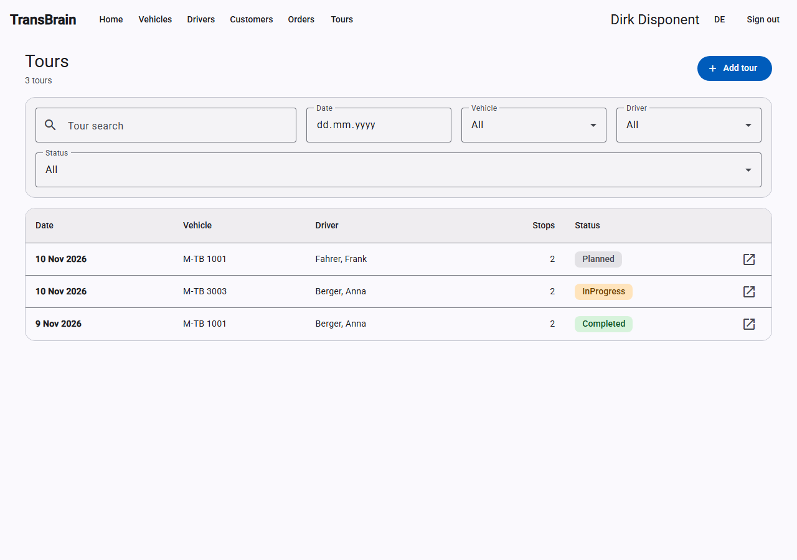

Eine **Tour** ist die Tagesarbeit eines Fahrzeugs mit einem Fahrer: eine geordnete Liste von
Stopps, die eine Menge von Aufträgen bedient.

- Angezeigte Spalten: Date (Tourdatum), Vehicle (Kennzeichen), Driver (Fahrer), Stops (Anzahl
  der Stopps), Status.
- Schaltfläche **„Add tour“** oberhalb der Tabelle plant eine neue Tour.
- Drei Filter: **Date**, **Vehicle** und **Driver**. Sie wirken gemeinsam.
- Pro Zeile öffnet **„Open“** die Detailseite — dort findet die eigentliche Arbeit statt.

## Tourenformular (Anlegen)

Erreichbar über „Add tour“ (`/tours/new`).

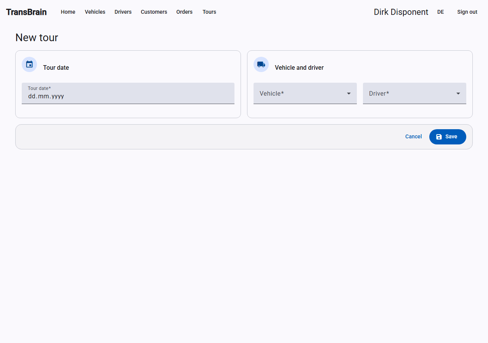

| Feld       | Bedeutung                          | Pflicht |
|------------|------------------------------------|:-------:|
| Tour date  | Datum, an dem die Tour gefahren wird | ja     |
| Vehicle    | Zugmaschine aus dem Fahrzeugstamm (Hänger werden nicht angeboten) | ja      |
| Driver     | Fahrer aus dem Fahrerstamm          | ja      |

Nach dem Speichern landen Sie **direkt auf der Detailseite** der neuen Tour, nicht in der Liste —
der nächste Schritt ist immer, Aufträge zuzuordnen.

**Eine Tour lässt sich nachträglich nicht umplanen.** Es gibt bewusst kein Bearbeiten-Formular:
Fahrzeug, Fahrer und Datum stehen mit dem Anlegen fest. Wurde falsch geplant, entfernen Sie die
Aufträge wieder (sie werden dadurch erneut disponierbar) und legen eine neue Tour an.

### Welche Kombinationen abgelehnt werden

Beim Speichern prüft der Server vier Regeln. Jede Ablehnung erscheint als Meldung oberhalb des
Formulars, und das Formular bleibt stehen — Ihre Eingaben gehen nicht verloren.

| Situation                                                | Meldung (sinngemäß)                                                            |
|----------------------------------------------------------|--------------------------------------------------------------------------------|
| Fahrzeug steht in der Werkstatt oder ist ausgemustert     | „Vehicle 'M-AB 1234' is 'InWorkshop' and cannot be assigned to a tour. (HTTP 409)“ |
| Fahrer ist abwesend oder inaktiv                          | „Driver 'Fahrer' is 'Absent' and cannot be assigned to a tour. (HTTP 409)“      |
| Führerschein läuft **vor** dem Tourdatum ab               | „The driver's licence expires on 2027-02-28, before the tour date 2027-03-01. (HTTP 409)“ |
| Fahrzeug hat an diesem Datum bereits eine Tour            | „That vehicle already has a tour on 2027-03-01. (HTTP 409)“                     |
| Fahrer hat an diesem Datum bereits eine Tour              | „That driver already has a tour on 2027-03-01. (HTTP 409)“                      |

**Zum Führerschein:** Ein Schein, der **genau am** Tourdatum abläuft, ist an diesem Tag noch
gültig — die Tour wird angenommen. Erst ab dem Folgetag lehnt der Server ab.

**Zur Doppelbuchung:** Sie gilt pro Kalendertag und ohne Ausnahme — auch eine bereits
abgeschlossene Tour belegt Fahrzeug und Fahrer für diesen Tag.

## Tourendetail

Erreichbar über „Open“ in der Liste (`/tours/{id}`).

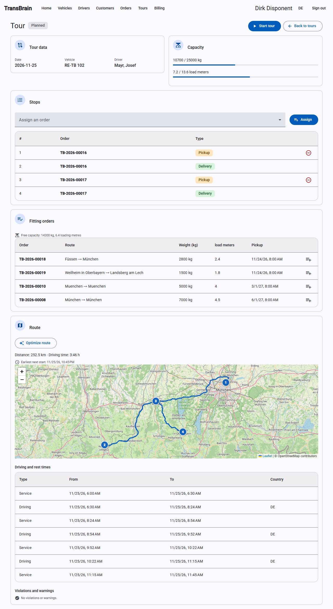

Die Seite gliedert sich in fünf Bereiche:

**1. Kopfdaten** — Datum, Fahrzeug, Fahrer und Status der Tour.

**2. Capacity (Auslastung)** — zwei Anzeigen mit Balken:

- `12000 / 18000 kg` — zugeladenes Gewicht gegen die Nutzlast des Fahrzeugs
- `8.4 / 13.6 load meters` — belegte Lademeter gegen die verfügbaren

Diese Zahlen sind der Grund, warum die Seite existiert: Sie sehen **vor** dem Zuordnen, wie viel
Luft noch bleibt.

**3. Stops** — die Stoppliste in Reihenfolge. Je zugeordnetem Auftrag entstehen **automatisch
zwei** Stopps: ein `Pickup` (Abholung) und ein `Delivery` (Zustellung), wobei die Abholung immer
die kleinere Nummer trägt. Die Schaltfläche **„Remove“** an der Abholzeile nimmt den ganzen
Auftrag wieder von der Tour; die verbleibenden Stopps werden lückenlos neu nummeriert.

**4. Route** — Strecke, Fahrzeit, Karte mit den Stopps und die Lenk- und Ruhezeiten der Tour.
Der Bereich wird unten unter „Route der Tour“ beschrieben.

**5. Assign an order (Auftrag zuordnen)** — ein Auswahlfeld mit den zuordenbaren Aufträgen und
die Schaltfläche **„Assign“**.

**Angeboten werden nur Aufträge im Status `Draft`.** Jeder andere Status würde vom Server
abgelehnt, und eine Auswahl anzubieten, die anschließend abgelehnt wird, ist schlechter, als sie
gar nicht anzubieten. Ein Auftrag, der bereits auf einer anderen Tour liegt, ist deshalb nicht in
der Liste.

Darunter erscheinen je nach Status die Schaltflächen **„Start tour“** (nur bei `Planned`) und
**„Complete tour“** (nur bei `InProgress`). Schaltflächen, die im aktuellen Status ohnehin
abgelehnt würden, werden hier ausgeblendet — anders als beim Stornieren eines Auftrags, wo die
Ablehnung die Regel erklärt.

### Route der Tour

Die Route wird beim Öffnen der Seite berechnet und nach jedem Zuordnen oder Entfernen eines
Auftrags neu geladen. Sie besteht aus:

- **Strecke** und **Fahrzeit** (Stunden:Minuten) der gesamten Tour.
- **Karte** mit der Fahrstrecke als blaue Linie und den nummerierten Stopps (1, 2, …) in
  Reihenfolge. Ein Tooltip am Stopp zeigt Typ (Abholung oder Zustellung), Auftragsnummer und Ort.
- **Frühester nächster Start:** der früheste Zeitpunkt, zu dem nach dieser Tour wieder gefahren
  werden darf.
- **Lenk- und Ruhezeiten:** Tabelle mit Fahrt, Pause und Service, jeweils mit Beginn, Ende und
  Land.
- **Verstöße und Warnungen:** Verstöße werden rot, Warnungen bernsteinfarben angezeigt. Der Text
  stammt vom Server.

**Hinweis:** Die Route wird über den Routing-Dienst OpenRouteService berechnet. Damit der Bereich
„Route“ mit Karte und Zeitplan erscheint, muss auf dem Server ein **OpenRouteService-API-Schlüssel**
konfiguriert sein. Fehlt der Schlüssel oder ist der Dienst nicht erreichbar, zeigt der Bereich die
Meldung „Die Routenberechnung ist derzeit nicht verfügbar …“ an; die übrige Seite bleibt benutzbar.

Kann die Route nicht berechnet werden (z. B. weil die Tour keine berechenbaren Stopps hat), zeigt
der Bereich die Meldung des Servers mit dem HTTP-Statuscode an, statt stillschweigend leer zu
bleiben.

### Was beim Zuordnen abgelehnt wird

| Situation                                                     | Meldung (sinngemäß)                                                              |
|---------------------------------------------------------------|----------------------------------------------------------------------------------|
| Gewicht der Tour überschreitet die Nutzlast                    | „Adding this order would load 21000 kg onto a vehicle rated for 18000 kg. (HTTP 409)“ |
| Lademeter überschreiten die verfügbaren                        | „Adding this order would need 15.0 load meters on a vehicle offering 13.6. (HTTP 409)“ |
| Tour ist bereits gestartet oder abgeschlossen                  | „A tour in status 'InProgress' no longer accepts changes to its stops. (HTTP 409)“ |

**Wichtig:** Die Kapazität wird gegen die **Summe der gesamten Tour** geprüft, nicht nur gegen
den einzelnen Auftrag. Ein Auftrag, der allein passen würde, kann als dritter oder vierter
trotzdem abgelehnt werden. Die Anzeige unter „Capacity“ zeigt Ihnen vorher, wie viel bleibt.

## Tourstatus: welche Schritte abgelehnt werden

Eine Tour durchläuft `Planned` → `InProgress` → `Completed`.

| Status       | Aufträge zuordnen/entfernen | „Start tour“ | „Complete tour“ |
|--------------|:---------------------------:|:------------:|:---------------:|
| `Planned`    | ja                          | ja           | **nein**        |
| `InProgress` | **nein**                    | **nein**     | ja              |
| `Completed`  | **nein**                    | **nein**     | **nein**        |

- **Eine Tour ohne Stopps lässt sich nicht starten.** Sie erhalten „A tour without stops cannot
  be started. (HTTP 409)“. Das ist Absicht: Eine leere Tour würde Fahrzeug und Fahrer für den Tag
  binden, ohne etwas zu transportieren.

### Der wichtigste Zusammenhang: Tour und Auftrag hängen zusammen

Das Starten und Abschließen einer Tour **verändert die Aufträge mit**, ohne dass jemand die
Auftragsmaske öffnet:

| Aktion an der Tour        | Was mit jedem zugeordneten Auftrag geschieht |
|---------------------------|-----------------------------------------------|
| Auftrag zuordnen          | `Draft` → `Planned`                           |
| Auftrag entfernen         | `Planned` → `Draft` (wieder disponierbar)     |
| **„Start tour“**          | `Planned` → `InTransit`                       |
| **„Complete tour“**       | `InTransit` → `Delivered`                     |

Wenn Sie sich also wundern, warum ein Auftrag in der Auftragsliste plötzlich `InTransit` zeigt,
obwohl niemand ihn angefasst hat: Seine Tour wurde gestartet. Das ist der normale Weg — die
Auftragsmaske selbst kennt diese Übergänge gar nicht.

**Nebenwirkung, die überrascht:** Sobald eine Tour gestartet ist, sind ihre Aufträge `InTransit`
und lassen sich **nicht mehr stornieren und nicht mehr bearbeiten**. Wollen Sie einen Auftrag
noch ändern, tun Sie es vor dem Start der Tour — oder nehmen Sie ihn vorher von der Tour.

## Touren als Fahrer (`fahrer`)

Dies ist die erste Stelle im System, an der **zwei angemeldete Benutzer Unterschiedliches sehen**.

Ein Benutzer mit der Rolle `fahrer` sieht in der Tourenliste **ausschließlich seine eigenen
Touren** und kann auch nur diese starten und abschließen. Für Administratoren, Disponenten und
Betrachter gilt das nicht — sie sehen alle Touren.

**Der kurze Weg führt über die Startseite:** Ein Fahrer findet seine Touren des Tages dort unter
„My tours today“ und kann sie direkt starten und abschließen, ohne die Tourenliste zu öffnen. Die
Regeln unten gelten unverändert — die Startseite ist nur eine bequemere Tür zu denselben Aktionen.

- **Die Liste wird eingeschränkt, nicht verweigert.** Ein Fahrer, der `/tours` öffnet, sieht seine
  Touren. Filtert er ausdrücklich auf einen Kollegen, bleibt die Liste **leer** — das ist die
  wahrheitsgemäße Antwort auf „die Touren dieses Kollegen, unter meinen“.
- **Eine fremde Tour direkt aufzurufen wird abgelehnt.** `/tours/{id}` einer fremden Tour meldet
  „A driver may only see their own tours. (HTTP 403)“.
- **Start und Abschluss einer fremden Tour werden abgelehnt** mit „A driver may only start or
  complete their own tours. (HTTP 403)“.

**Voraussetzung:** Die Zuordnung läuft über das Feld **External user id** im Fahrerstamm, in dem
die Keycloak-Kennung (`sub`) des Fahrers hinterlegt wird. Ist dieses Feld leer, gehört der
Fahrerdatensatz zu **niemandem, der sich anmelden kann** — dessen Touren kann dann auch kein
Fahrer starten. Das ist Absicht: Ein leeres Feld als „passt zu jedem“ zu behandeln, würde die
Tour dem erstbesten Fahrer überlassen.

## Rollen und Rechte

Die Anmeldung erfolgt über Keycloak mit genau einer der vier Rollen `admin`,
`disponent`, `fahrer` oder `viewer`.

| Rolle       | Ansehen          | Fahrzeuge/Fahrer/Kunden pflegen | Aufträge pflegen | Touren planen | Tour starten/abschließen |
|-------------|------------------|:------------------------:|:----------------:|:-------------:|:------------------------:|
| `admin`     | alles            | ja                       | ja               | ja            | ja                       |
| `disponent` | alles            | **nein**                 | **ja**           | **ja**        | **ja**                   |
| `fahrer`    | **nur eigene Touren** | **nein**            | **nein**         | **nein**      | **nur eigene**           |
| `viewer`    | alles            | **nein**                 | **nein**         | **nein**      | **nein**                 |

**Aufträge und Touren sind die Ausnahme von der Regel „nur `admin` darf schreiben“.** Ein
Disponent darf beides anlegen, ändern und stornieren beziehungsweise planen — das ist genau seine
Aufgabe. Bei Fahrzeugen, Fahrern und Kunden (Stammdaten) darf er weiterhin nur lesen.

**Der Fahrer ist die zweite Ausnahme:** Er darf nichts anlegen, aber seine eigenen Touren starten
und abschließen — siehe Abschnitt „Touren als Fahrer“.

**Die Oberfläche bietet nur an, was Ihre Rolle auch darf.** Die Schaltflächen
„Add vehicle“/„Add driver“/„Add customer“, „Edit“ und „Delete“ erscheinen ausschließlich für die Rolle
`admin`; „New order“, „Edit“, „Cancel order“ und „Plan tour“ nur für `admin` und
`disponent`; „Start tour“ und „Complete tour“ für `admin`, `disponent` und `fahrer`. Wer
eine Schaltfläche nicht sieht, dürfte sie ohnehin nicht benutzen.

Das **Lesen** ist davon unberührt: alle vier Rollen dürfen alle Listen ansehen, mit der
einen Ausnahme, dass ein Fahrer in der Tourenliste nur seine eigenen Touren sieht. Die
Navigation blendet für einen Fahrer die Bereiche Fahrzeuge, Fahrer, Kunden und Aufträge aus, weil
er sie für seine Arbeit nicht braucht — über die Adresszeile bleiben sie erreichbar.

Sollten Sie dennoch eine Ablehnung mit `HTTP 403` sehen, ist das kein Bedienfehler: Es
bedeutet, dass sich Ihre Rechte seit dem Laden der Seite geändert haben. Ein Neuladen zeigt
dann die passende Oberfläche.

## Bekannte Einschränkungen (Zusammenfassung)

- Sortieren lässt sich bisher nur die Fahrzeugliste.
- Die Kennzahlen und Arbeitslisten der Startseite werden beim Öffnen einmal geladen; sie
  aktualisieren sich nicht von selbst, solange die Seite offen bleibt.
- Löschen von Fahrern erfolgt sofort, ohne Sicherheitsabfrage; das Löschen von Fahrzeugen
  und das Stornieren eines Auftrags fragen dagegen nach.
- In der Auftragsliste lässt sich nur nach Status filtern; die Filter nach Abholzeitraum,
  die die API anbietet, haben noch keine Bedienelemente.
- Eine Tour lässt sich nach dem Anlegen weder umplanen noch löschen. Eine falsch geplante Tour
  bleibt als leere Tour stehen, nachdem ihre Aufträge entfernt wurden — und belegt Fahrzeug und
  Fahrer für diesen Tag weiter.
- Die Listen zeigen bis zu 100 Einträge und haben keine Blätterfunktion; darüber hinaus sind
  ältere Einträge nicht erreichbar.
