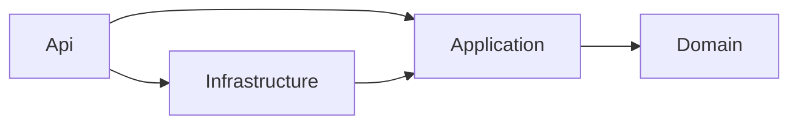

# TransBrain — Developer guide

TransBrain is dispatch software for a trucking company: vehicles, drivers, transport orders and tours.
This guide explains how the code is organised and how to extend it. Running and deploying it is covered in
[INSTALLATION.md](INSTALLATION.md); the HTTP surface and its policies in the [README](../README.md);
authentication in [KEYCLOAK.md](KEYCLOAK.md). Binding conventions live in [AGENTS.md](../AGENTS.md).

## 1. Stack

| Area | Technology |
|---|---|
| Runtime | .NET 10, C# 14, nullable enabled, warnings are errors |
| API | ASP.NET Minimal APIs (no controllers), OpenAPI + Scalar in Development |
| Persistence | EF Core 10, PostgreSQL (Npgsql), Redis distributed cache |
| Application | Hand-rolled CQRS mediator (not MediatR), FluentValidation, Result pattern |
| Auth | Keycloak (OIDC, JWT bearer), realm roles `admin`, `disponent`, `fahrer`, `viewer` |
| Orchestration | .NET Aspire (`AppHost`, `ServiceDefaults`) |
| Frontends | Angular + Angular Material (`TransBrain.Web`), Vue 3 + Vuetify + Pinia (`TransBrain.VueWeb`) |
| Tests | xUnit + AwesomeAssertions, Testcontainers, `WebApplicationFactory`, Playwright (e2e) |

Package versions are pinned centrally in `Directory.Packages.props`; shared compiler settings
(`TreatWarningsAsErrors`, `EnforceCodeStyleInBuild`) in `Directory.Build.props`.

## 2. Repository layout

```
src/
  TransBrain.Domain/          Entities, value objects, Result/Error. No dependencies.
  TransBrain.Application/     Features (vertical slices), mediator, abstractions. Depends on Domain.
  TransBrain.Infrastructure/  EF Core, repositories, migrations, Redis cache. Implements Application abstractions.
  TransBrain.Api/             Endpoints, auth policies, Program.cs. Composition root.
  TransBrain.ServiceDefaults/ Aspire defaults: telemetry, health checks, service discovery, resilience.
  TransBrain.AppHost/         Aspire orchestration + Keycloak dev realm (realms/transbrain-realm.json).
  TransBrain.Web/             Angular SPA (+ e2e/ Playwright specs)
  TransBrain.VueWeb/          Vue SPA   (+ e2e/ Playwright specs)
tests/
  TransBrain.Domain.Tests/
  TransBrain.Application.Tests/   (coverage gate: >= 80 % lines, see CI)
  TransBrain.Api.IntegrationTests/
deploy/                       nginx config for the SPA containers, Keycloak production image + realm
infra/main.bicep              Azure deployment
docker-compose.yml            Local/demo stack
docs/                         This guide, installation, Keycloak, operator guides, design specs and plans
```

## 3. Architecture

Clean Architecture, dependencies point inward:



`Api` references `Infrastructure` only to register it in `Program.cs`; endpoint code talks to
`ISender` and nothing else.

### 3.1 Domain

Aggregates: `Vehicle`, `Driver`, `TransportOrder`, `Tour` (with `TourStop`). Value objects and DTO-like
types are `record`s (`LicensePlate`, `OrderNumber`, `Address`, `Cargo`, `TimeWindow`). Invariants are
enforced in factory methods (`Vehicle.Create(...)`) that return `Result<T>`; nothing throws for control
flow.

`Result<T>` / `Error` (`Domain/Common`): an `Error` has a `Code` (e.g. `Vehicle.DuplicateLicensePlate`),
a message and an `ErrorType` — `Validation`, `NotFound`, `Conflict`, `Forbidden`. Validation failures may
carry per-field messages (`Failures`).

### 3.2 Application: CQRS and vertical slices

Each use case is one folder under `Features/<Aggregate>/<UseCase>/`:

```
Features/Vehicles/CreateVehicle/
  CreateVehicleCommand.cs            record : ICommand<VehicleResponse>
  CreateVehicleCommandHandler.cs     internal sealed class : ICommandHandler<,>
  CreateVehicleCommandValidator.cs   FluentValidation AbstractValidator
```

The mediator (`Application/Common/Messaging`) is deliberately small:

- `ICommand<T>` / `IQuery<T>` are marker interfaces; handlers return `Task<Result<T>>`.
- `ISender.Send(...)` resolves the handler and wraps it in the `IPipelineBehavior` chain
  (`LoggingBehavior`, then `ValidationBehavior`). Validation failures come back as
  `Error.ValidationFailures`, so a handler never sees an invalid request.
- `AddApplication()` finds handlers and validators by reflection over the assembly — no manual
  registration per feature.

Repositories and other ports are interfaces in `Application/Abstractions` (`IVehicleRepository`,
`ICacheService`, `ICurrentUser`, `IOrderNumberGenerator`, …); `Infrastructure` implements them.

**Caching:** list/get-by-id of vehicles and drivers are cached via `ICacheService`; every write calls
`RemoveByPrefixAsync(<Aggregate>CacheKeys.Prefix)`. Orders and tours are deliberately **not** cached
(they change on every status transition). With no `ConnectionStrings:cache`, caching is off.

### 3.3 Infrastructure

`TransBrainDbContext` with one `IEntityTypeConfiguration` per aggregate (`Persistence/Configurations`),
repositories in `Persistence/Repositories`, `RedisCacheService`, and `SequentialOrderNumberGenerator`
(database-backed sequence). Rules that must hold under concurrency live in the database, not in a
pre-check: tour double booking is refused by unique indexes on `(tour_date, vehicle_id)` and
`(tour_date, driver_id)`; the repository maps the unique violation to a `409`.

### 3.4 API

`Program.cs` is the composition root. Endpoints are grouped in classes implementing `IEndpointGroup`
(`VehicleEndpoints`, `DriverEndpoints`, `OrderEndpoints`, `TourEndpoints`); they are discovered by
reflection and mapped at startup. Each endpoint sends a command/query and converts the result with
`result.ToHttpResult(...)` (`Common/ResultExtensions.cs`), which is the single place that maps
`ErrorType` to HTTP status codes (400/404/409/403).

**Authorization** (`Authorization/Policies.cs`, registered in `Program.cs`):

| Policy | Roles |
|---|---|
| `MasterDataWrite` | `admin` |
| `DispatchWrite` | `admin`, `disponent` |
| `TourStatusWrite` | `admin`, `disponent`, `fahrer` |
| `Read` | all four |

The **fallback policy requires an authenticated user**, so an endpoint that forgets
`RequireAuthorization` is closed, not open (side effect: unknown routes answer `401`). Keycloak puts
roles in `realm_access.roles`; `OnTokenValidated` copies them into `ClaimTypes.Role`. The rule "a driver
touches only their own tours" is enforced in the tour handlers via `ICurrentUser`
(`HttpContextCurrentUser`), because a policy cannot see which tour is addressed. A driver is linked to a
login through `Driver.ExternalUserId` = Keycloak `sub`.

**Environment switches** in `Program.cs`:

| Behaviour | Development | Other environments |
|---|---|---|
| OpenAPI document + Scalar UI | on | off |
| `/health`, `/alive` | on | off |
| EF migrations at start | always | only if `Database:MigrateOnStartup=true` |
| OIDC metadata over plain HTTP | allowed | HTTPS required |

### 3.5 Frontends

Both SPAs consume the same API through the relative path `/api` (dev server proxy or nginx) and sign in
with the public client `transbrain-spa` (authorization code + PKCE). The authority comes from the global
`window.TRANSBRAIN_CONFIG.authority` set by `public/config.js`, falling back to
`https://localhost:8080/realms/transbrain`; containers overwrite `config.js` at start from
`OIDC_AUTHORITY` (`deploy/nginx/40-config-js.sh`), so one image works in every environment.

- Angular: feature folders under `src/app` (`vehicles`, `drivers`, `orders`, `tours`, `home`, `auth`),
  `angular-auth-oidc-client`, services per aggregate.
- Vue: `src/views` (one per screen), `src/api` (axios per aggregate), `src/stores/auth.ts` (Pinia),
  `src/auth/userManager.ts` (`oidc-client-ts`, tokens in `sessionStorage`).

A user-facing UI change must also update the matching operator guide
(`docs/BEDIENUNG_TRANSBRAIN_WEB.md` / `_VUEWEB.md`) and its screenshot under `docs/img/`.

## 4. Local setup

See [INSTALLATION.md § 1](INSTALLATION.md#1-local-development-with-aspire). Short version:

```bash
dotnet dev-certs https --trust
dotnet run --project src/TransBrain.AppHost
```

Data is deliberately not persisted in this mode (no volumes for Postgres/Keycloak); the schema is rebuilt
by migrations and the realm re-imported on every start. Test users: README, "Test users".

## 5. Common tasks

### 5.1 Add a use case

1. Create `Features/<Aggregate>/<UseCase>/` with the command/query record, the handler and, if the input
   needs checking, a validator. Return `Result<T>`; use `Error.NotFound/Conflict/Validation/Forbidden`.
2. Add the endpoint to the aggregate's `IEndpointGroup`: send the message, `ToHttpResult`, declare
   `Produces*`, and choose a policy with `RequireAuthorization(Policies.…)`.
3. Writes to cached aggregates must invalidate their cache prefix.
4. Tests: handler tests in `Application.Tests` (fakes in `Fakes/`), HTTP behaviour in
   `Api.IntegrationTests`.

### 5.2 Add an aggregate

Domain type with a `Create` factory → `IEntityTypeConfiguration` → repository interface in
`Abstractions` + implementation in `Infrastructure` and its registration in
`Infrastructure/DependencyInjection.cs` → feature folders → endpoint group → migration → both frontends.

### 5.3 Change the schema

```bash
dotnet ef migrations add <Name> --project src/TransBrain.Infrastructure --startup-project src/TransBrain.Api
```

There is no design-time DbContext factory, so the tool builds the API host; in Development that host
migrates on start, i.e. it needs a reachable Postgres via `ConnectionStrings__transbraindb` (for example
`docker compose up -d postgres`). Commit the generated `*.cs`, `*.Designer.cs` and the updated
`TransBrainDbContextModelSnapshot.cs`. Migrations are applied on API start (Development / the
`MigrateOnStartup` flag); there is no separate migration job.

### 5.4 Change roles, clients or users in Keycloak

Edit `src/TransBrain.AppHost/realms/transbrain-realm.json` (dev, re-imported on every start) and mirror
structural changes (roles, client settings, mappers) in `deploy/keycloak/transbrain-realm.json`
(production template: placeholders for the SPA URLs, no users). Roles used in code must exist in both.

## 6. Testing

```bash
dotnet test TransBrain.slnx                       # Domain, Application, API integration (needs Docker)
dotnet test tests/TransBrain.Application.Tests \
  --collect:"XPlat Code Coverage" --settings tests/TransBrain.Application.Tests/coverage.runsettings
```

- Naming: `Method_Scenario_ExpectedResult`.
- API tests run through `WebApplicationFactory` (`TransBrainApiFactory`) with a fake auth handler
  (`TestAuthHandler`) and a Testcontainers PostgreSQL; Redis only in the cache tests.
- Application coverage gate: 80 % lines, enforced in `.github/workflows/ci.yml`.
- Angular unit tests: `npm run test -- --watch=false` in `src/TransBrain.Web`. The Vue app has none.
- e2e (Playwright, `npm run e2e` in a frontend folder): need the running Aspire stack and a trusted dev
  certificate; **not** run in CI. Workers are pinned to 1 on purpose (concurrent Keycloak logins time out).

## 7. CI and release flow

`.github/workflows/ci.yml` on push to `main` and on pull requests: restore, build (warnings fail the
build), Domain/Application/API tests, the coverage gate, then `npm ci` + `npm run build` for both
frontends and the Angular unit tests. No images are built or published by CI.

Workflow rules (AGENTS.md): branch `feature/<name>`, Conventional Commits, run the tests before
committing, and add a `CHANGELOG.md` entry under `[Unreleased]` for notable changes.

## 8. Containers and deployment (for developers)

| File | Purpose |
|---|---|
| `src/TransBrain.Api/Dockerfile` | Multi-stage SDK → ASP.NET runtime image, non-root, port 8080. Build context: repo root |
| `src/TransBrain.Web/Dockerfile`, `src/TransBrain.VueWeb/Dockerfile` | Node build → nginx. Build context: repo root |
| `deploy/nginx/default.conf.template` | SPA fallback, `/api/` reverse proxy to `${API_URL}`, `config.js` no-cache |
| `deploy/nginx/40-config-js.sh` | Writes `config.js` from `OIDC_AUTHORITY` on container start |
| `deploy/keycloak/` | Keycloak image with the production realm baked in |
| `docker-compose.yml` | Postgres, Redis, Keycloak (dev mode), API, both SPAs |
| `infra/main.bicep` | Azure Container Apps, PostgreSQL Flexible Server, Redis, ACR, Log Analytics |

Gotchas that cost time:

- The API reads `ConnectionStrings__transbraindb` / `__cache` and `services__keycloak__http(s)__0`; these
  are the names Aspire injects locally, so containers must set the same ones.
- Keycloak's issuer must be identical for browser and API (`KC_HOSTNAME`). In Compose the API reaches
  Keycloak as `keycloak:8080`, so `KC_HOSTNAME_BACKCHANNEL_DYNAMIC=true` is required, otherwise the
  discovery document sends the API to `localhost:8080`, which is itself inside the API container.
- A Keycloak container health probe must send a `Host` header when the backchannel is dynamic.
- The production realm is imported only when it does not exist yet; later edits to the file do not apply.

## 9. Known gaps

- No Playwright run in CI (no headless stack yet).
- No `/health` outside Development; no separate migration step for deployments.
- Validation messages are pinned to English (`Program.cs`, see README "API response language").
- The Azure template has not yet been deployed against a real subscription.
