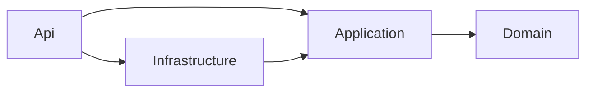

# TransBrain — Developer guide

TransBrain is dispatch software for a trucking company: vehicles, drivers, transport orders and tours.
This guide explains how the code is organised and how to extend it. Running and deploying it is covered in
[INSTALLATION.md](INSTALLATION.md); the HTTP surface and its policies in the [README](../README.md);
authentication in [KEYCLOAK.md](KEYCLOAK.md). Binding conventions live in [AGENTS.md](../AGENTS.md).

## 1. Stack

| Area | Technology |
|---|---|
| Runtime | .NET 10, C# 14, nullable enabled, warnings are errors |
| API | ASP.NET Minimal APIs (no controllers), OpenAPI + Scalar in Development |
| Persistence | EF Core 10, PostgreSQL (Npgsql), Redis distributed cache |
| Application | Hand-rolled CQRS mediator (not MediatR), FluentValidation, Result pattern |
| Auth | Keycloak (OIDC, JWT bearer), realm roles `admin`, `disponent`, `fahrer`, `viewer` |
| Orchestration | .NET Aspire (`AppHost`, `ServiceDefaults`) |
| Frontends | Angular + Angular Material (`TransBrain.Web`), Vue 3 + Vuetify + Pinia (`TransBrain.VueWeb`) |
| Tests | xUnit + AwesomeAssertions, Testcontainers, `WebApplicationFactory`, Playwright (e2e) |

Package versions are pinned centrally in `Directory.Packages.props`; shared compiler settings
(`TreatWarningsAsErrors`, `EnforceCodeStyleInBuild`) in `Directory.Build.props`.

## 2. Repository layout

```
src/
  TransBrain.Domain/          Entities, value objects, Result/Error. No dependencies.
  TransBrain.Application/     Features (vertical slices), mediator, abstractions. Depends on Domain.
  TransBrain.Infrastructure/  EF Core, repositories, migrations, Redis cache. Implements Application abstractions.
  TransBrain.Api/             Endpoints, auth policies, Program.cs. Composition root.
  TransBrain.ServiceDefaults/ Aspire defaults: telemetry, health checks, service discovery, resilience.
  TransBrain.AppHost/         Aspire orchestration + Keycloak dev realm (realms/transbrain-realm.json).
  TransBrain.Web/             Angular SPA (+ e2e/ Playwright specs)
  TransBrain.VueWeb/          Vue SPA   (+ e2e/ Playwright specs)
tests/
  TransBrain.Domain.Tests/
  TransBrain.Application.Tests/   (coverage gate: >= 80 % lines, see CI)
  TransBrain.Api.IntegrationTests/
deploy/                       nginx config for the SPA containers, Keycloak production image + realm
infra/main.bicep              Azure deployment
docker-compose.yml            Local/demo stack
scripts/seed-testdata.py      Seeds a running dev stack with test data (section 4)
docs/                         This guide, installation, Keycloak, operator guides, design specs and plans
```

## 3. Architecture

Clean Architecture, dependencies point inward:



`Api` references `Infrastructure` only to register it in `Program.cs`; endpoint code talks to
`ISender` and nothing else.

### 3.1 Domain

Aggregates: `Vehicle`, `Driver`, `TransportOrder`, `Tour` (with `TourStop`). Value objects and DTO-like
types are `record`s (`LicensePlate`, `OrderNumber`, `Address`, `Cargo`, `TimeWindow`). Invariants are
enforced in factory methods (`Vehicle.Create(...)`) that return `Result<T>`; nothing throws for control
flow.

`Result<T>` / `Error` (`Domain/Common`): an `Error` has a `Code` (e.g. `Vehicle.DuplicateLicensePlate`),
a message and an `ErrorType` — `Validation`, `NotFound`, `Conflict`, `Forbidden`. Validation failures may
carry per-field messages (`Failures`).

### 3.2 Application: CQRS and vertical slices

Each use case is one folder under `Features/<Aggregate>/<UseCase>/`:

```
Features/Vehicles/CreateVehicle/
  CreateVehicleCommand.cs            record : ICommand<VehicleResponse>
  CreateVehicleCommandHandler.cs     internal sealed class : ICommandHandler<,>
  CreateVehicleCommandValidator.cs   FluentValidation AbstractValidator
```

The mediator (`Application/Common/Messaging`) is deliberately small:

- `ICommand<T>` / `IQuery<T>` are marker interfaces; handlers return `Task<Result<T>>`.
- `ISender.Send(...)` resolves the handler and wraps it in the `IPipelineBehavior` chain
  (`LoggingBehavior`, then `ValidationBehavior`). Validation failures come back as
  `Error.ValidationFailures`, so a handler never sees an invalid request.
- `AddApplication()` finds handlers and validators by reflection over the assembly — no manual
  registration per feature.

Repositories and other ports are interfaces in `Application/Abstractions` (`IVehicleRepository`,
`ICacheService`, `ICurrentUser`, `IOrderNumberGenerator`, …); `Infrastructure` implements them.

**Caching:** list/get-by-id of vehicles and drivers are cached via `ICacheService`; every write calls
`RemoveByPrefixAsync(<Aggregate>CacheKeys.Prefix)`. Orders and tours are deliberately **not** cached
(they change on every status transition). With no `ConnectionStrings:cache`, caching is off.

### 3.3 Infrastructure

`TransBrainDbContext` with one `IEntityTypeConfiguration` per aggregate (`Persistence/Configurations`),
repositories in `Persistence/Repositories`, `RedisCacheService`, and `SequentialOrderNumberGenerator`
(database-backed sequence). Rules that must hold under concurrency live in the database, not in a
pre-check: tour double booking is refused by unique indexes on `(tour_date, vehicle_id)` and
`(tour_date, driver_id)`; the repository maps the unique violation to a `409`.

### 3.4 API

`Program.cs` is the composition root. Endpoints are grouped in classes implementing `IEndpointGroup`
(`VehicleEndpoints`, `DriverEndpoints`, `OrderEndpoints`, `TourEndpoints`); they are discovered by
reflection and mapped at startup. Each endpoint sends a command/query and converts the result with
`result.ToHttpResult(...)` (`Common/ResultExtensions.cs`), which is the single place that maps
`ErrorType` to HTTP status codes (400/404/409/403).

**Authorization** (`Authorization/Policies.cs`, registered in `Program.cs`):

| Policy | Roles |
|---|---|
| `MasterDataWrite` | `admin` |
| `DispatchWrite` | `admin`, `disponent` |
| `TourStatusWrite` | `admin`, `disponent`, `fahrer` |
| `Read` | all four |

The **fallback policy requires an authenticated user**, so an endpoint that forgets
`RequireAuthorization` is closed, not open (side effect: unknown routes answer `401`). Keycloak puts
roles in `realm_access.roles`; `OnTokenValidated` copies them into `ClaimTypes.Role`. The rule "a driver
touches only their own tours" is enforced in the tour handlers via `ICurrentUser`
(`HttpContextCurrentUser`), because a policy cannot see which tour is addressed. A driver is linked to a
login through `Driver.ExternalUserId` = Keycloak `sub`.

**Environment switches** in `Program.cs`:

| Behaviour | Development | Other environments |
|---|---|---|
| OpenAPI document + Scalar UI | on | off |
| `/health`, `/alive` | on | off |
| EF migrations at start | always | only if `Database:MigrateOnStartup=true` |
| OIDC metadata over plain HTTP | allowed | HTTPS required |

### 3.5 Frontends

Both SPAs consume the same API through the relative path `/api` (dev server proxy or nginx) and sign in
with the public client `transbrain-spa` (authorization code + PKCE). The authority comes from the global
`window.TRANSBRAIN_CONFIG.authority` set by `public/config.js`, falling back to
`https://localhost:8080/realms/transbrain`; containers overwrite `config.js` at start from
`OIDC_AUTHORITY` (`deploy/nginx/40-config-js.sh`), so one image works in every environment.

- Angular: feature folders under `src/app` (`vehicles`, `drivers`, `orders`, `tours`, `home`, `auth`),
  `angular-auth-oidc-client`, services per aggregate.
- Vue: `src/views` (one per screen), `src/api` (axios per aggregate), `src/stores/auth.ts` (Pinia),
  `src/auth/userManager.ts` (`oidc-client-ts`, tokens in `sessionStorage`).

A user-facing UI change must also update the matching operator guide
(`docs/BEDIENUNG_TRANSBRAIN_WEB.md` / `_VUEWEB.md`) and its screenshot under `docs/img/`.

## 4. Local setup

See [INSTALLATION.md § 1](INSTALLATION.md#1-local-development-with-aspire). Short version:

```bash
dotnet dev-certs https --trust
dotnet run --project src/TransBrain.AppHost
```

Postgres data persists in a Docker volume (pending migrations apply on start); Keycloak has no volume and
re-imports the realm on every start. Test users: README, "Test users".

Test data: with the AppHost running and an empty database, run

```bash
python3 scripts/seed-testdata.py   # --api / --keycloak to override http://localhost:5265 / https://localhost:8080
```

It signs in as `admin.user` and creates, through the API (so every validation applies), 5 drivers, 5 vehicles
with special documents, 5 customers with delivery locations, 5 orders and 5 tours, plus the insurer and
customer-class catalog entries they use. Dates are relative to today, so the "expires soon" / "expired"
cases (licence, ADR document, UVV, inspection) stay meaningful. The driver Franz Huber is linked to
`fahrer.user` by its Keycloak id, which changes on every Keycloak start — re-link it in the driver form
after a restart. The script refuses to run when vehicles already exist; to reseed, delete the Postgres
volume with the AppHost stopped (`docker volume ls | grep postgres`, then `docker volume rm <name>`).

### 4.1 Routing and geocoding (self-hosted by default)

Route planning and address lookup call no external service by default. The AppHost starts two containers
that read one OpenStreetMap extract, which you download once (the folder is gitignored):

```bash
curl -L -o data/osm/region.osm.pbf https://download.geofabrik.de/europe/germany/bayern-latest.osm.pbf
```

| Resource | Image | Purpose | First start (Upper Bavaria, 260 MB, measured on 4 cores) | Volume |
|---|---|---|---|---|
| `ors` | `openrouteservice/openrouteservice:v10.1.0` | truck routes, profile `driving-hgv` only | builds the graph, about 3 min, 0.2 GB | `transbrain-ors` |
| `nominatim` | `mediagis/nominatim:5.3` | address → position | imports the database, about 85 min, 3 GB | `transbrain-nominatim` |

All of Bavaria is about three times that extract, so expect several hours for the Nominatim import. For a
quick dev setup use `.../germany/bayern/oberbayern-latest.osm.pbf` instead.

The AppHost injects both addresses into the Api (`OpenRouteService__BaseUrl`, `Nominatim__BaseUrl`). The Api
does not wait for them: until a container is healthy, `GET /api/tours/{id}/route` and the position/location
endpoints answer `503`. Addresses and routes outside the extract are not found (`404 Geocoding.NoMatch`) —
with a Bavarian extract that includes the Austrian addresses of `scripts/seed-testdata.py`. The seed tour
Weilheim → München and the locations in Landsberg, Kaufering and München use real addresses in Upper
Bavaria, so they get map pins and a route even with the small `oberbayern` extract; the other seed
addresses lie outside it or use invented street names.

- **Updating / other region:** `python scripts/update-osm-extract.py [--region oberbayern|bayern|germany | --url <geofabrik-url>]`
  downloads a fresh extract to `data/osm/region.osm.pbf` and removes both volumes, so the next start
  re-imports (run with the AppHost stopped; `--keep-volumes` only swaps the file). Manually that is: stop
  the AppHost, replace the file, `docker volume rm transbrain-ors transbrain-nominatim`, start again. Both
  containers take exactly one file; merge extracts with `osmium merge` if you need several.
- **Online services instead of the containers:** `OpenRouteService:Mode = Online` in the AppHost
  configuration sends tour routing to the public `api.openrouteservice.org` and skips the `ors`
  container (and its graph build) entirely:
  ```bash
  dotnet user-secrets set OpenRouteService:Mode Online --project src/TransBrain.AppHost
  dotnet user-secrets set Parameters:ors-api-key <key> --project src/TransBrain.AppHost
  ```
  The key comes with a free account at openrouteservice.org. Geocoding follows the routing choice —
  the one switch above also sends it to the public `nominatim.openstreetmap.org` and skips the
  `nominatim` container and its import (both online = no extract needed at all); set
  `Nominatim:Mode` to `SelfHosted` or `Online` to decide it separately. The public Nominatim needs
  no key but has a strict fair-use policy (about one request per second; the required identifying
  User-Agent is sent automatically — replace `Nominatim:UserAgent` with your own contact for
  serious use); the resolver's cache and the manual overrides keep the request volume low. You
  trade "no external call" for worldwide coverage and no local import, within the public rate
  limits. Without the AppHost the Api takes the same choice directly (`OpenRouteService__Mode`,
  `OpenRouteService__ApiKey`, `Nominatim__Mode`, see INSTALLATION.md) — this is also how the
  Compose and Azure setups, which ship no map containers, can get maps. A step-by-step guide
  including the registration (German): [ONLINE_KARTENDIENSTE.md](ONLINE_KARTENDIENSTE.md).
- **Status:** `GET /api/geodata/map-status` probes both services (Nominatim `/status`, ORS `/v2/health`)
  and reports availability plus the OSM data date; the geodata page in both frontends shows it as a status
  card. In online routing mode the probe is an empty directions request instead (`/v2/health` exists only
  on the self-hosted container): HTTP 400 proves the service is up and the key accepted, 401/403 a key
  problem — no route is computed, so it costs no quota — and no OSM data date is reported, because the
  public service keeps its own data current. The public Nominatim answers the same `/status` probe as the
  container. The response also names the installed extract: the Api
  parses the PBF header of the file at
  `OsmExtract:Path` (the AppHost sets `OsmExtract__Path` to `data/osm/region.osm.pbf`) and reports the
  Geofabrik region path (from `osmosis_replication_base_url`), file date, size and bounding box — merged
  files without replication info fall back to the bounding box. A file date newer than the service dates
  means the extract was swapped but not yet re-imported. There is deliberately no import button — the
  import runs for minutes to hours inside the containers and the Api has no (and should get no) Docker
  access.
- **Sizing:** the ORS heap is `XMX` in `AppHost.cs` (4g; rule of thumb 2 × pbf size per profile). All of
  Germany needs a server (tens of GB of RAM, >100 GB disk, a day or more of import).
- **Still external:** the map background tiles in both frontends load from `tile.openstreetmap.org`.

## 5. Common tasks

### 5.1 Add a use case

1. Create `Features/<Aggregate>/<UseCase>/` with the command/query record, the handler and, if the input
   needs checking, a validator. Return `Result<T>`; use `Error.NotFound/Conflict/Validation/Forbidden`.
2. Add the endpoint to the aggregate's `IEndpointGroup`: send the message, `ToHttpResult`, declare
   `Produces*`, and choose a policy with `RequireAuthorization(Policies.…)`.
3. Writes to cached aggregates must invalidate their cache prefix.
4. Tests: handler tests in `Application.Tests` (fakes in `Fakes/`), HTTP behaviour in
   `Api.IntegrationTests`.

### 5.2 Add an aggregate

Domain type with a `Create` factory → `IEntityTypeConfiguration` → repository interface in
`Abstractions` + implementation in `Infrastructure` and its registration in
`Infrastructure/DependencyInjection.cs` → feature folders → endpoint group → migration → both frontends.

### 5.3 Change the schema

```bash
dotnet ef migrations add <Name> --project src/TransBrain.Infrastructure --startup-project src/TransBrain.Api
```

There is no design-time DbContext factory, so the tool builds the API host; in Development that host
migrates on start, i.e. it needs a reachable Postgres via `ConnectionStrings__transbraindb` (for example
`docker compose up -d postgres`). Commit the generated `*.cs`, `*.Designer.cs` and the updated
`TransBrainDbContextModelSnapshot.cs`. Migrations are applied on API start (Development / the
`MigrateOnStartup` flag); there is no separate migration job.

### 5.4 Change roles, clients or users in Keycloak

Edit `src/TransBrain.AppHost/realms/transbrain-realm.json` (dev, re-imported on every start) and mirror
structural changes (roles, client settings, mappers) in `deploy/keycloak/transbrain-realm.json`
(production template: placeholders for the SPA URLs, no users). Roles used in code must exist in both.

## 6. Testing

```bash
dotnet test TransBrain.slnx                       # Domain, Application, API integration (needs Docker)
dotnet test tests/TransBrain.Application.Tests \
  --collect:"XPlat Code Coverage" --settings tests/TransBrain.Application.Tests/coverage.runsettings
```

- Naming: `Method_Scenario_ExpectedResult`.
- API tests run through `WebApplicationFactory` (`TransBrainApiFactory`) with a fake auth handler
  (`TestAuthHandler`) and a Testcontainers PostgreSQL; Redis only in the cache tests.
- Application coverage gate: 80 % lines, enforced in `.github/workflows/ci.yml`.
- Angular unit tests: `npm run test -- --watch=false` in `src/TransBrain.Web`. The Vue app has none.
- e2e (Playwright, `npm run e2e` in a frontend folder): need the running Aspire stack and a trusted dev
  certificate; **not** run in CI. Workers are pinned to 1 on purpose (concurrent Keycloak logins time out).

## 7. CI and release flow

`.github/workflows/ci.yml` on push to `main` and on pull requests: restore, build (warnings fail the
build), Domain/Application/API tests, the coverage gate, then `npm ci` + `npm run build` for both
frontends and the Angular unit tests. No images are built or published by CI.

Workflow rules (AGENTS.md): branch `feature/<name>`, Conventional Commits, run the tests before
committing, and add a `CHANGELOG.md` entry under `[Unreleased]` for notable changes.

## 8. Containers and deployment (for developers)

| File | Purpose |
|---|---|
| `src/TransBrain.Api/Dockerfile` | Multi-stage SDK → ASP.NET runtime image, non-root, port 8080. Build context: repo root |
| `src/TransBrain.Web/Dockerfile`, `src/TransBrain.VueWeb/Dockerfile` | Node build → nginx. Build context: repo root |
| `deploy/nginx/default.conf.template` | SPA fallback, `/api/` reverse proxy to `${API_URL}`, `config.js` no-cache |
| `deploy/nginx/40-config-js.sh` | Writes `config.js` from `OIDC_AUTHORITY` on container start |
| `deploy/keycloak/` | Keycloak image with the production realm baked in |
| `docker-compose.yml` | Postgres, Redis, Keycloak (dev mode), API, both SPAs |
| `infra/main.bicep` | Azure Container Apps, PostgreSQL Flexible Server, Redis, ACR, Log Analytics |

Gotchas that cost time:

- The API reads `ConnectionStrings__transbraindb` / `__cache` and `services__keycloak__http(s)__0`; these
  are the names Aspire injects locally, so containers must set the same ones.
- Keycloak's issuer must be identical for browser and API (`KC_HOSTNAME`). In Compose the API reaches
  Keycloak as `keycloak:8080`, so `KC_HOSTNAME_BACKCHANNEL_DYNAMIC=true` is required, otherwise the
  discovery document sends the API to `localhost:8080`, which is itself inside the API container.
- A Keycloak container health probe must send a `Host` header when the backchannel is dynamic.
- The production realm is imported only when it does not exist yet; later edits to the file do not apply.

## 9. Known gaps

- No Playwright run in CI (no headless stack yet).
- No `/health` outside Development; no separate migration step for deployments.
- Validation messages are pinned to English (`Program.cs`, see README "API response language").
- The Azure template has not yet been deployed against a real subscription.
