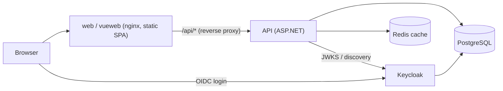

# TransBrain — Installation and operation

Three ways to run TransBrain, from "developer laptop" to "production-like":

| Option | For | Keycloak | Data persists | Section |
|---|---|---|---|---|
| .NET Aspire (`AppHost`) | Daily development | Dev container, HTTPS | No (by design) | [1](#1-local-development-with-aspire) |
| Docker Compose | Demo, test, evaluation on one machine | Dev mode, HTTP, dev realm | Postgres: yes | [2](#2-docker-compose) |
| Azure Container Apps (Bicep) | Hosted environment | Production mode, own realm | Yes | [3](#3-azure-container-apps-bicep) |

Architecture and code conventions are in [DEVELOPER_GUIDE.md](DEVELOPER_GUIDE.md).

## Components



Both SPAs are served by nginx and call the **relative** path `/api`; nginx forwards it to the API
(`API_URL`). The browser therefore only ever talks to its own origin and to Keycloak, and the API needs
no CORS configuration in the container setups.

## Runtime configuration reference

| Setting | Where | Meaning |
|---|---|---|
| `ConnectionStrings__transbraindb` | API | Npgsql connection string |
| `ConnectionStrings__cache` | API | Redis connection string. **Unset = caching disabled** (not an in-memory fallback) |
| `services__keycloak__http__0` / `__https__0` | API | Base URL of Keycloak, as the API reaches it. Resolved by service discovery for the `keycloak` JWT scheme |
| `ASPNETCORE_ENVIRONMENT` | API | `Development` enables OpenAPI/Scalar, `/health`, plain-HTTP OIDC metadata and auto-migration |
| `Database__MigrateOnStartup` | API | `true` applies EF migrations at start in **non-Development** environments |
| `Cors__AllowedOrigins__0…` | API | Only needed when a SPA calls the API cross-origin (Aspire dev servers use the Vite/Angular proxy) |
| `API_URL` | web, vueweb | Upstream the nginx `/api/` location proxies to |
| `OIDC_AUTHORITY` | web, vueweb | Realm URL as the **browser** sees it; written to `/config.js` at container start |

> Token validation compares the token's `iss` claim with the issuer in Keycloak's discovery document.
> Browser and API must therefore see **one** issuer string: that is what `KC_HOSTNAME` pins in both the
> Compose and the Azure setup.

---

## 1. Local development with Aspire

Prerequisites: .NET 10 SDK, Node.js >= 26.4.0, Docker, and a trusted dev certificate:

```bash
dotnet dev-certs https --trust
```

```bash
dotnet run --project src/TransBrain.AppHost
```

Starts Postgres (+pgAdmin), Redis, Keycloak with the dev realm, the API and both frontends. The Aspire
dashboard link is printed on start. Angular: <http://localhost:4200>, Vue: <http://localhost:4300>,
Keycloak: <https://localhost:8080>. Test users: see [README.md](../README.md#test-users) and
[KEYCLOAK.md](KEYCLOAK.md). Prefer `dotnet run` over `aspire run` (see README, known issue).

Tests: `dotnet test TransBrain.slnx` (needs Docker for Testcontainers); e2e: `npm run e2e` in a frontend
folder while the stack is running.

---

## 2. Docker Compose

Prerequisites: Docker with the Compose plugin (v2). Nothing else — .NET and Node run inside the build.

```bash
docker compose up --build -d
docker compose ps          # wait until keycloak is "healthy" (30-60 s on first start)
```

| Service | URL | Notes |
|---|---|---|
| Angular frontend | <http://localhost:4200> | |
| Vue frontend | <http://localhost:4300> | |
| API | <http://localhost:5000> | Scalar API docs at `/scalar/v1` |
| Keycloak | <http://localhost:8080> | Admin console `/admin`, user `admin` |

Sign in with the dev realm users (`admin.user` / `admin`, `dispo.user` / `dispo`, `fahrer.user` /
`fahrer`, `viewer.user` / `viewer`).

**Ports 4200, 4300 and 8080 are fixed on purpose**: the dev realm only allows those redirect URIs, and
the browser must reach Keycloak at exactly `http://localhost:8080`.

### Configuration

Override via a `.env` file next to `docker-compose.yml` (git-ignored) or the shell:

| Variable | Default |
|---|---|
| `POSTGRES_PASSWORD` | `transbrain-dev` |
| `KEYCLOAK_ADMIN_PASSWORD` | `admin` |

### Operations

```bash
docker compose logs -f api          # follow one service
docker compose up --build -d api    # rebuild + restart after code changes
docker compose down                 # stop, keep the database
docker compose down -v              # stop and delete the database volume
```

The API runs EF migrations on start (it runs in `Development` here). Postgres data lives in the
`postgres-data` volume; Keycloak keeps nothing and re-imports
`src/TransBrain.AppHost/realms/transbrain-realm.json` on every start.

### Limits of this setup

It is a **local/demo** stack, not a production deployment: HTTP only, well-known passwords and users,
Keycloak in `start-dev`, API in `Development`. It binds to `localhost` only because the Keycloak issuer is
`http://localhost:8080`. To serve other machines, change `KC_HOSTNAME`, `OIDC_AUTHORITY` and the realm's
redirect URIs together — or use the Azure setup, which is built for that.

### Troubleshooting

| Symptom | Cause / fix |
|---|---|
| `api` never starts | It waits for a healthy `keycloak`; check `docker compose logs keycloak` |
| Login works, API answers `401` | Issuer mismatch: the browser's authority must be `http://localhost:8080/realms/transbrain` |
| Login redirects with "Invalid redirect URI" | SPA not opened on port 4200/4300 |
| `password authentication failed` after changing `POSTGRES_PASSWORD` | The volume keeps the old password: `docker compose down -v` |

---

## 3. Azure Container Apps (Bicep)

Template: [`infra/main.bicep`](../infra/main.bicep). It creates, in one resource group:

| Resource | SKU | Purpose |
|---|---|---|
| Log Analytics workspace | PerGB2018 | Container logs |
| Azure Container Registry | Basic | Images; pulled via a managed identity (`AcrPull`), no admin user |
| PostgreSQL Flexible Server 17 | Burstable `B1ms` | Databases `transbraindb` and `keycloak` |
| Azure Cache for Redis | Basic `C0`, TLS only | API cache |
| Container Apps environment | Consumption | Hosts the four apps |
| Container Apps `api`, `keycloak`, `web`, `vueweb` | see template | `api` has **internal** ingress; the other three are public (HTTPS) |

> **Status:** the template compiles cleanly with `az bicep build`, and the Compose setup was verified end
> to end (migration, login token validated by the API, nginx proxy). The Azure deployment itself has
> **not been run against a real subscription** — treat the first deployment as a dry run in a throwaway
> resource group and expect small adjustments (quota, region, SKU availability).

### Prerequisites

- Azure subscription with permission to create resources and role assignments (Owner or Contributor +
  User Access Administrator on the resource group)
- [Azure CLI](https://learn.microsoft.com/cli/azure/install-azure-cli) 2.60 or newer (includes Bicep)
- Resource providers registered: `Microsoft.App`, `Microsoft.ContainerRegistry`,
  `Microsoft.DBforPostgreSQL`, `Microsoft.Cache`, `Microsoft.OperationalInsights`

### Step 1 — base infrastructure

```bash
az login
az account set --subscription <subscription-id>

RG=rg-transbrain
az group create -n $RG -l westeurope

# Pick strong values; keep them in a password manager / Key Vault.
export PG_PASSWORD='<strong password>'
export KC_ADMIN_PASSWORD='<strong password>'

az deployment group create -g $RG -f infra/main.bicep \
  -p deployApps=false postgresAdminPassword=$PG_PASSWORD keycloakAdminPassword=$KC_ADMIN_PASSWORD \
  --query properties.outputs.acrName.value -o tsv
```

The apps are skipped in this pass because their images do not exist yet. The command prints the
registry name.

### Step 2 — build and push the images (in ACR, no local Docker needed)

Run from the repository root:

```bash
ACR=<registry name from step 1>

az acr build -r $ACR -t transbrain-api:latest     -f src/TransBrain.Api/Dockerfile     .
az acr build -r $ACR -t transbrain-web:latest     -f src/TransBrain.Web/Dockerfile     .
az acr build -r $ACR -t transbrain-vueweb:latest  -f src/TransBrain.VueWeb/Dockerfile  .
az acr build -r $ACR -t transbrain-keycloak:latest deploy/keycloak
```

### Step 3 — deploy the apps

```bash
az deployment group create -g $RG -f infra/main.bicep \
  -p deployApps=true postgresAdminPassword=$PG_PASSWORD keycloakAdminPassword=$KC_ADMIN_PASSWORD \
  --query properties.outputs
```

Outputs: `webUrl`, `vuewebUrl`, `keycloakUrl`. On start the API applies the EF migrations
(`Database__MigrateOnStartup=true`); Keycloak imports the production realm
(`deploy/keycloak/transbrain-realm.json`) into its own database. Keycloak is slow on a cold start
(1-2 minutes); the first API request may fail until it is up.

### Step 4 — create users

The production realm contains **roles and clients, but no users**. Open `<keycloakUrl>/admin`, sign in as
`admin` with `KC_ADMIN_PASSWORD`, switch to realm `transbrain` and:

1. *Users → Add user*, set a non-temporary password under *Credentials*.
2. *Role mapping → Assign role*: one of `admin`, `disponent`, `fahrer`, `viewer`.
3. For a `fahrer`: copy the user's ID (the Keycloak `sub`) into the driver record's `externalUserId`,
   otherwise that driver cannot start tours.

Then open `webUrl` or `vuewebUrl` and sign in.

### Updating

```bash
az acr build -r $ACR -t transbrain-api:latest -f src/TransBrain.Api/Dockerfile .
az containerapp update -g $RG -n transbrain-api \
  --image $ACR.azurecr.io/transbrain-api:latest --revision-suffix r$(date +%s)
```

`latest` is only re-pulled on a new revision, hence the suffix. Prefer immutable tags: push
`:<git-sha>` and redeploy the template with `-p imageTag=<git-sha>`. Schema changes ship with the API
image (migrations run on start). Rolling back the image does **not** roll back the schema.

### Operations

```bash
az containerapp logs show -g $RG -n transbrain-api --follow
az containerapp revision list -g $RG -n transbrain-api -o table
```

Delete everything: `az group delete -n $RG` (irreversible, includes the databases).

### Things to know before going live

- **Realm import runs once.** Keycloak skips the import when the realm already exists. If the SPA URLs
  change later (custom domain), edit the `transbrain-spa` client's redirect URIs / web origins in the
  admin console; changing the template alone has no effect.
- **Secrets** are plain Container Apps secrets, passed as deployment parameters. For stricter handling
  use Key Vault references and keep the passwords out of shell history.
- **Keycloak admin console is public** (it shares the app's ingress). Restrict it with ingress IP rules or
  a separate internal admin hostname, and enable MFA for the `admin` account.
- **PostgreSQL** is reachable from Azure services only (the `0.0.0.0` firewall rule) and uses the admin
  login for both the API and Keycloak. Production hardening: a dedicated login per database, VNet
  integration with private access, and zone-redundant HA.
- **Keycloak runs a single replica** on the shared Postgres; clustering needs additional configuration.
- **Health probes:** `/health` is only mapped in `Development`, so the API relies on Container Apps'
  default TCP probes.
- **Custom domain / TLS:** add one per app in the Container Apps environment, then update `KC_HOSTNAME`
  (the `keycloakUrl` variable in the template) and the realm client as described above.
- **Cost:** the template uses the cheapest tiers that work (Basic ACR, Burstable PostgreSQL, Basic Redis,
  Consumption Container Apps with one always-on replica each). Estimate your region's price in the Azure
  pricing calculator before deploying.
