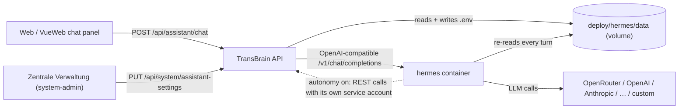

# AI assistant (KI-Assistent)

TransBrain ships an optional AI assistant that supports every signed-in user in their daily
work — explaining screens and workflows, answering questions about the data, and (when
explicitly allowed) performing small write actions on the user's behalf. It is powered by the
self-learning [Hermes Agent](https://hermes-agent.nousresearch.com/) by Nous Research, running
in its **own container** next to the API.

## How the pieces fit

| Piece | Role |
|---|---|
| `hermes` container (`nousresearch/hermes-agent`) | Runs the agent gateway with an OpenAI-compatible API server on port 8642. Started by the Aspire AppHost and by `docker-compose.yml`; the deployment works fine without it — the feature then reports itself "not provisioned". |
| `deploy/hermes/data` → `/opt/data` | The agent's **persistent data volume**: configuration, persona, skills, and everything the agent learns (sessions, memories). Partially checked into git — see below. |
| `Features/Assistant` (Application layer) | Chat proxy and settings slices. The chat handler prepends a server-built system message (user name, roles, current page, autonomy rule) and forwards the conversation. |
| `/api/assistant/status`, `/api/assistant/chat` | For every tenant role (`admin`, `disponent`, `fahrer`, `viewer`; the tenant-less `system-admin` has no Read capability and therefore no chat). The frontends show a floating chat button on every page while the assistant is enabled. |
| `/api/system/assistant-settings` | The "zentrale Verwaltung": system-admin-only GET/PUT that edits the agent's `.env` **in the volume** — there is deliberately no database copy of this configuration. |
| `transbrain-agent` Keycloak client | Confidential client with a service account (role `disponent`, tenant 1 in dev) the agent uses for autonomous API calls via the checked-in `transbrain-api` skill. |

## The volume and what belongs in git

The volume is the agent's single source of truth and survives both containers. Curated files
are version-controlled, everything the agent accumulates at runtime is not —
`deploy/hermes/data/.gitignore` is a **whitelist**, so new runtime files (and the stock skills
Hermes unpacks into `skills/` on startup) stay out of git automatically:

| Path in `deploy/hermes/data` | In git | Content |
|---|---|---|
| `config.yaml` | yes | Agent defaults (default model, turn limits) plus two settings the embedded setup depends on: `approvals.mode: "off"` (a non-streaming chat client can never answer an approval card, see below) and `terminal.env_passthrough` (forwards the `TRANSBRAIN_*` variables into the agent's otherwise sanitized terminal sessions). `${VAR}` references resolve from `.env`. |
| `SOUL.md` | yes | The persona: German TransBrain support assistant, its rules and boundaries. |
| `skills/transbrain-api/` | yes | The checked-in skill that teaches the agent the TransBrain REST API and the autonomy rules. |
| `.env.example` | yes | Template for `.env` with every supported variable. |
| `.env` | **no** | API keys and the switches the central administration writes. Created on first save (or copy the example). |
| `sessions/`, `memories/`, `state.db`, … | **no** | What the agent learns and does at runtime — valuable, hence the persistent volume, but machine-local. To adopt a learned skill into git, whitelist it in `data/.gitignore`. |

Because Hermes re-reads `.env` at the **start of every turn**, changes made in the central
administration (or by hand in the file) apply immediately — no container restart. Changes to
`SOUL.md` apply to new sessions; changes to `config.yaml` and infrastructure variables like the
API server key need a container restart.

## Configuration

Settings page: **Zentrale Verwaltung → KI-Assistent** (role `system-admin`). It edits exactly
these keys in the volume's `.env`:

| `.env` key | Meaning |
|---|---|
| `TRANSBRAIN_ASSISTANT_ENABLED` | Master switch. Off = the frontends hide the chat and `/api/assistant/chat` answers 503. |
| `TRANSBRAIN_ASSISTANT_PROVIDER` | One of `openrouter`, `openai-api`, `anthropic`, `gemini`, `deepseek`, `xai`, `custom`. |
| `TRANSBRAIN_ASSISTANT_MODEL` | Model id in the provider's naming, e.g. `anthropic/claude-sonnet-4.5` on OpenRouter. |
| `TRANSBRAIN_ASSISTANT_AUTONOMY` | Allows the agent to perform write actions through the API (see trust model). |
| `OPENROUTER_API_KEY`, `OPENAI_API_KEY`, `ANTHROPIC_API_KEY`, `GOOGLE_API_KEY`, `DEEPSEEK_API_KEY`, `XAI_API_KEY` | The selected provider's key. The UI writes the right variable for the chosen provider; keys of other providers stay on file, so switching back is free. The API never returns a stored key. |
| `OPENAI_BASE_URL` | Only while provider is `custom`: any OpenAI-compatible endpoint (Ollama, vLLM, Azure OpenAI, …). Removed automatically when another provider is selected, so it cannot hijack real OpenAI calls. A custom endpoint may be keyless. |

Hand-written lines and comments in `.env` are preserved; the settings page only upserts the
keys above. Operators can equally edit the file directly — the UI shows whatever is on disk.

The API finds the pieces through the `HermesAgent` options section (wired by AppHost and
compose): `BaseUrl` (gateway address), `ApiKey` (the gateway's `API_SERVER_KEY`),
`DataDirectory` (the volume path as seen by the API process), `TimeoutSeconds` (default 300 —
the first question of a session is the slowest: Hermes initializes the session, loads the
persona and skills and usually needs several tool rounds).
If `BaseUrl`/`DataDirectory` are absent the feature reports "not provisioned" instead of failing.

## Trust model and autonomy

- **Chat is proxied, never direct**: browsers talk only to the TransBrain API, which checks the
  normal JWT, builds the system context (user, roles, current page, autonomy rule) and calls the
  gateway server-to-server with the `API_SERVER_KEY`. Users cannot inject a `system` message —
  the API rejects that role.
- **Autonomy is opt-in and double-gated.** The agent can act on the API only with the
  `transbrain-agent` service account (client-credentials flow, role `disponent`, pinned to one
  tenant). The `TRANSBRAIN_ASSISTANT_AUTONOMY` switch is sent to the agent in every system
  message and in the skill's rules: while off, the agent must explain steps instead of doing
  them; while on, it may perform clearly delegated write actions and must announce them.
  Defence in depth: even a confused agent can never exceed the service account's own role and
  tenant.
- **Privacy**: conversations go to whatever LLM provider is configured. The persona instructs
  the agent not to reveal data of other tenants or users; the hard boundary, however, is the
  service account's tenant claim, enforced by the API's row-level tenant filters.
- The gateway's API server refuses requests without the correct Bearer key, and in the compose
  setup the hermes port is not published to the host (only the API container reaches it).

## Dev & ops

- **Aspire**: `dotnet run --project src/TransBrain.AppHost` starts `hermes` automatically
  (image pull on first run). The API server key defaults to `transbrain-dev-hermes-key`;
  override via the `Parameters:hermes-api-server-key` configuration parameter. The gateway
  requires **at least 16 characters** — with a shorter key it refuses to start the API server
  (log: "API_SERVER_KEY is shorter than 16 characters") and `/health` never comes up.
- **Compose**: service `hermes`, same bind mount, key via `HERMES_API_SERVER_KEY`.
- The gateway reports health on the unauthenticated `GET /health`
  (`{"status": "ok", "platform": "hermes-agent", ...}`) — both the AppHost and compose use it as
  the container health check. Everything under `/v1/*` requires the Bearer key.
- The agent needs an LLM key before it answers: open the settings page, pick a provider (e.g.
  OpenRouter), paste the key, save — effective with the next message.
- **Troubleshooting**
  - Chat button missing → assistant disabled or not provisioned (`GET /api/assistant/status`).
  - 503 `Assistant.NotConfigured` → model or API key missing in the settings.
  - 503 `Assistant.Unreachable` → hermes container not running or still starting
    (`docker logs`/Aspire dashboard; first start pulls a large image).
  - 503 `Assistant.AuthFailed` → `HermesAgent__ApiKey` of the API and `API_SERVER_KEY` of the
    hermes container disagree.
  - 503 `Assistant.VolumeNotWritable` → the API's `HermesAgent__DataDirectory` mount is missing
    or read-only.
  - Agent answers but reports the `TRANSBRAIN_*` variables as missing → Hermes sanitizes the
    environment of terminal sessions; the variables only get through because
    `terminal.env_passthrough` in `config.yaml` **and** `required_environment_variables` in the
    skill's `SKILL.md` list them. Keep both lists when adding variables.
  - Agent answers but cannot call the API → check `TRANSBRAIN_API_BASE_URL`,
    `TRANSBRAIN_OIDC_TOKEN_URL`, `TRANSBRAIN_AGENT_CLIENT_SECRET` in the hermes environment and
    the realm's `transbrain-agent` client.
  - API log shows `Resilience event occurred. EventName: 'OnTimeout' … 'Standard-TotalRequestTimeout'`
    → the hermes `HttpClient` is running through the standard resilience handler that
    ServiceDefaults applies to every client (30 s total, 10 s per attempt, retries — a retried
    chat POST starts a duplicate agent turn). The registration in
    `TransBrain.Infrastructure/DependencyInjection.cs` must keep its `RemoveAllResilienceHandlers()`.
  - Chat request hangs for minutes, then fails; hermes logs show `Exec approval text prompt send
    (success=False …)` or `BLOCKED: Command timed out without user response` → `approvals.mode`
    in `config.yaml` must stay `"off"` (quoted — a bare `off` is YAML for `false`). The chat
    integration is non-streaming, so nobody could ever answer an approval prompt; Hermes'
    hardline blocklist for destructive commands stays active regardless.
